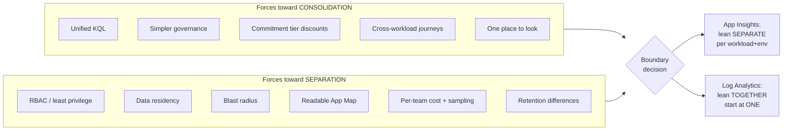

# 01 — Architecture Principles

These principles drive every downstream decision. Where two principles conflict, the lower-numbered one wins.

---

## P1 — Correlation is the product; resources are just containers

The value of observability is the ability to follow **one user request** across every hop. Everything else — how many Application Insights resources, which workspace, which dashboard — is subordinate to preserving `operation_Id` / `traceparent` continuity.

**Implication:** Never make a resource-topology decision that breaks a trace. If splitting two services into separate Application Insights resources makes their shared journey hard to follow, don't split them.

---

## P2 — The resource boundary is the *workload*, not the *business domain* and not the *microservice*

A **workload** is an independently owned business capability with a coherent support model, release lifecycle, SLOs, and access boundary.

- **Too coarse** (one App Insights for the whole company): Application Map becomes unreadable, sampling is untunable, blast radius of misconfiguration is total, RBAC is all-or-nothing.
- **Too fine** (one App Insights per microservice): every trace becomes a cross-resource query, App Map fragments, cost of governance explodes.
- **Just right** (one per workload per environment): App Map shows a meaningful system, one team owns it, one SLO set applies.

**Business domain** is expressed as a **tag and a telemetry attribute**, not as a resource. This is the single most important reframe in this architecture: you asked "multiple App Insights based on business domains?" — the answer is that domains are how you *group and filter*, workloads are how you *partition*.

---

## P3 — Production and non-production telemetry never share an Application Insights resource

Mixing environments corrupts baselines, breaks dynamic-threshold alerting, pollutes usage analytics, and makes an accidental non-prod misconfiguration a production incident. Microsoft's guidance is explicit: send telemetry from different development stages to separate Application Insights resources with separate connection strings.

Note the scope of this principle: it binds **Application Insights resources**, not workspaces. Whether prod and non-prod also need separate *workspaces* is a separate question answered by P4's criteria — and usually the answer is no.

---

## P4 — Start with one Log Analytics workspace and justify every additional one

Microsoft's workspace design guidance is unambiguous: *"Your design should always start with a single workspace... your design should use the fewest number of workspaces to meet your requirements."* There are no performance limits from the amount of data in a workspace, so volume alone is never a reason to split.

Split only against a documented criterion:

separate Microsoft Entra tenants · data residency or sovereignty for a geography · distinct legal-entity data ownership · genuine split billing to separate parties · different retention **for the same table** · access control unachievable with resource-context or table-level RBAC · security/SecOps separation · deliberate multi-region resilience · legacy agent multi-homing limits

**A different Azure region is not, by itself, a split criterion.** The documented position is to use a single workspace across regions unless a geography requirement exists. Cross-region egress charges are described as usually minor, and data arriving via Azure diagnostic settings incurs **no** egress charge at all.

"Team preference" and "org chart" are **not** valid split reasons. Resource-context RBAC, table-level retention, and tags with usage queries solve most perceived isolation needs without another workspace — and consolidating keeps your ingestion volume high enough to qualify for commitment-tier discounts.

---

## P5 — Colocate Application Insights with its workspace, and resolve the multi-region tension deliberately

Well-Architected guidance is to deploy an Application Insights resource in the same region as its Log Analytics workspace: two regions means two chances for a regional failure to break your monitoring, plus added latency.

This collides with P4 in a multi-region estate — you cannot have both one workspace and universal colocation. Resolve it explicitly rather than by accident: favor consolidation for small and medium estates, and favor colocation where residency, sovereignty, or resilience requirements genuinely apply. See [02 — Resource Topology](./02-resource-topology.md) for the full treatment.

---

## P6 — Instrument with OpenTelemetry; prefer autoinstrumentation where it exists

OTel is the strategic direction for Azure Monitor, is vendor-portable, and gives consistent semantics across languages. Use platform autoinstrumentation (App Service, Functions, AKS) when available — it removes SDK upgrade toil and drift.

**Write custom spans only where automatic instrumentation fails to represent a meaningful business or technical operation.**

---

## P7 — Telemetry is a designed schema, not an exhaust stream

Resource attributes, span names, custom dimensions, and business events are a **contract**. They get reviewed, versioned, and governed like an API.

- Low cardinality on anything used for grouping or alerting.
- Stable `service.name` — it becomes the Application Map node name.
- No credentials, tokens, PII, full payloads, or bind values. Ever.

---

## P8 — Collect for a purpose; every stream has a named consumer

Before enabling a log category or raising a log level, name the alert, dashboard, query, investigation, or compliance requirement it serves. Unowned telemetry is pure cost.

---

## P9 — Alert on user impact and SLO burn, not on symptoms

Alerting on every CPU spike and every 500 trains teams to ignore alerts. Alert on the golden signals and error-budget burn; keep symptom data for *investigation*, not *notification*.

---

## P10 — Monitor the monitoring

Ingestion gaps, daily-cap trips, throttling, exporter failures, missing heartbeats, and dead availability tests are all silent-failure modes that make you *think* everything is healthy.

---

## P11 — Everything is code

Workbook JSON, KQL query packs, alert rules, action groups, DCRs, policy assignments, and the telemetry conventions themselves are version-controlled and promoted through environments.

---

## P12 — The portfolio view is a first-class product, not a byproduct

Executives, architects, and on-call engineers need different views of the same estate. The portfolio hub is designed, owned, and maintained deliberately — with real metadata behind it, not just whatever tags happen to exist.

---

## Principle tension map

**Read this diagram as the thesis of the whole architecture:** the two resource types resolve the same tension in *opposite* directions, and that is deliberate. Application Insights separates to keep the diagnostic experience sharp; Log Analytics consolidates to keep the analytical and governance surface unified.

---

## Anti-patterns to name and avoid

| Anti-pattern | Why it fails |
|---|---|
| One App Insights for the entire enterprise | Unreadable App Map, no RBAC granularity, single point of misconfiguration, untunable sampling |
| One App Insights per microservice | Every trace is a cross-resource query; App Map fragments; governance cost explodes |
| One Log Analytics workspace per application | Cross-workload queries become slow and limited; cost of management scales linearly with apps |
| Classic (non-workspace) App Insights | Retired. No CMK, Private Link, BYOS, or commitment tiers |
| Daily cap as primary cost control | Creates blind spots exactly when volume spikes — i.e., during incidents |
| Logs used as a substitute for metrics | Expensive, slow to alert on, high cardinality risk |
| Ownership metadata only in someone's head | Portfolio view degrades to a resource list with no business meaning |
| Instrumentation added per-team, ad hoc | No correlation across teams; end-to-end tracing silently fails at the seams |
