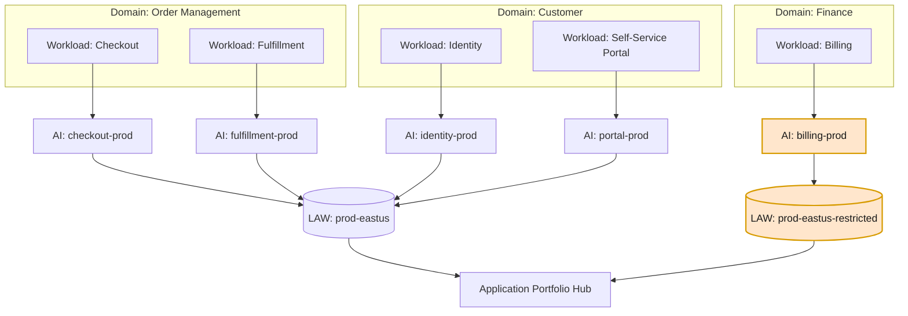
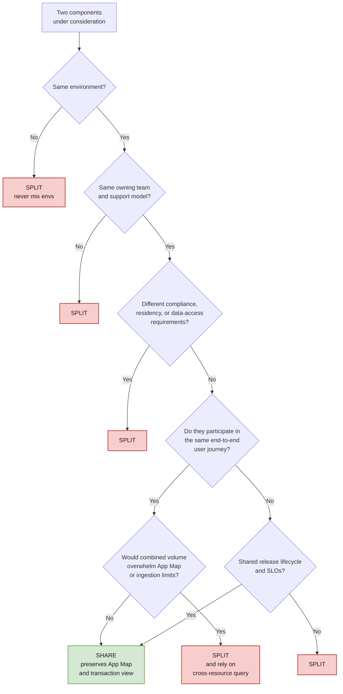
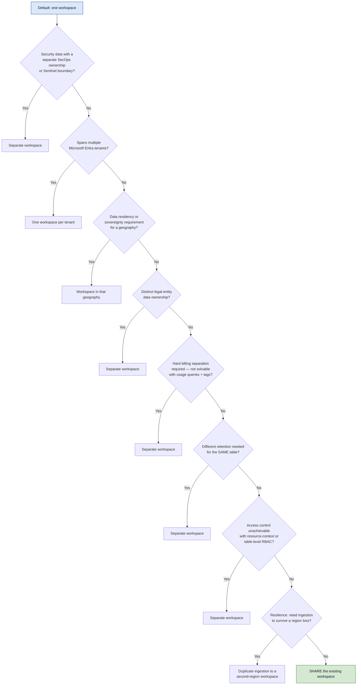
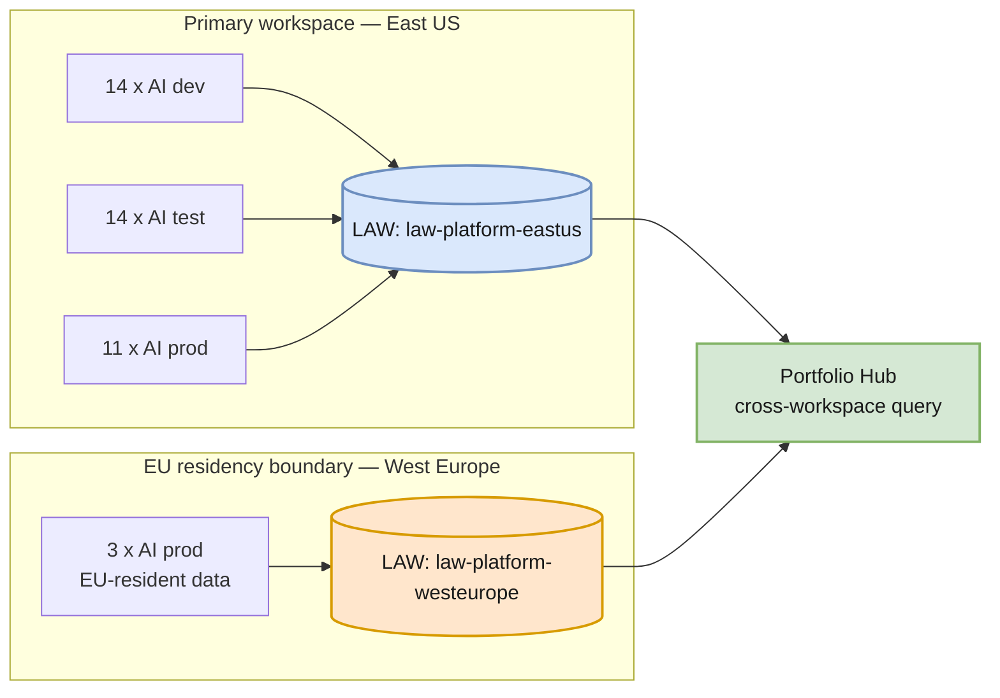

# 02 — Resource Topology

How many Application Insights resources, how many Log Analytics workspaces, and where the lines get drawn.

---

## The core model

**Read the diagram:** Five workloads across three business domains produce five Application Insights resources — *not three*. Domain grouping happens through tags and telemetry attributes, and is reassembled in the portfolio layer. Billing is highlighted because it carries a compliance constraint (financial data) that forces a separate, restricted workspace — an exception justified by a real boundary, not by org structure.

---

## Application Insights: the split-or-share decision tree

### Rules of thumb

| Situation | Decision |
|---|---|
| 6 microservices, one team, one release train, one user journey | **One** Application Insights resource. Distinguish services via `service.name` / cloud role name |
| Same app, dev / test / prod | **Three** Application Insights resources |
| Two workloads that call each other across team boundaries | **Two** resources; correlate via cross-resource KQL and the portfolio hub |
| A workload with a PCI/PHI-scoped component | Split the sensitive component; consider a restricted workspace |
| A single service generating >50% of estate ingestion | Split it so its sampling and cost are independently tunable |

### The documented "share it" checklist

Microsoft lists specific conditions under which components should use a **single** Application Insights resource. Treat all of these as needing to be true — if any is false, you have a split candidate:

- [ ] The components are **deployed together** and developed/managed by the **same team**.
- [ ] Centralizing KPIs (response time, failure rate) in one dashboard is desirable, with segmentation by role name where needed.
- [ ] There is **no need for different Azure RBAC** between the components.
- [ ] **Identical** metric alert criteria, continuous export, and billing/quota management across components is acceptable.
- [ ] It is acceptable that an **API key can read data from all components equally**, and the limit of 10 API keys covers them all.
- [ ] The **same smart detection and work-item integration** settings suit every component.

> **The Live Metrics caveat.** Live Metrics **cannot split data by role name.** If several noisy services share one Application Insights resource, the Live Metrics stream becomes an undifferentiated firehose. This is a genuine, often-overlooked cost of sharing — weigh it for workloads where live triage during an incident matters.

> **Consolidation is not a migration.** If you point components at a new, consolidated Application Insights resource, telemetry in the old resource **does not transfer**. Keep the old resource until the new one holds enough history for business continuity, then delete it.

> **Cloud role name is mandatory, not cosmetic.** Without meaningful `Cloud_RoleName` values, Application Map and several other portal experiences simply do not function. For most app types you must set it explicitly (Service Fabric and classic Cloud Services infer it). See [04 — C# Instrumentation](04-csharp-instrumentation.md).

---

## Log Analytics: the consolidation decision

> **Start from one workspace — for the entire estate.** Microsoft's workspace design guidance is unusually direct about this: *"Your design should always start with a single workspace to reduce the complexity of managing multiple workspaces and in querying data from them. There are no performance limitations from the amount of data in your workspace... As you identify criteria to create more workspaces, your design should use the fewest number of workspaces to meet your requirements."*
>
> Every additional workspace is a cost you pay forever in query complexity, alert scoping, RBAC administration, and workbook maintenance. Make each one earn its existence against a documented criterion below.

**Notably, "different Azure region" is not by itself a reason to split.** Microsoft's guidance is to use a single workspace across regions unless you have a geography/residency requirement. Two commonly-assumed objections are weaker than people think:

- **Egress charges** — bandwidth charges for cross-region log ingestion are described as "usually minor compared to the total cost." Critically, **data sent to a workspace by Azure diagnostic settings does not incur egress charges at all.** The charge applies to agent-collected data (VMs and similar).
- **Latency** — not a documented driver of workspace design.

The real region-driven reasons are **data residency/sovereignty** and **resilience** (deliberately ingesting to workspaces in more than one region so a regional outage doesn't blind you).

### Split criteria (aligned to the documented list)

Two criteria deserve expansion because they are routinely misapplied:

- **Retention.** Retention is configurable **per table**, so differing retention needs across *applications* usually do **not** justify a workspace split. A split is justified only when the *same table* must carry different retention for different sources.
- **Billing.** A workspace split is a blunt instrument for chargeback. Usage queries by resource, plus consistent tagging, satisfy most chargeback models without fragmenting the data. Split only when a separate party must literally receive a separate Azure bill.

**Commitment tiers push the other way:** consolidating ingestion into fewer workspaces raises daily volume, which qualifies you for larger commitment-tier discounts. Fragmenting a 300 GB/day estate across ten workspaces can leave every one of them on pay-as-you-go.

### Valid vs invalid split reasons

| ✅ Valid | ❌ Invalid |
|---|---|
| Separate Microsoft Entra tenants | "Each team wants their own" |
| Data residency / sovereignty for a geography | Different Azure region, absent a residency requirement |
| Distinct legal-entity data ownership | Org chart / reporting line |
| Genuine split billing to separate parties | Cosmetic cost attribution (use usage queries + tags) |
| Different retention **for the same table** | Different retention across apps (use table-level retention) |
| Access control that resource-context and table-level RBAC cannot express | "It feels cleaner" |
| Security/SecOps data separation (Sentinel boundary) | One-off dashboard convenience |
| Deliberate multi-region resilience | Different programming language or release cadence |
| Legacy agent multi-homing limitations | Different Application Insights resource |

> **Prod vs non-prod is a nuance, not an automatic split.** Separate Application Insights resources per environment are non-negotiable. Separate *workspaces* per environment are optional — justify them with access control, retention, or noise-isolation reasoning, and be aware you may forfeit commitment-tier volume by doing so. Many estates are well served by one workspace with environment carried as a resource attribute and dimension.

---

## Worked topology example

A mid-size estate: 3 business domains, 14 workloads, 2 regions, 3 environments.

Start from one workspace and apply the criteria. Only one criterion fires: three workloads serve EU customers and carry a data-residency obligation.

**Result: 42 Application Insights resources, 2 Log Analytics workspaces.**

That ratio is the signature of a healthy design. Application Insights resources are diagnostic, workload-scoped, and numerous. Workspaces are analytical, governed, and few.

Note what did **not** produce a split:

| Tempting split | Why it was rejected |
|---|---|
| Prod vs non-prod workspaces | Access control is satisfied by resource-context RBAC; environment is a queryable dimension; consolidating keeps the estate in a commitment tier |
| One workspace per business domain | Domain is an attribute, not a boundary — and splitting would break the cross-domain portfolio query outright |
| One workspace per region | No residency requirement for the second region's workloads; diagnostic-settings data incurs no egress charge |
| One workspace per subscription | Subscriptions are a billing/lifecycle construct, not a telemetry boundary |

> **The colocation tension, stated honestly.** Well-Architected guidance recommends deploying an Application Insights resource in the same region as its Log Analytics workspace. A single consolidated workspace and a multi-region application estate cannot both satisfy that fully. Resolve it deliberately:
>
> - **Small/medium multi-region estates:** favor consolidation. Accept cross-region Application Insights → workspace linkage. The operational simplicity is usually worth more than the marginal ingress path.
> - **Regulated or latency/sovereignty-sensitive geographies:** favor colocation and accept a second workspace — this is exactly the residency criterion firing.
> - **Never** create a workspace per region *and* claim you did it for colocation if no residency, resilience, or sovereignty requirement exists. That is the region anti-pattern wearing a Well-Architected badge.

---

## Sizing and limit guardrails

| Concern | Guardrail |
|---|---|
| Cross-resource query breadth | **Hard limit: a single query may span at most 100 workspaces or classic Application Insights resources.** Keep routine portfolio queries within a bounded, Resource-Graph-selected set — and note that consolidating workspaces is what keeps you far below this ceiling |
| Application Map readability | If a workload's map exceeds roughly 15–20 nodes, reconsider the workload boundary |
| Ingestion spikes | Per-workload sampling and source filtering **before** workspace-level daily caps |
| Workspace count growth | Every new workspace requires a written justification against one of the documented split criteria |
| Region expansion | A new region does **not** create a workspace by default. It creates one only when residency, sovereignty, or a deliberate resilience requirement applies |
| Commitment tier erosion | Before splitting, check whether the split drops either side below a commitment-tier threshold |

---

## Migration notes

- **Classic Application Insights is retired.** All resources must be workspace-based.
- Converting classic → workspace-based preserves data continuity and unlocks CMK, Private Link, BYOS, and commitment tiers.
- Moving an Application Insights resource between workspaces does **not** migrate historical data; plan a cutover date and keep the old workspace readable through its retention window.
- Cross-subscription workspace linkage requires `Microsoft.OperationalInsights/workspaces/sharedKeys/action` on the target workspace, even within the same tenant.
