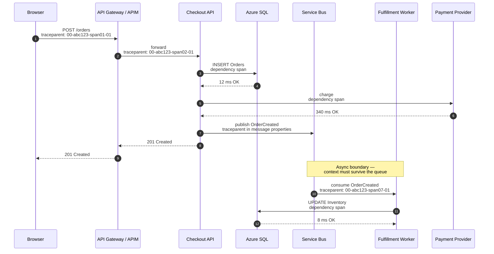
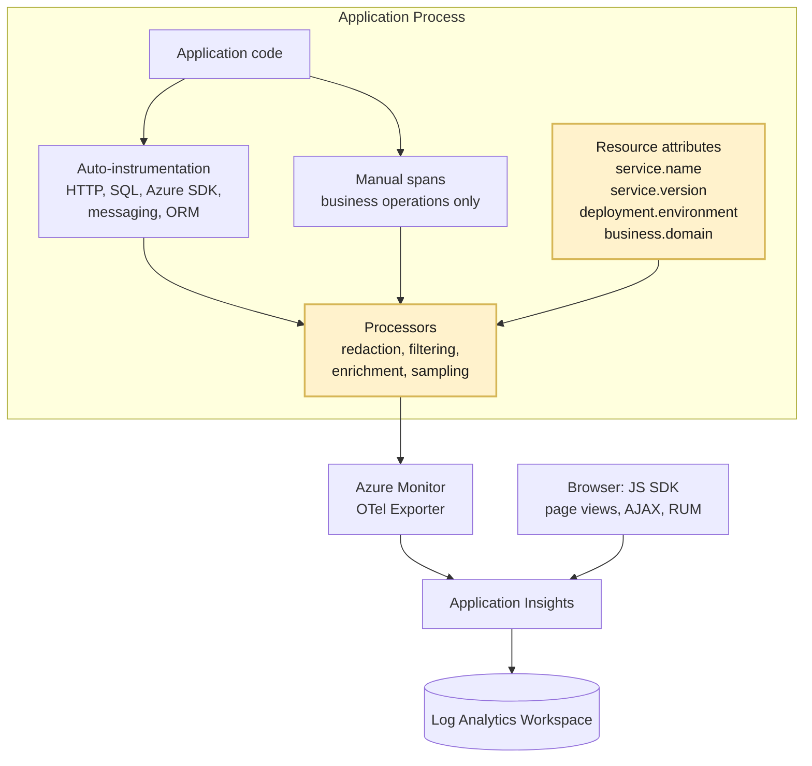
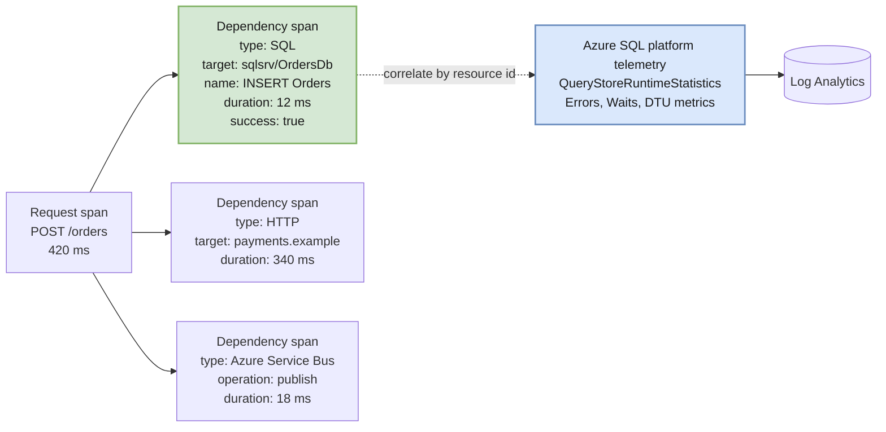
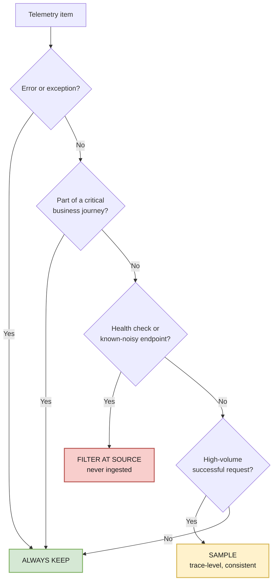

# 03 — Telemetry Flow

How a single user action becomes one continuous, queryable trace — through gateways, services, queues, background workers, and **database calls**.

---

## End-to-end trace: the target experience



Every span above shares `operation_Id = abc123`. That single identifier is what makes Transaction Diagnostics show the whole story — including the async tail that happens *after* the user already got their response.

**The three places this usually breaks:**
1. **The gateway** — APIM/proxies that generate a new correlation ID instead of forwarding `traceparent`.
2. **The queue** — publishers that don't write trace context into message properties, or consumers that don't read it.
3. **Background work** — timers, retries, and fan-out that start a fresh root span.

Test all three explicitly. See the [validation harness](#validation-harness) below.

---

## Instrumentation architecture



Highlighted boxes are where **custom engineering** is required — the exporter and auto-instrumentation are supplied by Azure; the attribute contract and the redaction/filtering processors are yours to build. See [04 — C# Instrumentation](./04-csharp-instrumentation.md) for working code and [07 — Service Responsibilities](./07-service-responsibilities.md) for the build/buy split.

---

## The correlation contract

| Element | Requirement | Why |
|---|---|---|
| `traceparent` / `tracestate` | W3C Trace Context on every outbound call and message | The universal join key |
| `operation_Id` | Derived from trace ID; identical across all spans of a journey | Powers Transaction Diagnostics |
| `operation_ParentId` | Set to the calling span's ID | Builds the tree, not just a flat list |
| `service.name` | Stable, human-meaningful, low-cardinality | Becomes the Application Map node name |
| `service.version` | Deployment version or build ID | Enables "did this regression start with a release?" |
| `deployment.environment` | prod / test / dev | Defense in depth against env mixing |
| `business.domain` | Domain label from the taxonomy | Portfolio grouping and filtering |
| `service.instance.id` | Pod / instance identifier | Isolates single-node failures |

**Cloud role mapping:** `service.name` → Application Insights `cloud_RoleName`. This is the single attribute that most determines whether your Application Map is useful or unreadable.

---

## Database dependency tracing

Database visibility is where most estates get the least value for the most risk. The rule: **capture shape and timing, never content.**



**Two layers, joined by resource identity — not by dumping database internals into spans:**
- **Application layer** (green): the dependency span tells you *this request spent 12 ms in the database*.
- **Platform layer** (blue): Azure SQL diagnostics tell you *why* — blocking, waits, plan regression, DTU saturation.

The portfolio and workload workbooks link these two layers via drill-down rather than attempting to merge them into a single span.

### What to capture

| Capture | Don't capture |
|---|---|
| Duration, success, result code | Bind/parameter values |
| Target server + database name | Connection strings or credentials |
| Operation name (`INSERT Orders`, sproc name) | Full result sets |
| Sanitized/normalized statement *(after review)* | Raw statements containing literals |
| Retry count, timeout indicators | Any PII or regulated data in predicates |

> **Query-text collection is a security decision, not a technical one.** Enable it only with explicit review, and prefer normalized statements (`SELECT * FROM Orders WHERE Id = ?`) over raw text.

### Coverage checklist

- ✅ Auto-instrumented clients (SQL, Cosmos, PostgreSQL/MySQL, Redis, Azure SDKs) — verify, don't assume
- ⚠️ ORM abstractions — confirm the span name is the operation, not a generic `ExecuteReader`
- ⚠️ Stored procedures — often surface as opaque calls; add custom spans where the sproc *is* the business operation
- ❌ Unsupported/legacy drivers — require manual dependency spans

---

## Sampling: preserve the story



**Critical rule: sampling decisions must be made at the trace level and propagated**, so you never keep a child span whose parent was dropped. Per-span independent sampling produces broken, misleading traces — which is worse than no trace.

### Verified sampling behaviour to design around

| Fact | Design consequence |
|---|---|
| The Azure Monitor OpenTelemetry distro ships a **rate-limited sampler that shows complete traces and avoids broken ones**, and it is the default when you set nothing | Don't hand-roll a sampler. The correct action is usually to tune the ratio, not replace the component |
| **The default is not "keep everything."** `AzureMonitorExporterOptions.TracesPerSecond` defaults to **5** in exporter 1.8.x. An app that never configured sampling is already sampling | Verified empirically: a burst of 58 spans landed 25, each tagged `microsoft.sample_rate: 50`. Treat "we didn't configure sampling" as "we accepted 5 traces/second per role instance" |
| **The exporter installs its sampler when you register it, overriding a sampler set *earlier* on the builder** | Ordering is load-bearing and silent. Call `SetSampler()` **after** `AddAzureMonitorTraceExporter(...)`, and set `TracesPerSecond = null` if you genuinely want everything. Otherwise your `AlwaysOnSampler` is decoration |
| **Live Metrics requires the Azure Monitor sampler** | Swapping in a generic OpenTelemetry sampler silently costs you Live Metrics. Real trade-off, rarely documented in team runbooks |
| **Metrics are not sampled** | Alert on metrics, investigate on traces. This is why SLO alerting belongs on metrics — sampling can never distort the number that pages someone |
| Sampling is reflected in `itemCount`; validate the effective rate with `100 / avg(itemCount)` | Make this a standing query. A sampling ratio that drifted after a config change is invisible otherwise |
| **Trace-based sampling for logs** drops log records tied to unsampled traces | The cheapest large win on log volume, and it keeps logs consistent with the traces you actually retained |
| Recommended log export floor is **ERROR**, adding WARN only where it is actionable | Verbose INFO from ORMs and HTTP clients is the most common ingestion surprise |
| **Ingestion sampling is not recommended** | Sample in the SDK, at the source, where trace consistency can still be guaranteed |
| The **daily cap is a last-resort control, not a replacement for sampling**, and it can create a gap in telemetry | Cap is a circuit breaker. If it fires, you are blind for the rest of the day — precisely when you can least afford it |

---

## Validation harness

Every workload must prove these before it is considered onboarded:

| # | Test | Pass criteria |
|---|---|---|
| 1 | Browser → API | Page view and server request share one `operation_Id` |
| 2 | Through the gateway | `traceparent` survives APIM/proxy; no new root span |
| 3 | Service → service | Child span has correct `operation_ParentId` |
| 4 | Service → database | Dependency span present, timed, correlated, sanitized |
| 5 | Across a queue | Consumer span joins the producer's trace |
| 6 | Background/timer job | Either joins the originating trace or emits a documented, intentional new root |
| 7 | Failure path | Exception correlates to the request and the failing dependency |
| 8 | Retry storm | Retries visible and distinguishable from distinct user attempts |
| 9 | Under sampling | End-to-end trace remains complete for retained journeys |
| 10 | Redaction | No secrets, PII, or raw payloads present in any captured field |

### Ingestion realities the harness must account for

Several of these tests fail intermittently for reasons that have nothing to do with the
instrumentation. Bake the following into the harness, or engineers will spend their first
onboarding day debugging a working system.

| Reality | Value | Consequence for validation |
|---|---|---|
| **Log ingestion latency** | 2–5 minutes, sometimes longer under load | Never assert immediately after emitting. Poll with a timeout; a test that queries at T+10s will fail against a perfectly healthy pipeline |
| **Records older than 48 hours are rejected** | Hard limit | Any replay, backfill, or migration of historical telemetry is capped. Data beyond it is discarded **silently** — no error, no dead-letter |
| **Pre-aggregated metrics accept only ~20 minutes of backdating** | Hard limit | Back-dated telemetry lands in the **log tables only**. Any dashboard built over replayed or historical data must query `AppRequests`/`AppDependencies`, not metrics — metric tiles will render empty while the equivalent log query works perfectly |
| **Live Metrics is the only sub-second surface** | ~1 second | Use it to confirm "telemetry is leaving the process at all" before debugging anything else. But it **cannot split by cloud role name**, so it shows one service at a time and is not a multi-service validation tool |
| **Application Map uses progressive discovery** | Nodes arrive in waves | A map that looks incomplete for the first minute is normal. Do not fail a test on the first render |

> **The practical consequence for dashboards:** if a workbook must display anything other
> than roughly the last 20 minutes of activity, it has to be built on log-table queries.
> This single constraint shapes the entire portfolio hub — see
> [06 — Application Portfolio](./06-application-portfolio.md).


---

## Reference KQL patterns

These belong in a version-controlled query pack (see [07](./07-service-responsibilities.md)).

```kusto
// Full end-to-end transaction for one operation
let opId = "abc123";
union requests, dependencies, exceptions, traces, pageViews
| where operation_Id == opId
| project timestamp, itemType, name, target, duration, success, cloud_RoleName
| order by timestamp asc
```

```kusto
// Database contribution to request latency, by operation
dependencies
| where timestamp > ago(1d) and type has "SQL"
| join kind=inner (requests | where timestamp > ago(1d)) on operation_Id
| summarize
    calls = count(),
    dbTime = sum(duration),
    reqTime = any(duration1)
    by requestName = name1, dbOperation = name
| extend dbSharePct = round(100.0 * dbTime / reqTime, 1)
| order by dbTime desc
```

```kusto
// Failed dependencies grouped by target — where is the estate breaking?
dependencies
| where timestamp > ago(1d) and success == false
| summarize failures = count(), p95 = percentile(duration, 95)
    by cloud_RoleName, type, target
| order by failures desc
```

```kusto
// Correlation health: are traces actually joining across services?
requests
| where timestamp > ago(1h)
| summarize services = dcount(cloud_RoleName) by operation_Id
| summarize
    singleServiceTraces = countif(services == 1),
    multiServiceTraces  = countif(services > 1)
```

The last query is the **canary for this entire architecture**. If multi-service traces trend toward zero, correlation is broken somewhere and every downstream view is quietly lying to you.
