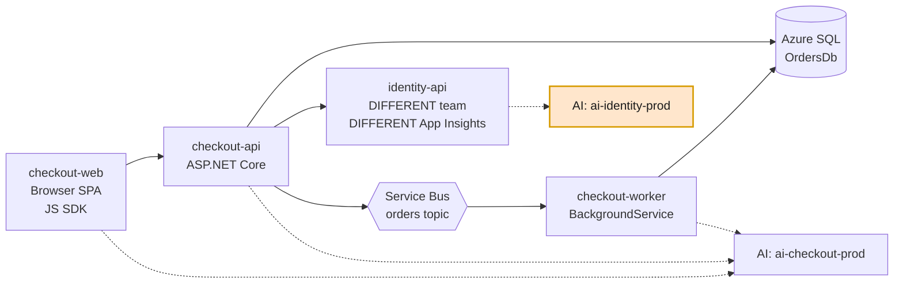

# 04 — C# Instrumentation Guide

Working C# for the correlation contract defined in [03 — Telemetry Flow](./03-telemetry-flow.md). Every sample targets one goal: **a single `operation_Id` that survives every hop** — browser → API → another team's API → database → queue → background worker — *even when those services report to different Application Insights resources*.

> **.NET 8+ / ASP.NET Core.** All samples use the **Azure Monitor OpenTelemetry Distro** (`Azure.Monitor.OpenTelemetry.AspNetCore`), which bundles ASP.NET Core, HttpClient, SqlClient, Azure SDK, and `ILogger` instrumentation.

---

## The reference system



Three components share `ai-checkout-prod` (one workload). `identity-api` is a **separate workload** with its own Application Insights resource — and the trace still flows through it unbroken. That is the scenario most people get wrong, so it is covered explicitly in [Sample 3](#sample-3--the-receiving-api-a-different-workload).

---

## Package baseline

```xml
<ItemGroup>
  <!-- The distro: exporter + ASP.NET Core + HttpClient + SqlClient + Azure SDK + ILogger -->
  <PackageReference Include="Azure.Monitor.OpenTelemetry.AspNetCore" Version="1.*" />

  <!-- Optional, add only what you need -->
  <PackageReference Include="OpenTelemetry.Instrumentation.Runtime" Version="1.*" />
  <PackageReference Include="OpenTelemetry.Instrumentation.EntityFrameworkCore" Version="1.*-beta.*" />
</ItemGroup>
```

```bash
dotnet add package Azure.Monitor.OpenTelemetry.AspNetCore
```

> `OpenTelemetry.Instrumentation.EntityFrameworkCore` is a **community** library — not covered by Azure support guarantees. Pin the version and validate on upgrade.

---

## Sample 0 — The shared bootstrap library *(custom build)*

Do **not** let each team hand-roll `Program.cs` observability. Ship one internal NuGet package that encodes the taxonomy from [05 — Domain Model](./05-domain-model.md). This is the single highest-leverage custom component in the whole architecture.

**`Contoso.Observability/ObservabilityOptions.cs`**

```csharp
namespace Contoso.Observability;

public sealed class ObservabilityOptions
{
    /// <summary>Workload id from the service catalog, e.g. "checkout". Maps to service.namespace.</summary>
    public required string Workload { get; init; }

    /// <summary>Component id, e.g. "checkout-api". Becomes the Application Map node name.</summary>
    public required string Component { get; init; }

    /// <summary>Business domain from the taxonomy, e.g. "order-management".</summary>
    public required string BusinessDomain { get; init; }

    /// <summary>tier-1 | tier-2 | tier-3</summary>
    public string Criticality { get; init; } = "tier-3";

    /// <summary>Owning team id, used for alert routing enrichment.</summary>
    public required string OwnerTeam { get; init; }

    /// <summary>Fraction of traces to retain. 1.0F in non-prod and for low-volume tier-1.</summary>
    public float SamplingRatio { get; init; } = 1.0F;

    /// <summary>Request paths excluded from tracing, e.g. health probes.</summary>
    public string[] ExcludedPaths { get; init; } = ["/health", "/healthz", "/ready", "/live", "/metrics"];
}
```

**`Contoso.Observability/ObservabilityExtensions.cs`**

```csharp
using System.Diagnostics;
using System.Reflection;
using Azure.Monitor.OpenTelemetry.AspNetCore;
using Microsoft.Extensions.DependencyInjection;
using Microsoft.Extensions.Hosting;
using OpenTelemetry.Trace;

namespace Contoso.Observability;

public static class ObservabilityExtensions
{
    /// <summary>
    /// The one ActivitySource every Contoso service uses for custom business spans.
    /// Registered once here so no team has to remember AddSource().
    /// </summary>
    public static readonly ActivitySource ActivitySource = new("Contoso.Business");

    public static IHostApplicationBuilder AddContosoObservability(
        this IHostApplicationBuilder builder,
        ObservabilityOptions options)
    {
        var environment = builder.Environment.EnvironmentName.ToLowerInvariant();

        var version = Assembly.GetEntryAssembly()?
            .GetCustomAttribute<AssemblyInformationalVersionAttribute>()?
            .InformationalVersion ?? "unknown";

        // Resource attributes: the correlation + portfolio contract.
        // service.namespace + service.name => Application Insights cloud_RoleName
        // service.instance.id              => cloud_RoleInstance
        var resourceAttributes = new Dictionary<string, object>
        {
            ["service.name"]             = options.Component,
            ["service.namespace"]        = options.Workload,
            ["service.version"]          = version,
            ["service.instance.id"]      = Environment.MachineName,
            ["deployment.environment"]   = environment,
            ["business.domain"]          = options.BusinessDomain,
            ["business.criticality"]     = options.Criticality,
            ["business.owner_team"]      = options.OwnerTeam
        };

        // Processors must be registered BEFORE UseAzureMonitor so they run in the pipeline.
        builder.Services.ConfigureOpenTelemetryTracerProvider((sp, tracing) =>
        {
            tracing.AddSource(ActivitySource.Name);
            tracing.AddProcessor(new HealthProbeFilteringProcessor(options.ExcludedPaths));
            tracing.AddProcessor(new TelemetryRedactionProcessor());
            tracing.AddProcessor(new BusinessContextEnrichingProcessor());
        });

        builder.Services.AddOpenTelemetry()
            .UseAzureMonitor(o =>
            {
                // Connection string comes from APPLICATIONINSIGHTS_CONNECTION_STRING.
                // Never hardcode it and never put it in appsettings.json.
                o.SamplingRatio = options.SamplingRatio;
            })
            // ConfigureResource must come AFTER UseAzureMonitor to override the
            // distro's default resource detectors.
            .ConfigureResource(rb => rb.AddAttributes(resourceAttributes));

        return builder;
    }
}
```

**Every service's `Program.cs` then reduces to three lines:**

```csharp
builder.AddContosoObservability(new ObservabilityOptions
{
    Workload       = "checkout",
    Component      = "checkout-api",
    BusinessDomain = "order-management",
    Criticality    = "tier-1",
    OwnerTeam      = "commerce-platform",
    SamplingRatio  = builder.Environment.IsProduction() ? 0.25F : 1.0F
});
```

**Why this matters:** correlation breaks at the *seams* between teams. A shared bootstrap package makes the correct configuration the path of least resistance and turns a convention into a compile-time dependency.

---

## Sample 1 — The entry-point API

**`checkout-api/Program.cs`**

```csharp
using Contoso.Observability;

var builder = WebApplication.CreateBuilder(args);

builder.AddContosoObservability(new ObservabilityOptions
{
    Workload       = "checkout",
    Component      = "checkout-api",
    BusinessDomain = "order-management",
    Criticality    = "tier-1",
    OwnerTeam      = "commerce-platform",
    SamplingRatio  = builder.Environment.IsProduction() ? 0.25F : 1.0F
});

// Typed clients: HttpClient instrumentation injects traceparent automatically.
builder.Services.AddHttpClient<IIdentityClient, IdentityClient>(c =>
{
    c.BaseAddress = new Uri(builder.Configuration["Services:Identity"]!);
});

builder.Services.AddDbContext<OrdersDbContext>(o =>
    o.UseSqlServer(builder.Configuration.GetConnectionString("OrdersDb")));

builder.Services.AddSingleton<OrderPublisher>();
builder.Services.AddScoped<OrderService>();
builder.Services.AddHealthChecks();

var app = builder.Build();

app.MapHealthChecks("/health");   // filtered out by HealthProbeFilteringProcessor

app.MapPost("/orders", async (CreateOrderRequest request, OrderService service, CancellationToken ct) =>
{
    var result = await service.PlaceOrderAsync(request, ct);
    return Results.Created($"/orders/{result.OrderId}", result);
});

app.Run();
```

That is the entire entry-point setup. The incoming `traceparent` header is parsed by ASP.NET Core instrumentation and becomes the ambient `Activity.Current` — everything downstream inherits from it automatically.

---

## Sample 2 — Calling another API *(propagation is automatic)*

**`checkout-api/IdentityClient.cs`**

```csharp
using System.Net.Http.Json;

public interface IIdentityClient
{
    Task<CustomerProfile?> GetProfileAsync(string customerId, CancellationToken ct);
}

public sealed class IdentityClient(HttpClient http) : IIdentityClient
{
    public async Task<CustomerProfile?> GetProfileAsync(string customerId, CancellationToken ct)
    {
        // No correlation code required.
        //
        // .NET's HttpClient DiagnosticsHandler creates a client Activity and injects
        //   traceparent: 00-<traceId>-<spanId>-<flags>
        // on every outbound request whenever Activity.Current is non-null.
        // .NET 5+ defaults Activity.DefaultIdFormat to W3C.
        //
        // The resulting span appears in Application Insights as a dependency of type Http.
        var response = await http.GetAsync($"/profiles/{customerId}", ct);
        response.EnsureSuccessStatusCode();
        return await response.Content.ReadFromJsonAsync<CustomerProfile>(cancellationToken: ct);
    }
}
```

### Do not do this

```csharp
// ❌ ANTI-PATTERN — hand-rolled correlation
request.Headers.Add("X-Correlation-Id", Guid.NewGuid().ToString());
```

A custom correlation header is invisible to Application Insights. It will not link the two services in Application Map, will not populate `operation_ParentId`, and will not appear in Transaction Diagnostics. If you have a legacy correlation header, **carry it alongside** `traceparent` — never instead of it.

### Gateway checklist

If traffic passes through APIM, Front Door, nginx, or an ingress controller, verify the proxy **forwards `traceparent` and `tracestate` unmodified**. In Azure API Management, ensure policies do not strip them:

```xml
<!-- APIM: preserve W3C trace context to the backend -->
<inbound>
    <base />
    <!-- Do NOT remove traceparent/tracestate. If the caller sent none, APIM's own
         Application Insights integration will originate one. -->
</inbound>
```

---

## Sample 3 — The receiving API *(a different workload)*

`identity-api` belongs to another team and reports to **`ai-identity-prod`**, a completely separate Application Insights resource.

**`identity-api/Program.cs`**

```csharp
using Contoso.Observability;

var builder = WebApplication.CreateBuilder(args);

builder.AddContosoObservability(new ObservabilityOptions
{
    Workload       = "identity",              // different workload
    Component      = "identity-api",
    BusinessDomain = "customer",              // different domain
    Criticality    = "tier-1",
    OwnerTeam      = "identity-platform",     // different team
    SamplingRatio  = 1.0F
});

var app = builder.Build();

app.MapGet("/profiles/{customerId}", async (string customerId, ProfileStore store, CancellationToken ct) =>
{
    // Activity.Current here is a CHILD of checkout-api's outbound span.
    // Same traceId => same operation_Id => same end-to-end transaction,
    // despite living in a different Application Insights resource.
    var profile = await store.GetAsync(customerId, ct);
    return profile is null ? Results.NotFound() : Results.Ok(profile);
});

app.Run();
```

### Two critical consequences

1. **Correlation is preserved.** `operation_Id` is identical in both resources because it derives from the W3C trace ID, not from the resource.
2. **The Azure portal will not join them for you by default.** Application Map and Transaction Diagnostics show cross-component links, but analytical queries must explicitly span the resources.

   Because both resources are **workspace-based** (classic is retired), use the `workspace()` expression — *not* the legacy `app()` expression, which the documentation scopes to classic Application Insights resources:

```kusto
// End-to-end transaction spanning TWO workspace-based Application Insights resources
// that live in DIFFERENT Log Analytics workspaces
let opId = "0af7651916cd43dd8448eb211c80319c";
union
    (workspace('law-checkout-prod').AppRequests),
    (workspace('law-checkout-prod').AppDependencies),
    (workspace('law-identity-prod').AppRequests),
    (workspace('law-identity-prod').AppDependencies)
| where OperationId == opId
| project TimeGenerated, Type, AppRoleName, Name, Target, DurationMs, Success
| order by TimeGenerated asc
```

**Two mitigations make this painless** — and they are exactly why the topology in [02](./02-resource-topology.md) works:

- Point both Application Insights resources at the **same Log Analytics workspace**. Then there is no federation at all — you query `AppRequests` and `AppDependencies` directly, and the union above collapses to:

```kusto
// Both resources share one workspace — no cross-resource syntax needed
let opId = "0af7651916cd43dd8448eb211c80319c";
union AppRequests, AppDependencies
| where OperationId == opId
| project TimeGenerated, Type, AppRoleName, Name, Target, DurationMs, Success, _ResourceId
| order by TimeGenerated asc
```

  Microsoft states this directly: *"You don't need a cross-workspace query to query data from multiple applications in the same workspace."* This is the single strongest practical argument for workspace consolidation.

- Where a split is genuinely required, encode the cross-resource union in a **saved query-pack function**, so engineers never hand-write it. Note the limits: a query may span at most **100** workspaces or classic Application Insights resources, and query-pack functions used for cross-resource scoping **cannot be used in log search alert rules**.

---

## Sample 4 — Database dependencies

The distro's bundled **SqlClient** instrumentation emits a dependency span per command automatically — duration, target server/database, success. No code required.

**`checkout-api/OrdersDbContext.cs`** — nothing observability-specific:

```csharp
public sealed class OrdersDbContext(DbContextOptions<OrdersDbContext> options) : DbContext(options)
{
    public DbSet<Order> Orders => Set<Order>();
    public DbSet<OrderLine> OrderLines => Set<OrderLine>();
}
```

### Statement text: leave it off

```csharp
// Optional: richer EF Core spans (community package).
builder.Services.ConfigureOpenTelemetryTracerProvider((sp, tracing) =>
{
    tracing.AddEntityFrameworkCoreInstrumentation(o =>
    {
        // Default is FALSE and our standard KEEPS it false.
        // Raw SQL text can contain customer data, PII, and inlined literals.
        o.SetDbStatementForText = false;
        o.SetDbStatementForStoredProcedure = true;   // sproc NAME only — safe and useful
    });
});
```

> Exact option names vary across instrumentation package versions. The **policy** does not: statement text capture is a security decision requiring explicit review, and defaults to off. See [03 — Database dependency tracing](./03-telemetry-flow.md#database-dependency-tracing).

### Naming the operation instead

You lose nothing by keeping SQL text off if you name the *business* operation. Wrap meaningful data access in a custom span:

```csharp
public sealed class OrderRepository(OrdersDbContext db)
{
    public async Task<Order> InsertOrderAsync(Order order, CancellationToken ct)
    {
        using var activity = ObservabilityExtensions.ActivitySource
            .StartActivity("db.orders.insert", ActivityKind.Internal);

        // Safe, low-cardinality, no customer data.
        activity?.SetTag("db.operation", "INSERT");
        activity?.SetTag("db.collection.name", "Orders");
        activity?.SetTag("order.line_count", order.Lines.Count);

        db.Orders.Add(order);
        await db.SaveChangesAsync(ct);

        activity?.SetTag("order.id", order.Id);
        return order;
    }
}
```

### Stored procedures

```csharp
public async Task<decimal> CalculateTaxAsync(Guid orderId, CancellationToken ct)
{
    using var activity = ObservabilityExtensions.ActivitySource
        .StartActivity("EXECUTE usp_CalculateTax", ActivityKind.Client);

    // Current *stable* database conventions. The older `db.system` / `db.operation` /
    // `db.statement` names are deprecated — see the note below on why the version of
    // your exporter decides whether these map correctly.
    activity?.SetTag("db.system.name", "microsoft.sql_server");
    activity?.SetTag("db.operation.name", "EXECUTE");
    activity?.SetTag("db.stored_procedure.name", "usp_CalculateTax");
    activity?.SetTag("db.namespace", "OrdersDb");

    try
    {
        return await db.Database
            .SqlQuery<decimal>($"EXEC usp_CalculateTax @OrderId = {orderId}")
            .SingleAsync(ct);
    }
    catch (Exception ex)
    {
        activity?.SetStatus(ActivityStatusCode.Error, ex.Message);
        activity?.AddException(ex);   // .NET 9+; use RecordException helper on earlier versions
        throw;
    }
}
```

### Database conventions: match your SDK, not just the spec

Database semantic conventions stabilised recently, and the ecosystem is mid-migration. Three
things are worth knowing before you hand-write `db.*` attributes:

**1. Your exporter version decides whether stable attributes work at all.**
Exporter **1.4.0 does not understand the stable names.** Feed it `db.system.name` and you get
`DependencyType = "Other"`, an empty `Data` column, and every `db.*` attribute stranded in
`customDimensions`. Exporter **1.8.3 maps them correctly** (`DependencyType = "SQL"`, the
statement in `Data`, database name in `Target`). If stable conventions appear "broken",
check the exporter version before concluding the spec is wrong.

**2. SqlClient 1.14+ removed the opt-in.** `OTEL_SEMCONV_STABILITY_OPT_IN` is gone; only
stable conventions are emitted. `SetDbStatementForText` was also removed (1.12.0-beta.3+),
so query text is now **always** captured — and **sanitized**, with literal values replaced
by `?`. Older vendored instrumentation captured no text at all for ad-hoc SQL, so `Data` was
empty. Both behaviours exist in the wild; know which one you are running.

**3. Where the spec and the SDKs disagree, follow the SDK.** The OTel registry specifies
`db.system.name = "azure.cosmosdb"`, but the shipping Cosmos .NET SDK still emits
`cosmosdb` plus `az.namespace = "Microsoft.DocumentDB"`. The exporter passes unrecognised
database systems through verbatim, so using the registry value yields
`DependencyType = "azure.cosmosdb"` — a value that appears in no real application's data and
that none of your queries, workbooks, or alerts will match.

> The rule: **emit what a real application built with today's SDKs emits.** Telemetry only
> has value if the queries written against it match production. Revisit when the Cosmos SDK
> adopts the registry value.

One more consequence worth internalising: `AppDependencies.ResultCode` is **empty for
successful SQL dependencies**. The exporter never populates it for database spans. That is
correct behaviour, not missing data — do not write alerts that assume it is present.

---

## Sample 5 — Business spans

Add custom spans only where an automatic span does not already represent a meaningful operation ([P6](./01-architecture-principles.md)).

```csharp
public sealed class OrderService(
    IIdentityClient identity,
    OrderRepository repository,
    OrderPublisher publisher,
    IPaymentGateway payments,
    ILogger<OrderService> logger)
{
    public async Task<OrderResult> PlaceOrderAsync(CreateOrderRequest request, CancellationToken ct)
    {
        // One business-level span that parents the whole operation.
        using var activity = ObservabilityExtensions.ActivitySource
            .StartActivity("order.place", ActivityKind.Internal);

        // Low-cardinality dimensions only — these are groupable and alertable.
        activity?.SetTag("order.channel", request.Channel);       // web | mobile | partner
        activity?.SetTag("order.currency", request.Currency);     // USD | EUR
        activity?.SetTag("order.line_count", request.Lines.Count);
        // ❌ never: activity?.SetTag("customer.email", request.Email);

        // ILogger entries automatically carry the current trace context.
        logger.LogInformation("Placing order for channel {Channel}", request.Channel);

        var profile = await identity.GetProfileAsync(request.CustomerId, ct);   // Http dependency
        var order   = await repository.InsertOrderAsync(request.ToOrder(profile), ct);   // SQL dependency
        var payment = await payments.ChargeAsync(order, ct);                    // Http dependency

        if (!payment.Succeeded)
        {
            activity?.SetStatus(ActivityStatusCode.Error, "payment_declined");
            activity?.SetTag("order.failure_reason", "payment_declined");
            throw new PaymentDeclinedException(order.Id);
        }

        await publisher.PublishOrderCreatedAsync(order, ct);                    // Service Bus dependency

        activity?.SetTag("order.id", order.Id);
        activity?.SetStatus(ActivityStatusCode.Ok);
        return new OrderResult(order.Id, payment.AuthorizationCode);
    }
}
```

### Business events for the portfolio

Spans answer "what happened in this request." **Metrics** answer "how is the business doing" — and cost far less at volume.

```csharp
public sealed class OrderMetrics
{
    public static readonly Meter Meter = new("Contoso.Checkout");

    private static readonly Counter<long> OrdersPlaced =
        Meter.CreateCounter<long>("contoso.orders.placed", unit: "{order}");

    private static readonly Histogram<double> OrderValue =
        Meter.CreateHistogram<double>("contoso.orders.value", unit: "USD");

    public static void RecordPlaced(string channel, string currency, decimal value)
    {
        var tags = new TagList { { "channel", channel }, { "currency", currency } };
        OrdersPlaced.Add(1, tags);
        OrderValue.Record((double)value, tags);
    }
}
```

Register the meter in the bootstrap library:

```csharp
builder.Services.ConfigureOpenTelemetryMeterProvider((sp, metrics) =>
    metrics.AddMeter(OrderMetrics.Meter.Name).AddRuntimeInstrumentation());
```

---

## Sample 6 — Crossing the queue *(the #1 place traces break)*

### Publisher

```csharp
using Azure.Messaging.ServiceBus;
using OpenTelemetry;
using OpenTelemetry.Context.Propagation;

public sealed class OrderPublisher(ServiceBusClient client)
{
    private static readonly TextMapPropagator Propagator = Propagators.DefaultTextMapPropagator;
    private readonly ServiceBusSender _sender = client.CreateSender("orders");

    public async Task PublishOrderCreatedAsync(Order order, CancellationToken ct)
    {
        using var activity = ObservabilityExtensions.ActivitySource
            .StartActivity("orders publish", ActivityKind.Producer);

        activity?.SetTag("messaging.system", "servicebus");
        activity?.SetTag("messaging.destination.name", "orders");
        activity?.SetTag("messaging.operation", "publish");

        var message = new ServiceBusMessage(BinaryData.FromObjectAsJson(new OrderCreated(order.Id)))
        {
            Subject = nameof(OrderCreated),
            MessageId = order.Id.ToString()
        };

        // Current Azure SDK versions inject trace context automatically.
        // We inject EXPLICITLY as well so correlation is version-independent and
        // survives a transport swap. Injecting the same key twice is idempotent.
        if (activity is not null)
        {
            Propagator.Inject(
                new PropagationContext(activity.Context, Baggage.Current),
                message.ApplicationProperties,
                static (props, key, value) => props[key] = value);
        }

        await _sender.SendMessageAsync(message, ct);
    }
}
```

### Consumer

```csharp
using System.Diagnostics;
using Azure.Messaging.ServiceBus;
using OpenTelemetry;
using OpenTelemetry.Context.Propagation;

public sealed class OrderConsumer(
    ServiceBusClient client,
    IServiceScopeFactory scopeFactory,
    ILogger<OrderConsumer> logger) : BackgroundService
{
    private static readonly TextMapPropagator Propagator = Propagators.DefaultTextMapPropagator;

    protected override async Task ExecuteAsync(CancellationToken stoppingToken)
    {
        var processor = client.CreateProcessor("orders", "fulfillment",
            new ServiceBusProcessorOptions { MaxConcurrentCalls = 8 });

        processor.ProcessMessageAsync += OnMessageAsync;
        processor.ProcessErrorAsync   += args =>
        {
            logger.LogError(args.Exception, "Service Bus error in {Entity}", args.EntityPath);
            return Task.CompletedTask;
        };

        await processor.StartProcessingAsync(stoppingToken);
        await Task.Delay(Timeout.Infinite, stoppingToken);
    }

    private async Task OnMessageAsync(ProcessMessageEventArgs args)
    {
        // Extract the producer's trace context from message properties.
        var parentContext = Propagator.Extract(
            default,
            args.Message.ApplicationProperties,
            static (props, key) =>
                props.TryGetValue(key, out var value) && value is string s
                    ? [s]
                    : Array.Empty<string>());

        Baggage.Current = parentContext.Baggage;

        // Passing parentContext.ActivityContext is what joins the original trace.
        // Omit it and you get an orphaned root span — the classic broken async trace.
        using var activity = ObservabilityExtensions.ActivitySource.StartActivity(
            "orders process",
            ActivityKind.Consumer,
            parentContext.ActivityContext);

        activity?.SetTag("messaging.system", "servicebus");
        activity?.SetTag("messaging.destination.name", "orders");
        activity?.SetTag("messaging.operation", "process");
        activity?.SetTag("messaging.message.id", args.Message.MessageId);
        activity?.SetTag("messaging.servicebus.delivery_count", args.Message.DeliveryCount);

        try
        {
            using var scope = scopeFactory.CreateScope();
            var handler = scope.ServiceProvider.GetRequiredService<OrderCreatedHandler>();
            await handler.HandleAsync(args.Message.Body.ToObjectFromJson<OrderCreated>(), args.CancellationToken);

            await args.CompleteMessageAsync(args.Message, args.CancellationToken);
            activity?.SetStatus(ActivityStatusCode.Ok);
        }
        catch (Exception ex)
        {
            activity?.SetStatus(ActivityStatusCode.Error, ex.Message);
            await args.AbandonMessageAsync(args.Message, cancellationToken: args.CancellationToken);
            throw;
        }
    }
}
```

**Result:** the worker's span carries the same `traceId` as the original `POST /orders`, so Transaction Diagnostics shows the async tail — work that happened *after* the user's HTTP response — inside the same transaction.

---

## Sample 7 — Scheduled jobs: use links, not false parents

A timer-triggered job that processes 500 orders has **no single parent**. Forcing one produces a misleading trace. Start a new root and attach `ActivityLink`s.

```csharp
public sealed class SettlementJob(OrdersDbContext db) : BackgroundService
{
    protected override async Task ExecuteAsync(CancellationToken ct)
    {
        using var timer = new PeriodicTimer(TimeSpan.FromMinutes(15));
        while (await timer.WaitForNextTickAsync(ct))
        {
            // Intentional new root: this batch is its own unit of work.
            using var batch = ObservabilityExtensions.ActivitySource
                .StartActivity("settlement.batch", ActivityKind.Internal);

            var pending = await db.Orders.Where(o => o.State == OrderState.Authorized).ToListAsync(ct);
            batch?.SetTag("batch.size", pending.Count);

            foreach (var order in pending)
            {
                // Link back to the trace that created the order, without pretending
                // the batch is a child of any single one of them.
                var links = ActivityContext.TryParse(order.OriginTraceParent, null, out var originCtx)
                    ? new[] { new ActivityLink(originCtx) }
                    : null;

                using var item = ObservabilityExtensions.ActivitySource.StartActivity(
                    "settlement.order",
                    ActivityKind.Internal,
                    parentContext: batch?.Context ?? default,
                    tags: null,
                    links: links);

                item?.SetTag("order.id", order.Id);
                await SettleAsync(order, ct);
            }
        }
    }
}
```

Persist the originating trace context when the record is created:

```csharp
order.OriginTraceParent = Activity.Current?.Id;   // "00-<traceId>-<spanId>-<flags>"
```

This gives you *"which user request ultimately caused this settlement?"* — a question that is otherwise unanswerable.

---

## Sample 8 — Redaction processor *(mandatory)*

```csharp
using System.Diagnostics;
using OpenTelemetry;

namespace Contoso.Observability;

/// <summary>
/// Defense in depth. Instrumentation libraries and careless SetTag calls both leak;
/// this is the last gate before telemetry leaves the process.
/// </summary>
public sealed class TelemetryRedactionProcessor : BaseProcessor<Activity>
{
    private static readonly HashSet<string> DropTags = new(StringComparer.OrdinalIgnoreCase)
    {
        "db.statement", "db.query.text",
        "http.request.header.authorization", "http.request.header.cookie",
        "http.response.header.set-cookie"
    };

    private static readonly string[] SensitiveQueryKeys =
        ["token", "code", "access_token", "id_token", "sig", "signature", "password", "secret", "key", "sas"];

    public override void OnEnd(Activity activity)
    {
        foreach (var tag in activity.TagObjects.ToArray())
        {
            if (DropTags.Contains(tag.Key))
            {
                activity.SetTag(tag.Key, null);            // null removes the tag
                continue;
            }

            // Strip secrets from URLs before they are exported.
            if (tag.Value is string s &&
                (tag.Key is "url.full" or "http.url" or "url.query") &&
                SensitiveQueryKeys.Any(k => s.Contains(k, StringComparison.OrdinalIgnoreCase)))
            {
                activity.SetTag(tag.Key, RedactQueryString(s));
            }
        }
    }

    private static string RedactQueryString(string url)
    {
        var split = url.IndexOf('?');
        if (split < 0) return url;

        var path  = url[..split];
        var pairs = url[(split + 1)..].Split('&', StringSplitOptions.RemoveEmptyEntries);

        var sanitized = pairs.Select(p =>
        {
            var eq  = p.IndexOf('=');
            var key = eq < 0 ? p : p[..eq];
            return SensitiveQueryKeys.Any(k => key.Equals(k, StringComparison.OrdinalIgnoreCase))
                ? $"{key}=REDACTED"
                : p;
        });

        return $"{path}?{string.Join('&', sanitized)}";
    }
}
```

---

## Sample 9 — Enrichment processor

Adds request-scoped business context that resource attributes cannot express.

```csharp
using System.Diagnostics;
using Microsoft.AspNetCore.Http;
using OpenTelemetry;

namespace Contoso.Observability;

public sealed class BusinessContextEnrichingProcessor(IHttpContextAccessor? accessor = null)
    : BaseProcessor<Activity>
{
    public override void OnEnd(Activity activity)
    {
        var http = accessor?.HttpContext;
        if (http is null) return;

        // Tenant/segment: useful, low cardinality, safe.
        if (http.Request.Headers.TryGetValue("X-Tenant-Id", out var tenant))
            activity.SetTag("business.tenant_id", tenant.ToString());

        // Stable pseudonymous user id for User Flows — never an email or raw identifier.
        var userId = http.User?.FindFirst("sub")?.Value;
        if (!string.IsNullOrEmpty(userId))
            activity.SetTag("enduser.id", Hash(userId));

        // Surface 5xx as errors even when instrumentation left status unset.
        if (http.Response.StatusCode >= 500 && activity.Status == ActivityStatusCode.Unset)
            activity.SetStatus(ActivityStatusCode.Error, $"HTTP {http.Response.StatusCode}");
    }

    private static string Hash(string value) =>
        Convert.ToHexString(System.Security.Cryptography.SHA256.HashData(
            System.Text.Encoding.UTF8.GetBytes(value)))[..16];
}
```

---

## Sample 10 — Filtering health probes

Health checks can be 60–80% of request volume and carry zero diagnostic value.

```csharp
using System.Diagnostics;
using OpenTelemetry;

namespace Contoso.Observability;

public sealed class HealthProbeFilteringProcessor(string[] excludedPaths) : BaseProcessor<Activity>
{
    public override void OnStart(Activity activity)
    {
        if (activity.Kind != ActivityKind.Server) return;

        var path = activity.GetTagItem("url.path") as string
                   ?? activity.GetTagItem("http.route") as string;

        if (path is not null && excludedPaths.Any(p => path.StartsWith(p, StringComparison.OrdinalIgnoreCase)))
        {
            // Stop collecting detail...
            activity.IsAllDataRequested = false;
            // ...and drop it from export entirely.
            activity.ActivityTraceFlags &= ~ActivityTraceFlags.Recorded;
        }
    }
}
```

> **Filter at the source, sample everything else.** Filtering is free and precise; sampling is statistical. Use filtering for known-worthless telemetry and reserve sampling for high-volume *useful* telemetry.

---

## Sample 11 — Sampling that preserves traces

```csharp
builder.Services.AddOpenTelemetry().UseAzureMonitor(o =>
{
    o.SamplingRatio = 0.25F;     // retain ~25% of traces
    // or, for predictable cost ceilings:
    // o.TracesPerSecond = 5.0;
});
```

The distro's default sampler is **`ApplicationInsightsSampler`**, which is *trace-consistent*: the decision is made once at the root and propagated, so you never keep a child whose parent was dropped. It also back-fills statistically correct counts via `itemCount`, so `requests | summarize sum(itemCount)` still reports true volume.

| Environment | Setting |
|---|---|
| Dev / test | `1.0F` — full fidelity, negligible volume |
| Prod, tier-1, low volume | `1.0F` |
| Prod, tier-1, high volume | `0.2F`–`0.5F`, plus source filtering |
| Prod, tier-3 | `0.05F`–`0.1F` or `TracesPerSecond` |

Exceptions and failed requests should stay visible: keep sampling moderate on tier-1 workloads and rely on filtering — not aggressive sampling — for cost control.

> ### ⚠️ Sampling is on before you configure it
>
> `TracesPerSecond` defaults to **5** in exporter 1.8.x. A service that has never touched
> sampling is already dropping telemetry once it exceeds five traces per second per role
> instance — which a moderately busy API does trivially. Dropped spans carry
> `microsoft.sample_rate` in `customDimensions`; a burst of 58 spans landing as 25 with
> `microsoft.sample_rate: 50` is the signature.
>
> There is a second trap. `AddAzureMonitorTraceExporter` / `UseAzureMonitor` installs its own
> sampler **at registration time**, silently replacing one you set earlier on the builder.
> This does *not* work:
>
> ```csharp
> // WRONG — the exporter overwrites this sampler
> builder.Services.AddOpenTelemetry().WithTracing(t => t
>     .SetSampler(new AlwaysOnSampler())
>     .AddAzureMonitorTraceExporter(o => o.ConnectionString = cs));
> ```
>
> To genuinely retain everything — in dev, in a load test, or when backfilling — all three
> of these are required, in this order:
>
> ```csharp
> builder.Services.AddOpenTelemetry().WithTracing(t => t
>     .AddAzureMonitorTraceExporter(o =>
>     {
>         o.ConnectionString  = cs;
>         o.TracesPerSecond   = null;   // disable the rate limiter
>         o.SamplingRatio     = 1.0F;
>     })
>     .SetSampler(new AlwaysOnSampler()));   // AFTER the exporter, or it is decoration
> ```
>
> The practical consequence: **upgrading the exporter can change how much telemetry you
> keep**, with no code change and no error. Verify effective retention after any exporter
> upgrade with `100 / avg(itemCount)`.

---

## Sample 12 — Browser → API correlation

Server-side tracing starts at the API. To begin the trace in the **browser**, add the JavaScript SDK and allow the correlation headers through CORS.

**`checkout-web` (TypeScript):**

```ts
import { ApplicationInsights, DistributedTracingModes } from '@microsoft/applicationinsights-web';

const appInsights = new ApplicationInsights({
  config: {
    connectionString: import.meta.env.VITE_APPINSIGHTS_CONNECTION_STRING,
    distributedTracingMode: DistributedTracingModes.W3C,   // emit traceparent

    // Attach correlation headers to same-origin AND these cross-origin API calls
    enableCorsCorrelation: true,
    correlationHeaderDomains: ['api.contoso.com'],

    enableAutoRouteTracking: true,      // SPA route changes as page views
    enableRequestHeaderTracking: true,
    enableResponseHeaderTracking: true,
    disableCookiesUsage: false
  }
});

appInsights.loadAppInsights();
appInsights.trackPageView();

// cloud_RoleName for the browser component, so it appears as a node in Application Map
appInsights.addTelemetryInitializer((item) => {
  item.tags = item.tags || {};
  item.tags['ai.cloud.role'] = 'checkout-web';
});
```

**Server side — CORS must permit the header, or correlation silently dies:**

```csharp
builder.Services.AddCors(options =>
{
    options.AddPolicy("spa", policy => policy
        .WithOrigins("https://checkout.contoso.com")
        .AllowAnyMethod()
        .WithHeaders("traceparent", "tracestate", "Request-Id", "Request-Context",
                     "Content-Type", "Authorization")
        .WithExposedHeaders("Request-Context"));
});

app.UseCors("spa");
```

> Browser and API can share one Application Insights resource (same workload) — that gives you page view → server request → SQL in a single Transaction Diagnostics view.

**Four verified behaviours worth knowing before you ship this config:**

| Setting | Documented behaviour | Why it matters here |
|---|---|---|
| `distributedTracingMode` | Defaults to `AI_AND_W3C`, **not** `W3C` | The default emits legacy `Request-Id` alongside `traceparent` for back-compat with services still on classic Application Insights SDKs. Set `W3C` explicitly only once you are confident every downstream service understands it |
| Same-origin calls | W3C headers are included **automatically** when the page domain matches the request domain | You only need `enableCorsCorrelation` for genuinely cross-origin API calls |
| `enableCorsCorrelation: true` | Adds correlation headers to **all** XHR/Fetch cross-origin requests | This can **break third-party calls** whose servers reject unknown headers on preflight. Scope it — use `correlationHeaderDomains` as an allow-list, or `correlationHeaderExcludedDomains` / `correlationHeaderExcludePatterns` to exclude. The docs' own example is excluding an identity provider: `correlationHeaderExcludedDomains: ['*.auth0.com']` |
| `enableRequestHeaderTracking` / `enableResponseHeaderTracking` | Both default to `false` | When enabled, the `ignoreHeaders` default of `["Authorization", "X-API-Key", "WWW-Authenticate"]` protects you. **If you override `ignoreHeaders`, you must re-add those three yourself** or you will ship bearer tokens into telemetry |

A safer production shape for a SPA that also calls an identity provider:

```ts
config: {
  connectionString: import.meta.env.VITE_APPINSIGHTS_CONNECTION_STRING,
  distributedTracingMode: DistributedTracingModes.W3C,
  enableCorsCorrelation: true,
  correlationHeaderDomains: ['api.contoso.com'],           // allow-list our own APIs
  correlationHeaderExcludedDomains: ['*.auth0.com', '*.login.microsoftonline.com'],
  enableAutoRouteTracking: true,
  enableRequestHeaderTracking: true,
  enableResponseHeaderTracking: true,
  ignoreHeaders: ['Authorization', 'X-API-Key', 'WWW-Authenticate', 'Cookie', 'Set-Cookie']
}
```

---

## Sample 13 — Logs that join the trace

```csharp
public sealed class OrderCreatedHandler(ILogger<OrderCreatedHandler> logger)
{
    public async Task HandleAsync(OrderCreated evt, CancellationToken ct)
    {
        // ILogger is captured by the distro. Every entry automatically carries
        // operation_Id and operation_ParentId from Activity.Current — no manual work.
        logger.LogInformation("Fulfilling order {OrderId}", evt.OrderId);

        using var scope = logger.BeginScope(new Dictionary<string, object>
        {
            ["order.id"] = evt.OrderId          // structured, queryable in customDimensions
        });

        try
        {
            await FulfillAsync(evt, ct);
        }
        catch (Exception ex)
        {
            // Exception telemetry correlates to the request AND the failing dependency.
            logger.LogError(ex, "Fulfillment failed for {OrderId}", evt.OrderId);
            throw;
        }
    }
}
```

Control cost with log levels — this is far cheaper than sampling after the fact:

```json
{
  "Logging": {
    "LogLevel": {
      "Default": "Information",
      "Microsoft.AspNetCore": "Warning",
      "Microsoft.EntityFrameworkCore.Database.Command": "Warning",
      "System.Net.Http.HttpClient": "Warning"
    }
  }
}
```

---

## Sample 14 — Shutting down without losing telemetry

Every exporter in this guide is **batching**. Spans and logs sit in an in-memory queue and
are exported on a schedule (5 seconds by default). Anything still in that queue when the
process exits is gone.

For a normal ASP.NET Core app this is handled for you: the providers are registered in DI,
and host shutdown disposes them, which flushes. **The failure cases are console apps,
workers, jobs, and any code that builds providers manually.**

```csharp
// A worker or console app that builds its own providers must dispose them.
var tracerProvider = Sdk.CreateTracerProviderBuilder()
    .AddSource(Telemetry.ActivitySourceName)
    .AddAzureMonitorTraceExporter()
    .Build();

var loggerFactory = LoggerFactory.Create(b => b.AddOpenTelemetry(o =>
{
    o.IncludeFormattedMessage = true;
    o.AddAzureMonitorLogExporter();
}));

try
{
    await RunAsync();
}
finally
{
    // Traces: flush without tearing down.
    tracerProvider.ForceFlush(timeoutMilliseconds: 30_000);

    // Logs: there is NO ForceFlush on ILoggerFactory. Disposing it is the only way to
    // flush the log exporter — so dispose it exactly once, at shutdown.
    loggerFactory.Dispose();
    tracerProvider.Dispose();
}
```

> ### ⚠️ Two traps, both verified the hard way
>
> **1. Disposing the logger factory mid-run silently kills all later logging.**
> Because disposal is the only flush mechanism, it is tempting to wrap it in a general
> "flush everything" helper and call that at checkpoints. Do not. After disposal the
> factory's loggers are dead; subsequent `LogInformation` calls are accepted and discarded
> with **no exception and no warning**. Traces keep flowing, so the app looks healthy while
> `AppTraces` quietly goes empty. Flush traces on demand; flush logs only at shutdown.
>
> **2. Do not call `ForceFlush` on a timer.**
> It is a blocking call, and across several providers it stalls the calling thread for
> seconds at a time. The batch processors already export every 5 seconds; a periodic flush
> buys nothing and costs throughput. Reserve `ForceFlush` for shutdown and for the moment
> before a deliberate process exit.

**Containers and orchestrators.** On SIGTERM you have only the grace period to flush
(Kubernetes defaults to 30 seconds; Azure Container Apps and App Service have their own).
Make sure graceful shutdown is wired up and that the grace period exceeds your flush timeout,
or the last few seconds of telemetry before every deployment will be missing — which is
precisely the telemetry you need when a deployment goes wrong.

```csharp
// Worker Service / minimal host: let the host own the providers and shutdown is handled.
builder.Services.AddOpenTelemetry()
    .WithTracing(t => t.AddSource(Telemetry.ActivitySourceName).AddAzureMonitorTraceExporter());

builder.Services.Configure<HostOptions>(o =>
    o.ShutdownTimeout = TimeSpan.FromSeconds(30));   // must exceed the flush timeout
```

---

## Configuration and deployment

The connection string is supplied **only** as an environment variable:

```
APPLICATIONINSIGHTS_CONNECTION_STRING=InstrumentationKey=...;IngestionEndpoint=...
```

> Do not put it in `appsettings.json` — that pattern is deprecated and risks committing the key.

**Bicep — App Service wiring with managed identity for downstream calls:**

```bicep
resource api 'Microsoft.Web/sites@2023-12-01' = {
  name: 'app-checkout-api-prod-eastus'
  location: location
  identity: { type: 'SystemAssigned' }
  tags: {
    businessDomain: 'order-management'
    workload: 'checkout'
    environment: 'prod'
    criticality: 'tier-1'
    ownerTeam: 'commerce-platform'
    costCenter: 'CC-4471'
  }
  properties: {
    serverFarmId: plan.id
    siteConfig: {
      appSettings: [
        {
          name: 'APPLICATIONINSIGHTS_CONNECTION_STRING'
          value: appInsights.properties.ConnectionString
        }
        {
          // Distro reads standard OTEL_* variables too
          name: 'OTEL_SERVICE_NAME'
          value: 'checkout-api'
        }
      ]
    }
  }
}

resource appInsights 'Microsoft.Insights/components@2020-02-02' = {
  name: 'ai-checkout-prod-eastus'
  location: location          // MUST match the workspace region
  kind: 'web'
  properties: {
    Application_Type: 'web'
    WorkspaceResourceId: logAnalyticsWorkspaceId    // workspace-based, always
  }
}
```

---

## Verifying it actually works

Run the [validation harness](./03-telemetry-flow.md#validation-harness) and confirm with these queries.

```kusto
// 1. Is anything multi-service? The canary for the whole architecture.
requests
| where timestamp > ago(1h)
| summarize services = dcount(cloud_RoleName) by operation_Id
| summarize single = countif(services == 1), multi = countif(services > 1)
```

```kusto
// 2. Walk one transaction end to end, in order
let opId = toscalar(
    requests
    | where timestamp > ago(1h) and name == "POST /orders"
    | top 1 by timestamp desc
    | project operation_Id);
union requests, dependencies, exceptions, traces
| where operation_Id == opId
| project timestamp, itemType, cloud_RoleName, name, target, duration, success
| order by timestamp asc
```

```kusto
// 3. Orphan detection — spans whose parent never arrived = broken propagation
dependencies
| where timestamp > ago(1h)
| where isempty(operation_ParentId)
| summarize orphans = count() by cloud_RoleName, type
| order by orphans desc
```

```kusto
// 4. Did the async tail join the trace? Producer and consumer in one operation.
requests
| where timestamp > ago(1h) and cloud_RoleName == "checkout-api"
| join kind=leftouter (
    dependencies
    | where cloud_RoleName == "checkout-worker"
    | summarize workerSpans = count() by operation_Id
) on operation_Id
| summarize withAsyncTail = countif(workerSpans > 0), withoutAsyncTail = countif(isempty(workerSpans))
```

```kusto
// 5. Redaction audit — must return zero rows
dependencies
| where timestamp > ago(1d)
| where tostring(customDimensions) matches regex @"(?i)(password|access_token|authorization|secret)"
| take 10
```

---

## Failure modes and fixes

| Symptom | Root cause | Fix |
|---|---|---|
| Services appear as separate transactions | Custom correlation header instead of `traceparent` | Use W3C; remove hand-rolled IDs ([Sample 2](#sample-2--calling-another-api-propagation-is-automatic)) |
| Trace stops at the gateway | APIM/proxy strips or regenerates `traceparent` | Verify inbound policy forwards trace headers |
| Worker spans are orphan roots | Consumer ignored the message's trace context | Extract + pass `parentContext.ActivityContext` ([Sample 6](#sample-6--crossing-the-queue-the-1-place-traces-break)) |
| Browser calls uncorrelated | CORS blocks `traceparent`; `enableCorsCorrelation` off | Fix CORS + SDK config ([Sample 12](#sample-12--browser--api-correlation)) |
| Application Map nodes named `unknown_service` | `service.name` not set | Set resource attributes in the bootstrap library ([Sample 0](#sample-0--the-shared-bootstrap-library-custom-build)) |
| Child spans present, parents missing | Per-span (non-consistent) sampling | Use the default `ApplicationInsightsSampler` ([Sample 11](#sample-11--sampling-that-preserves-traces)) |
| No SQL dependencies | Non-`SqlClient` driver, or Dapper over an unsupported provider | Add manual spans ([Sample 4](#sample-4--database-dependencies)) |
| Ingestion cost spike | Verbose EF Core/HttpClient logs, health probes | Log levels + filtering processor ([Sample 10](#sample-10--filtering-health-probes)) |
| Secrets visible in telemetry | URL query strings, statement text | Redaction processor ([Sample 8](#sample-8--redaction-processor-mandatory)) |
| Custom spans missing entirely | `ActivitySource` never registered | `AddSource(...)` in the bootstrap library |
| Traces arrive but `AppTraces` is empty | `ILoggerFactory` was disposed earlier in the process — disposal is the only log flush, and it is permanent | Dispose only at shutdown ([Sample 14](#sample-14--shutting-down-without-losing-telemetry)) |
| Last few seconds before each deploy are missing | Process exited before the batch exporters flushed | Graceful shutdown + grace period > flush timeout ([Sample 14](#sample-14--shutting-down-without-losing-telemetry)) |
| Throughput drops, thread stalls for seconds | `ForceFlush` called on a timer | Flush at shutdown only ([Sample 14](#sample-14--shutting-down-without-losing-telemetry)) |
| Telemetry volume silently drops after an upgrade | Exporter 1.8.x defaults `TracesPerSecond = 5` and overrides an earlier `SetSampler` | Set `TracesPerSecond = null`, then `SetSampler` **after** the exporter ([Sample 11](#sample-11--sampling-that-preserves-traces)) |

---

## Related

- [03 — Telemetry Flow](./03-telemetry-flow.md) — the correlation contract these samples implement
- [05 — Domain Model](./05-domain-model.md) — where `business.domain` and `service.name` values come from
- [07 — Service Responsibilities](./07-service-responsibilities.md) — build vs. buy for each piece above
