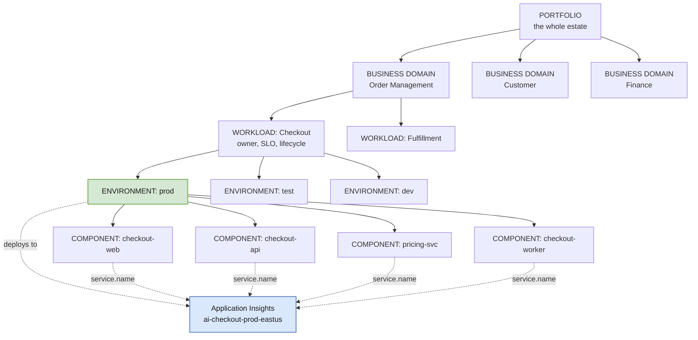
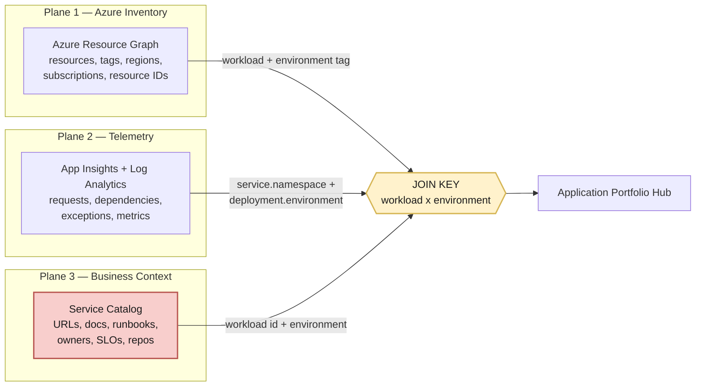
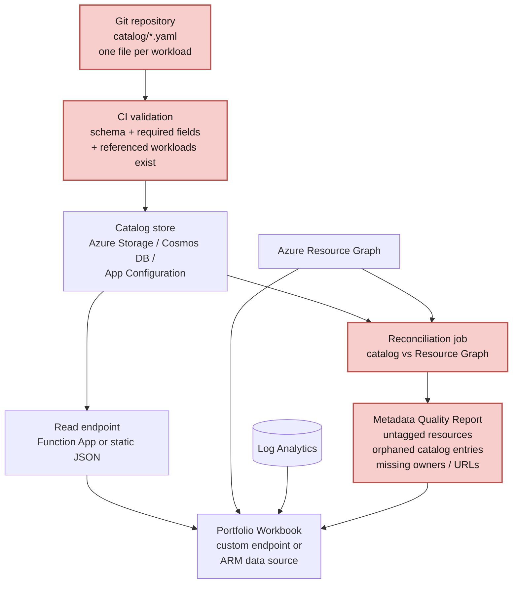

# 05 — Domain Model & Taxonomy

The metadata contract that lets telemetry, Azure inventory, and business context join together. **This is the layer that makes a portfolio view possible** — without it, you have a resource list, not a portfolio.

---

## The hierarchy



### The one rule that matters

**Resource boundary = WORKLOAD × ENVIRONMENT** (green).
**Grouping label = BUSINESS DOMAIN** (a tag, not a resource).
**Distinguisher inside a resource = COMPONENT** (via `service.name`).

Four components, one Application Insights resource, one readable Application Map. Three domains, but zero domain-level resources.

---

## Level definitions

| Level | Definition | Test |
|---|---|---|
| **Portfolio** | Everything the organization runs and must report on | — |
| **Business Domain** | A capability area meaningful to the business, stable over years | Would a non-technical executive recognize the name? |
| **Workload** | Independently owned capability with coherent support, lifecycle, SLOs, and access boundary | Can one team deploy it on their own schedule and be paged for it? |
| **Environment** | A deployment stage with its own data and blast radius | Does a failure here affect real customers? |
| **Component** | A deployable service, function, job, or front end | Does it have its own process and its own `service.name`? |

The **workload** test is the decisive one. If two things fail the "one team, one schedule, one pager" test, they are two workloads and get two Application Insights resources.

---

## The metadata contract

Every workload declares these attributes. This is the join key across all three data planes.

### Tier 1 — Required as Azure tags *and* telemetry attributes

| Attribute | Azure tag | Telemetry attribute | Example |
|---|---|---|---|
| Business domain | `businessDomain` | `business.domain` | `order-management` |
| Workload | `workload` | `service.namespace` | `checkout` |
| Component | *(resource name)* | `service.name` | `checkout-api` |
| Environment | `environment` | `deployment.environment` | `prod` |
| Criticality | `criticality` | `business.criticality` | `tier-1` |
| Owner team | `ownerTeam` | — | `commerce-platform` |
| Cost center | `costCenter` | — | `CC-4471` |
| Data classification | `dataClassification` | — | `confidential` |

### Tier 2 — Required in the service catalog (cannot live usefully in tags)

| Attribute | Why not a tag | Example |
|---|---|---|
| Application URL(s) | Multiple values, length limits | `https://checkout.contoso.com` |
| Internal documentation | URL length, frequent change | Confluence/SharePoint link |
| Runbook URL | Per-scenario, multiple | Ops wiki link |
| Source repository | Multiple repos per workload | GitHub/ADO URL |
| Support channel | Changes often | Teams channel link |
| On-call rotation | Owned by the paging system | PagerDuty/ServiceNow ref |
| SLO targets | Structured object | `availability: 99.9, p95: 800ms` |
| Architecture diagram | Link | Repo path or wiki |
| Business owner | Person, changes with reorgs | Name / Entra group |
| Upstream/downstream deps | Graph structure | List of workload IDs |

### Tier 3 — Derived at query time (never stored)

Availability, latency, error rate, request volume, active alerts, resource health, ingestion volume, cost, deployment version, last deployment time.

---

## Three data planes, one join



The red box is **custom build** — Azure has no native service catalog. The yellow box is the contract that must be enforced by policy and validated continuously, because a single inconsistent tag silently drops a workload out of the portfolio.

---

## Hybrid catalog pattern



Everything in red is custom-built. It is modest engineering — a schema, a CI check, a storage location, and a scheduled reconciliation job — but it is the difference between a portfolio that stays accurate and one that rots within two quarters.

**Why version-controlled YAML:** changes get reviewed, history is auditable, ownership updates travel through the same process as code, and the catalog can be regenerated from scratch.

---

## Example catalog entry

```yaml
workload: checkout
businessDomain: order-management
displayName: Checkout & Cart
description: Customer-facing checkout, cart, pricing, and order placement.
ownerTeam: commerce-platform
businessOwner: VP Digital Commerce
costCenter: CC-4471
criticality: tier-1
dataClassification: confidential

environments:
  prod:
    appInsights: /subscriptions/.../components/ai-checkout-prod-eastus
    logAnalytics: /subscriptions/.../workspaces/law-prod-eastus
    urls:
      - https://checkout.contoso.com
    slo:
      availability: 99.9
      latencyP95Ms: 800
      errorRatePct: 0.5
  test:
    appInsights: /subscriptions/.../components/ai-checkout-test-eastus

links:
  documentation: https://contoso.sharepoint.com/sites/commerce/checkout
  runbook: https://contoso.sharepoint.com/sites/ops/runbooks/checkout
  repository: https://github.com/contoso/checkout
  architectureDiagram: https://github.com/contoso/checkout/blob/main/docs/architecture.md
  supportChannel: https://teams.microsoft.com/l/channel/commerce-support
  dashboard: https://portal.azure.com/#@contoso/dashboard/arm/...

components:
  - name: checkout-web
    type: spa
    hosting: static-web-apps
  - name: checkout-api
    type: api
    hosting: app-service
  - name: pricing-svc
    type: api
    hosting: container-apps
  - name: checkout-worker
    type: worker
    hosting: container-apps

dependencies:
  upstream: [identity]
  downstream: [fulfillment, billing]
  external: [payment-provider, tax-service]
```

---

## Naming standard

| Resource | Pattern | Example |
|---|---|---|
| Application Insights | `ai-{workload}-{env}-{region}` | `ai-checkout-prod-eastus` |
| Log Analytics | `law-{env}-{region}[-{qualifier}]` | `law-prod-eastus`, `law-prod-eastus-restricted` |
| Resource group | `rg-{workload}-{env}-{region}` | `rg-checkout-prod-eastus` |
| Workbook | `wb-{scope}-{purpose}` | `wb-portfolio-hub`, `wb-checkout-golden-signals` |
| Alert rule | `alrt-{workload}-{signal}-{severity}` | `alrt-checkout-availability-sev1` |
| Action group | `ag-{ownerTeam}-{severity}` | `ag-commerce-platform-sev1` |
| Availability test | `avail-{workload}-{endpoint}` | `avail-checkout-homepage` |
| `service.name` | `{workload}-{component}` | `checkout-api` |

Naming is not cosmetic here — the portfolio workbook parses these patterns to infer relationships where tags are missing, and consistent names make Application Map legible at a glance.

---

## Governance of the taxonomy

| Control | Mechanism | Enforcement |
|---|---|---|
| Required tags present | Azure Policy `deny` or `modify` | Deployment time |
| Tag values from allowed list | Azure Policy `allowedValues` | Deployment time |
| Catalog schema valid | CI pipeline validation | Pull request |
| Catalog ↔ Azure reconciled | Scheduled job + quality report | Weekly |
| `service.name` matches catalog | KQL check in portfolio hub | Continuous |
| New workload registered | Onboarding checklist + PR | Per workload |
| Domain list changes | Architecture review board | On change |

**Cardinality discipline:** business domains should number in the low tens, not hundreds. If domains proliferate, they have become team names rather than business capabilities — and the portfolio grouping loses its meaning.
