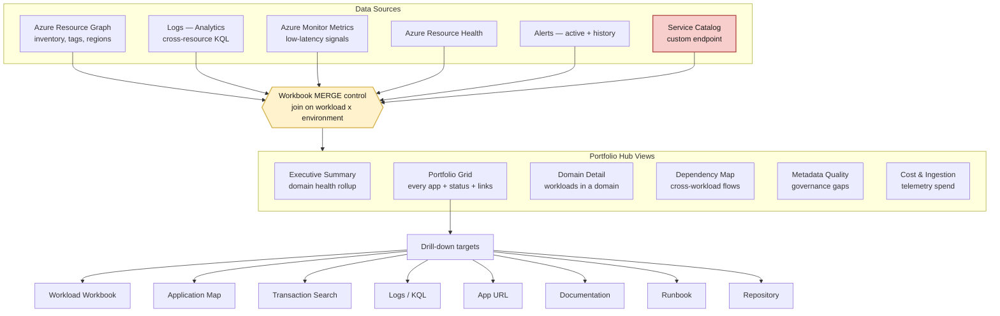
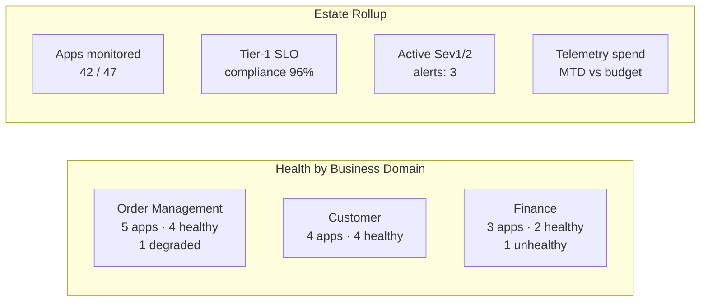
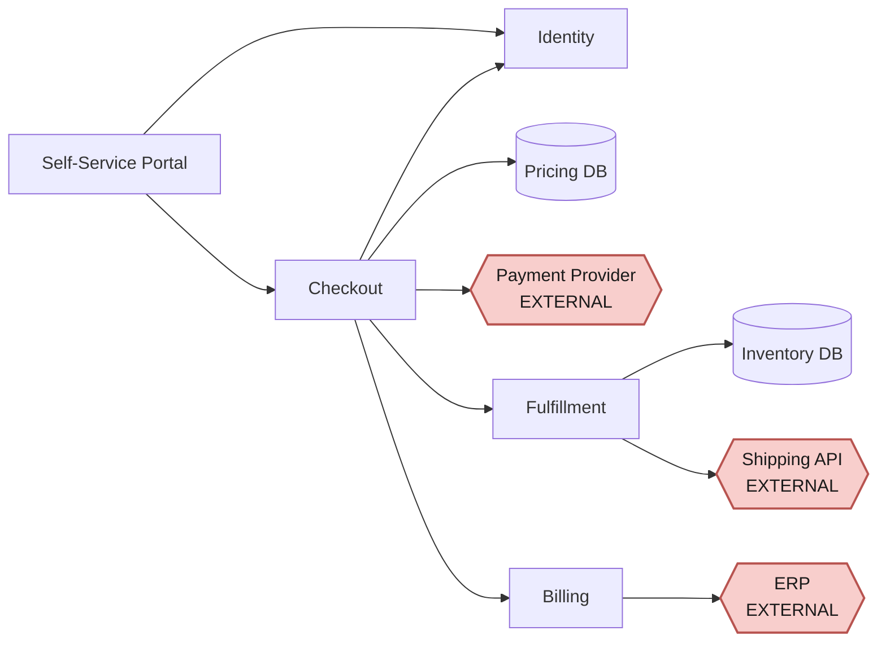
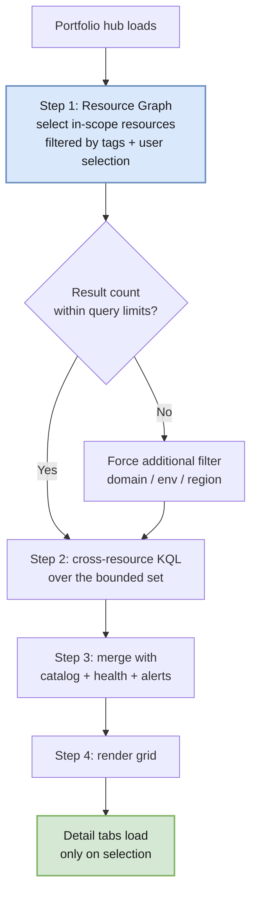
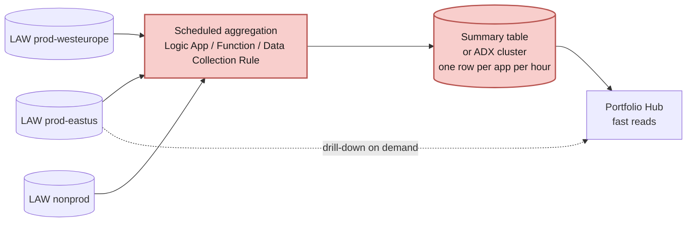

# 06 — Application Portfolio

The destination of this architecture: one place where an executive, an architect, and an on-call engineer each get what they need about the entire application estate — inventory, health, business context, and one-click paths to the app, its docs, its runbook, and its telemetry.

---

## Portfolio hub composition



The **merge control** is the technical heart of the hub — it is what turns six unrelated data sources into one row per application. Workbooks support inner, outer, left/right, semi, and anti joins natively.

> **Design tip:** use a *left outer join* from Resource Graph → telemetry, so a deployed-but-silent application still appears in the portfolio (with an obvious "no telemetry" state). An inner join would hide exactly the applications you most need to find.

---

## View 1 — Executive summary

Audience: leadership. Question answered: *"Is the estate healthy, and where is the risk concentrated?"*



Components: tiles/stat visualizations for rollups, a domain heatmap, SLO compliance trend, open incident count, coverage percentage (**how many known apps are actually instrumented** — often the most revealing number in the whole hub), and telemetry cost against budget.

---

## View 2 — Portfolio grid

Audience: architects and operators. The workhorse view: one row per application per environment.

| Column | Source | Rendering |
|---|---|---|
| Application | Catalog | Text + link to workload workbook |
| Domain | Tag / catalog | Grouping column |
| Environment | Tag | Filter |
| Criticality | Tag | Color-coded label |
| Owner team | Tag / catalog | Text |
| Health | Resource Health + alerts | Traffic-light icon |
| Availability 24h | KQL | Percentage bar |
| Requests/min | KQL | Sparkline |
| P95 latency | KQL | Bar + threshold |
| Error rate | KQL | Bar + threshold |
| Active alerts | Alerts | Count badge |
| Last deployment | `service.version` change | Relative time |
| Ingestion GB/day | Usage KQL | Number |
| **App** | Catalog | 🔗 URL link action |
| **Docs** | Catalog | 🔗 URL link action |
| **Runbook** | Catalog | 🔗 URL link action |
| **Repo** | Catalog | 🔗 URL link action |
| **Telemetry** | Resource ID | 🔗 App Insights link action |

Workbook **link actions** provide this natively: `URL` opens external links in a new tab; Application Insights actions open Transaction Search, User Flows, User Timeline, or resource blades directly from a grid cell.

**Filters:** domain · environment · criticality · owner · region · health · has-telemetry · has-SLO.

---

## View 3 — Domain detail

Audience: domain architects. Drill into one business domain: constituent workloads, shared dependencies, cross-workload journeys, aggregate SLO, alert history, and change/deployment timeline.

---

## View 4 — Dependency map

Audience: architects and incident commanders. Question answered: *"What breaks if this breaks?"*



Built from two inputs: **observed** dependencies (from `dependencies` telemetry — what actually happens) and **declared** dependencies (from the catalog — what was designed). The gap between them is itself valuable: undeclared dependencies are architectural drift; declared-but-unobserved dependencies are dead code or broken instrumentation.

External dependencies (red) deserve special attention — they are where your SLO is most exposed to something you don't control.

---

## View 5 — Metadata quality

Audience: platform team. This view is what keeps the portfolio from decaying.

| Check | Signal |
|---|---|
| Azure resources missing required tags | Count + list |
| Catalog entries with no matching Azure resource | Orphans |
| Azure resources with no catalog entry | Unregistered apps |
| Workloads with no Application Insights | Instrumentation gaps |
| Missing owner, URL, runbook, or docs link | Incomplete metadata |
| `service.name` not matching catalog components | Drift |
| Tier-1 workloads without SLOs or availability tests | Governance gaps |
| App Insights with no telemetry in 7 days | Dead or misconfigured |

Publish a **portfolio completeness score** per domain and trend it. A number that leadership sees is the most reliable forcing function for metadata hygiene.

---

## View 6 — Cost & ingestion

Ingestion GB by workload / table / telemetry type, cost allocation by domain and cost center, sampling effectiveness, retention distribution, top ingestion growth, and daily-cap proximity warnings.

Pair this with the alerting on cap trips described in [01 — P10](./01-architecture-principles.md): a workload that silently hits its cap looks perfectly healthy in every other view.

---

## Query strategy at scale



**The scaling rule: let Resource Graph choose the resources, then query only those.** Never fan a query across every workspace in the tenant.

### The documented limits you are designing against

| Limit | Value | Consequence for the hub |
|---|---|---|
| Resources in a single cross-resource query | **100** workspaces or classic Application Insights resources | This is a hard ceiling, not a performance guideline. A consolidated workspace topology ([02](./02-resource-topology.md)) keeps you an order of magnitude below it. A fragmented one puts the portfolio hub in permanent danger of simply failing |
| Query-pack functions for cross-resource scoping | **Cannot be used in log search alert rules** | Access validation happens at alert-creation time, so a function that federates resources is rejected. Portfolio *views* may use functions; portfolio *alerts* must inline their scope |
| Cross-resource queries | Do **not** support parameterized functions | Your reusable query functions must take their scope from the saved definition, not from a runtime parameter — plan the function library accordingly |

> **This is the practical payoff of workspace consolidation.** Every architectural argument in [02](./02-resource-topology.md) about "fewest workspaces" cashes out here: the portfolio hub is the component that suffers first and worst from a fragmented topology. If the estate ever needs more than 100 workspaces in one query, the portfolio layer must be rebuilt around scheduled summarization rather than live federation.

Performance techniques:
- Resource Graph first, telemetry second — always.
- Pre-aggregate golden signals into the smallest possible result set.
- Default to a short time range (1h/24h); make longer ranges an explicit choice.
- Lazy-load detail tabs; don't run every query on page load.
- Use metrics instead of logs for simple **current-state** numbers (metrics are also never sampled) — but see the backdating limit below before using them for anything historical.
- Consider a scheduled summarization job for very large estates (see below).

### Escalation path for very large estates

If live cross-resource queries stop meeting latency needs:



Custom-built (red). Only introduce this when you have measured a real problem — it adds a pipeline to own and a freshness lag to explain.

---

## Building the workbook: practicalities

The design above is the easy part. These are the things that actually cost time, all of them
verified while building the reference implementation in [`demo/`](./demo/README.md).

### Generate the ARM template; do not hand-write it

An ARM workbook carries its entire definition in `properties.serializedData` as a **JSON
string** — the whole workbook, escaped, on one line. Hand-editing it is miserable and every
mistake is a quoting mistake.

Author the workbook as a normal object in a small build script and let the serializer do the
escaping:

```javascript
// build-workbook.mjs
const workbook = { version: "Notebook/1.0", items: [ /* ...real objects... */ ] };
const template = {
  $schema: "https://schema.management.azure.com/schemas/2019-04-01/deploymentTemplate.json#",
  resources: [{
    type: "microsoft.insights/workbooks",
    apiVersion: "2022-04-01",
    // Deterministic name — see below.
    name: "[guid(resourceGroup().id, 'portfolio-workbook')]",
    kind: "shared",
    properties: { displayName: "Application Portfolio", category: "workbook",
                  serializedData: JSON.stringify(workbook), sourceId: "[parameters('workbookSourceId')]" }
  }]
};
```

### The four traps

| Trap | What happens | Fix |
|---|---|---|
| **`[newGuid()]` as the workbook name** | The resource name changes on every deployment, so each deploy creates a **new** workbook instead of updating the existing one. You end up with a gallery full of identical copies | Use a deterministic name: `[guid(resourceGroup().id, 'portfolio-workbook')]`. Redeploys then update in place |
| **`columnMatch` is a substring/regex match, not an exact match** | A link rule written for a column named `App` also matches `Application`, `AppRoleName`, and anything else containing "App" — silently turning unrelated columns into hyperlinks | Anchor the pattern: `^App$`. Better, avoid column names that are prefixes of each other — rename the URL column to `Website` |
| **The `greenRed` palette colours *high* values red** | Availability of 100% renders bright red and 95% renders green — an alarming, exactly-backwards dashboard | Use `redGreen` for metrics where high is good. Always eyeball the rendered result; the palette names describe the gradient direction, not the semantics |
| **Metric-based tiles render empty over historical data** | Pre-aggregated metrics reject backdating beyond ~20 minutes, so any tile built on metrics shows nothing for replayed, backfilled, or migrated telemetry | Build portfolio tiles on **log-table** queries (`AppRequests`, `AppDependencies`). Reserve metrics for genuinely current-state tiles |

### Verifying a deployed workbook

`az resource show` does **not** return `serializedData`, so it cannot tell you whether your
change landed. Ask for the content explicitly:

```bash
az rest --method get --url "https://management.azure.com<resourceId>?api-version=2022-04-01&canFetchContent=true"
```

Keep ARM-level strings such as `displayName` **ASCII**. Non-ASCII characters passed through
the CLI on Windows can arrive mangled; text inside `serializedData` is unaffected because it
travels as an escaped JSON string.

### Where the catalog lives

For a demo or pilot, inline the catalog as a KQL `datatable` in the query — zero extra
infrastructure, no storage account, and no SAS token in a committed file. For production,
host it as a blob and switch to `externaldata()`; the rest of the query is unchanged. That
swap is deliberately the only thing that differs between the two, so the pilot query is the
production query.

---

## Delivery surface options

| Surface | Best for | Tradeoff |
|---|---|---|
| **Azure Monitor Workbook** *(recommended for the operational hub)* | The portfolio hub itself | Rich merge/link actions, native RBAC, free; authoring is JSON. **Viewers must hold Azure RBAC** |
| Azure Dashboard | Pinned executive tiles | Limited interactivity and joins |
| Azure Managed Grafana | Ops teams already on Grafana; multi-cloud | Extra cost; weaker Azure inventory/link integration |
| **Power BI / Microsoft Fabric** *(recommended for the business audience)* | Leadership, finance, and compliance reporting; blending with CMDB, cost, and DevOps data; long-horizon trends | Needs a semantic model to build and own. **Not** for diagnostics or operational alerting |
| Fabric Real-Time Dashboard | Near-real-time views for a Fabric-native audience | Connects directly to App Insights and Log Analytics with no data movement — but the cross-service query path is blocked by Private Link |
| Existing developer portal | Teams already using Backstage or similar | Build the health integration yourself |

**Recommendation:** Workbook as the primary *operational* hub, pinned tiles to a dashboard for leadership, and **Power BI/Fabric as a parallel surface for audiences who cannot hold Azure RBAC** — see [10 — Fabric Integration](./10-fabric-integration.md). These are complements, not alternatives: the Workbook answers "what is broken," the semantic model answers "what do we run and what does it cost."

---

## RBAC model

| Role | Scope | Sees |
|---|---|---|
| Portfolio Viewer | Reader at MG scope | Inventory, health, links — not telemetry detail |
| Workload Team | Monitoring Reader on their resources | Full telemetry for their workloads |
| Platform/SRE | Monitoring Contributor estate-wide | Everything, plus edits workbooks and alerts |
| Security | Reader + Security Reader | Governance, compliance, and audit views |
| Executive | Reader at MG scope | Executive summary view only |

Workbooks respect the viewer's RBAC — a user sees only the resources they can read. Design the grid so that missing permissions render as an explicit "no access" state rather than an ambiguous blank, so nobody mistakes a permissions gap for a healthy silence.

### The RBAC ceiling — and the escape from it

That behaviour is correct for engineers and **structurally wrong for the portfolio audience.** A CFO, a business owner, or a compliance officer will not — and should not — be granted Monitoring Reader across the estate. Which means the Workbook portfolio hub is unavailable to precisely the people who most want a portfolio view.

There is no way to configure around this. A Workbook cannot show a user data they lack Azure RBAC to read; that is the security model working as designed, not a gap to be patched.

**The escape is a second surface, not a different Workbook.** A Power BI semantic model carries its own permission model, decoupled from Azure RBAC, with row-level security to scope a business owner to their own domain. Microsoft's Log Analytics guidance names this scenario explicitly: *"Sharing insights with stakeholders who don't have access to Log Analytics."*

| Audience | Surface | Access model |
|---|---|---|
| Engineers, SRE, platform | Workbook portfolio hub | Azure RBAC — resource-context |
| Executives, business owners, finance, compliance | Power BI semantic model | Semantic model permissions + RLS |

See [10 — Fabric Integration](./10-fabric-integration.md) for the integration paths, constraints, and the phased adoption plan. Note the ordering rule: build this **after** the taxonomy in [05](./05-domain-model.md) is stable, never before.
