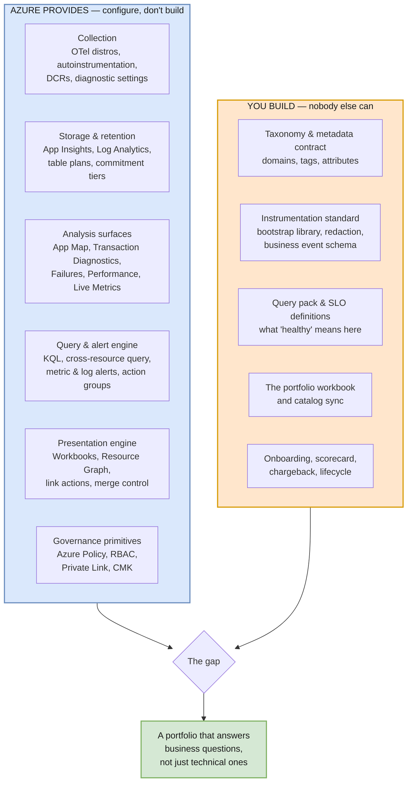
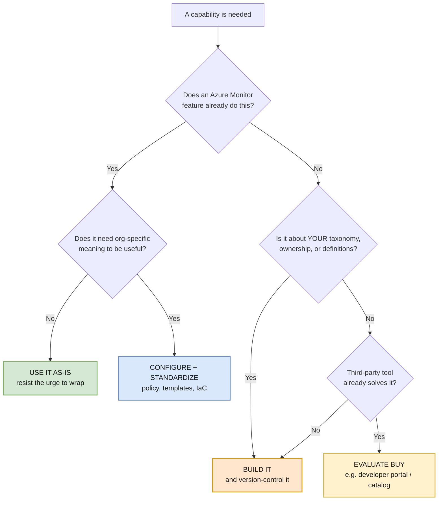

# 07 — Service Responsibilities: Azure-Native vs. Custom Build

> The single most expensive mistake in an observability program is building something Azure already gives you — closely followed by *assuming* Azure gives you something it doesn't. This document draws that line explicitly.

---

## The responsibility split at a glance

**The pattern:** Azure supplies *mechanism*. You supply *meaning*. Every custom-build item below exists because it encodes a decision only your organization can make — what a workload is, what healthy means, who owns it, and where its documentation lives.

---

## Layer 1 — Collection

| Capability | Azure-native | Custom build | Notes |
|---|---|---|---|
| HTTP request/dependency tracing | ✅ `Azure.Monitor.OpenTelemetry.AspNetCore` distro | — | Bundles ASP.NET Core, HttpClient, SqlClient, Azure SDK, and `ILogger` |
| W3C trace propagation | ✅ Automatic across HTTP | ⚠️ Custom protocols, some message brokers | Queues are the #1 place traces break — see [04, Sample 6](./04-csharp-instrumentation.md) |
| SQL dependency capture | ✅ Via bundled SqlClient instrumentation | ⚠️ Non-`SqlClient` providers, stored-proc semantics | |
| Codeless attach (App Service, Functions, AKS) | ✅ | — | Prefer where available; zero code change |
| Browser RUM | ✅ JavaScript SDK | ⚠️ CORS + correlation config | Cross-origin correlation is off by default |
| Azure resource logs | ✅ Diagnostic settings | ⚠️ The *policy* deciding which categories | No egress charge for diagnostic-settings data |
| VM / hybrid collection | ✅ Data Collection Rules + Azure Monitor Agent | ⚠️ DCR standard per workload class | |
| **Resource attribute standard** | ❌ | ✅ **Custom** | `service.name`, `service.version`, `deployment.environment`, `business.domain` — the join key for everything downstream |
| **Redaction of secrets/PII** | ⚠️ Partial (JS SDK `ignoreHeaders` defaults) | ✅ **Custom** | Server-side redaction processors are entirely your responsibility |
| **Shared bootstrap library** | ❌ | ✅ **Custom** | The highest-leverage artifact in the whole program |

> **The most important custom item in this layer is the shared bootstrap library.** Without it, resource attributes, redaction, sampling, and filtering are re-implemented (differently, and wrongly) by every team. With it, onboarding a service is one NuGet reference and one config block.

---

## Layer 2 — Storage and retention

| Capability | Azure-native | Custom build |
|---|---|---|
| Workspace-based Application Insights | ✅ | — |
| Log Analytics workspace, table plans (Analytics / Basic / Auxiliary) | ✅ | ⚠️ The *policy* for which table gets which plan |
| Table-level retention and archive | ✅ | ⚠️ Retention standard by data class |
| Commitment tiers | ✅ | ⚠️ Volume forecasting and tier review cadence |
| Customer-managed keys, Private Link, BYOS | ✅ | ⚠️ AMPLS topology design |
| **Workspace topology decision** | ❌ | ✅ **Custom** — see [02](./02-resource-topology.md) |
| **Daily cap and sampling policy** | ⚠️ Mechanism only | ✅ **Custom** — per-workload targets |

---

## Layer 3 — Analysis

| Capability | Azure-native | Custom build |
|---|---|---|
| Application Map | ✅ | ⚠️ Requires correct `cloud_RoleName` or it does not function |
| Transaction Diagnostics (end-to-end view) | ✅ | — |
| Failures / Performance blades | ✅ | — |
| Live Metrics | ✅ | ⚠️ Requires the Azure Monitor sampler; **cannot split by role name** |
| Smart Detection | ✅ | ⚠️ Tuning and routing |
| Cross-resource KQL | ✅ | ⚠️ Bounded by 100 resources per query |
| Availability tests | ✅ | ⚠️ Which endpoints, which geographies |
| **Standard query pack** | ❌ | ✅ **Custom** — failures, latency percentiles, dependency contribution, deployment markers, business journeys |
| **SLO and burn-rate definitions** | ❌ | ✅ **Custom** — Azure has no SLO object; you compose it from metrics + alert logic |
| **Business journey instrumentation** | ❌ | ✅ **Custom** — "checkout completed" is not a thing Azure can infer |

> **Azure has no native SLO construct.** This surprises people. You define the indicator, the target, the measurement window, and the burn-rate alert logic yourself, on top of metric alerts and log search alerts. Budget real effort here.

---

## Layer 4 — Presentation and portfolio

This is where the custom-build share is highest, and it is exactly the layer the user's portfolio requirement lives in.

| Capability | Azure-native | Custom build |
|---|---|---|
| Workbooks rendering engine, parameters, tabs, grids | ✅ | — |
| Azure Resource Graph inventory queries | ✅ | ⚠️ The queries themselves |
| Workbook link actions (to URLs, resources, blades) | ✅ | ⚠️ The link map |
| Merge control (join Resource Graph ↔ Logs ↔ Metrics) | ✅ | ⚠️ The join keys — your taxonomy |
| Resource Health, Service Health, alert state as data sources | ✅ | — |
| Managed Grafana as an alternative surface | ✅ | ⚠️ Dashboard definitions |
| **Reporting for audiences without Azure RBAC** | ⚠️ Fabric / Power BI semantic models | ✅ **The model, measures, and RLS** |
| Blending telemetry with CMDB, cost, and DevOps data | ⚠️ Fabric dataflows, pipelines, notebooks | ✅ **Connectors and reconciliation logic** |
| **The portfolio workbook itself** | ❌ | ✅ **Custom** — see [06](./06-application-portfolio.md) |
| **Service catalog** (app URLs, docs, runbooks, owners, repos) | ❌ | ✅ **Custom** — Azure has no idea what your internal wiki URL is |
| **Catalog ↔ Azure sync and drift detection** | ❌ | ✅ **Custom** |
| **Metadata quality scorecard** | ❌ | ✅ **Custom** |

> **Azure knows your resources. It does not know your applications.** Resource Graph can tell you an App Service exists, its tags, its region, and its resource ID. It cannot tell you the app's public URL, its architecture decision record, its on-call rota, its business criticality, or which Confluence space documents it. That gap is the entire reason the catalog exists.

### If Microsoft Fabric is in the estate

Fabric shifts several rows in this layer from "custom" toward "configure" — but only at the analytical layer, and it introduces one significant new custom artifact.

| Capability | Fabric provides | Still custom |
|---|---|---|
| Streaming ingestion of telemetry | Eventstream, Event Hub connectors, managed private endpoints | Which tables, filters, and sampling |
| Analytical store and cheap long retention | Eventhouse, Lakehouse, OneLake | Table design, update policies, aggregation cadence |
| Reporting surface for non-RBAC audiences | Power BI, Real-Time Dashboards | **The semantic model, its measures, and row-level security** |
| Blending with CMDB / cost / DevOps | Dataflows, pipelines, notebooks | Connector logic and reconciliation |
| Business-condition alerting | Activator | The condition definitions — **never** operational alerts |

**The semantic model becomes the highest-value custom artifact in the presentation layer** — a governed definition of availability, SLO attainment, and cost per application that Power BI, Excel, and Copilot all read consistently. Fabric hosts that definition; it cannot supply it.

Fabric changes nothing in Layers 1–3. Collection, storage, and diagnosis remain Azure Monitor's job. See [10 — Fabric Integration](./10-fabric-integration.md).

---

## Layer 5 — Governance

| Capability | Azure-native | Custom build |
|---|---|---|
| Azure Policy (required tags, diagnostic settings, allowed regions) | ✅ | ⚠️ The initiative definitions |
| Azure RBAC, resource-context access, table-level RBAC | ✅ | ⚠️ The role model |
| Microsoft Entra authentication, managed identity | ✅ | — |
| Cost analysis, budgets, usage queries | ✅ | ⚠️ Chargeback allocation model |
| **Taxonomy and tag standard** | ❌ | ✅ **Custom** — see [05](./05-domain-model.md) |
| **Onboarding checklist and maturity scorecard** | ❌ | ✅ **Custom** |
| **Telemetry schema review / high-cardinality detection** | ❌ | ✅ **Custom** |
| **Monitoring the monitoring** (ingestion gaps, cap trips, exporter failures) | ⚠️ Signals exist | ✅ **Custom** — the alert rules and runbook |

---

## The custom-build backlog, ranked by leverage

If you build these in order, each one makes the next cheaper.

| # | Artifact | Why it comes first | Rough effort |
|---|---|---|---|
| 1 | **Taxonomy + tag standard** | Every other artifact joins on it. Getting this wrong is the only truly expensive mistake | Days |
| 2 | **Shared instrumentation bootstrap library** | Turns onboarding from a project into a config change; carries redaction and sampling for free | 1–2 weeks |
| 3 | **Redaction processors** | Security gate — must exist before broad production rollout | Days |
| 4 | **Standard KQL query pack** | Stops every team writing its own subtly-wrong latency query | 1 week |
| 5 | **Workload workbook template** | The per-team deliverable; also the drill-down target for the portfolio | 1–2 weeks |
| 6 | **Service catalog + schema** | Supplies what Azure structurally cannot know | 1 week + ongoing curation |
| 7 | **Portfolio hub workbook** | The headline deliverable — but it is only as good as items 1 and 6 | 2–3 weeks |
| 8 | **Catalog sync + metadata quality report** | Keeps the portfolio honest as the estate changes | 1–2 weeks |
| 9 | **SLO and burn-rate alert library** | Highest ongoing value, but needs stable baselines first | Ongoing |
| 10 | **IaC modules for all of the above** | Makes the whole thing reproducible and reviewable | Continuous |

---

## Build-vs-buy decision rule

**A note on "buy" for the catalog:** if your organization already runs an internal developer portal (Backstage, ServiceNow CMDB, an existing service registry), make it the authoritative source for catalog metadata and have the portfolio hub read from it. Do not create a second, competing catalog — the failure mode of portfolio programs is almost always metadata drift, and two catalogs guarantee it.

---

## Anti-patterns in this layer

| Anti-pattern | Why it fails |
|---|---|
| Building a custom telemetry pipeline "for flexibility" | Loses autoinstrumentation, Application Map, and every portal experience. Enormous ongoing cost |
| Wrapping the OTel distro in a proprietary abstraction | Breaks on every upstream version bump; obscures documented behaviour |
| Treating the workbook as the deliverable | The workbook is the *surface*. The taxonomy and catalog are the deliverable |
| Building the portfolio hub before the taxonomy | Produces a beautiful dashboard full of `unknown_service` and null owners |
| Copying dashboards between teams instead of templating | Guarantees divergence within a quarter |
| Exporting everything to an external SIEM/APM "just in case" | Doubles cost, halves the value of both systems |

---

**Next:** [08 — Implementation Roadmap](./08-implementation-roadmap.md) · **Back:** [06 — Application Portfolio](./06-application-portfolio.md) · [README](./README.md)
