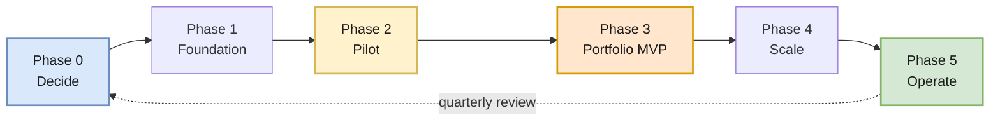

# 08 — Implementation Roadmap

> A phased plan that gets to a working portfolio without boiling the ocean — and without building the portfolio on top of metadata nobody has agreed to yet.

---

## Sequencing logic

**The one ordering rule that matters:** taxonomy before instrumentation, instrumentation before portfolio. Reversing this produces a portfolio hub that renders `unknown_service`, null owners, and broken links — which destroys executive confidence in the program before it has delivered anything.

---

## Phase 0 — Decide (1–2 weeks)

Decisions, not deliverables. Nothing here requires a single Azure resource.

| Decision | Output | Reference |
|---|---|---|
| What is a "workload" in our organization? | Written definition + 5 worked examples | [05](./05-domain-model.md) |
| Business domain list | Agreed, stable, ≤ ~10 top-level domains | [05](./05-domain-model.md) |
| Workspace topology | Start at one; documented justification for each exception | [02](./02-resource-topology.md) |
| Tag standard and required attributes | Tag schema + OTel resource attribute mapping | [05](./05-domain-model.md) |
| Naming standard | For App Insights, workspaces, workbooks, alerts, action groups | [05](./05-domain-model.md) |
| Catalog source of truth | Existing developer portal, or new Git-backed YAML catalog | [05](./05-domain-model.md) |
| Data classification and redaction policy | What may never enter telemetry | [03](./03-telemetry-flow.md) |

**Exit criteria:** a platform owner and at least two application teams can independently classify the same five services identically.

> If you cannot pass that exit criterion, do **not** proceed. The whole architecture joins on this taxonomy.

---

## Phase 1 — Foundation (3–4 weeks)

| Workstream | Deliverable |
|---|---|
| Resource baseline | Workspace(s) provisioned via IaC; workspace-based Application Insights module |
| Instrumentation library | Shared bootstrap NuGet package: resource attributes, redaction, sampling, filtering ([04](./04-csharp-instrumentation.md)) |
| Governance | Azure Policy initiative for required tags, diagnostic settings, allowed regions, workspace linkage |
| Access model | RBAC role assignments: platform operators, workload teams, portfolio viewers, security |
| Cost guardrails | Sampling defaults, log-level defaults, table plan policy, budget alerts |
| Query pack v1 | Failures, latency percentiles, dependency contribution, exceptions, deployment markers |

**Exit criteria:** a new service can be onboarded with one package reference and one connection-string setting, and it appears with correct `cloud_RoleName`, domain, environment, and owner attributes without any team-specific code.

---

## Phase 2 — Pilot (4–6 weeks)

Pick **one** workload that exercises the hard parts. A pilot that avoids the hard parts teaches you nothing.

Required characteristics:

- [ ] A browser or API entry point
- [ ] At least two collaborating services
- [ ] At least one **cross-workload** call to a service in a *different* Application Insights resource
- [ ] An asynchronous message path (queue or topic)
- [ ] A database dependency
- [ ] A scheduled or background job
- [ ] Production-like volume, including a realistic failure mode

Run the full [validation harness from 03](./03-telemetry-flow.md#validation-harness) against it.

### Pilot acceptance criteria

| # | Criterion |
|---|---|
| 1 | A single user request is traceable end to end across every participating component |
| 2 | The trace survives the queue hop and the background job |
| 3 | Database calls appear as correlated dependencies with duration and success, and **no** sensitive data |
| 4 | Application Map shows meaningful role names — no `unknown_service` |
| 5 | The cross-resource call is joinable by query, and the technique is documented |
| 6 | Sampling is active and traces remain complete; effective rate verified via `100 / avg(itemCount)` |
| 7 | Redaction verified by deliberate negative test (send a fake token, confirm it is absent) |
| 8 | Ingestion volume and cost are attributable to the workload |
| 9 | An induced failure produces exactly one actionable alert routed to the right owner |
| 10 | Instrumentation failure itself is detectable (kill the exporter, confirm you notice) |

> **Criterion 10 is the one teams skip and later regret.** A monitoring system that fails silently is worse than none, because it manufactures false confidence.

---

## Phase 3 — Portfolio MVP (3–4 weeks)

Build the smallest portfolio that is genuinely useful, using the pilot plus 3–5 additional workloads.

| Deliverable | Scope for MVP |
|---|---|
| Catalog | Entries for the MVP workloads only; schema validated in CI |
| Resource Graph inventory query | App Insights resources + tags + owners + environments |
| Portfolio grid | Name, domain, owner, environment, criticality, availability, failure rate, P95 latency, active alerts |
| Link actions | App URL, documentation, runbook, repository, Azure resource, workload workbook |
| Filters | Domain, environment, owner, criticality |
| Drill-down | Grid row → workload workbook → Application Map / Transaction Search / Logs |
| Metadata quality view | Which workloads are missing which required fields |

**Deliberately out of scope for MVP:** cost view, dependency map, executive summary, historical trending. Add them once the grid is trusted.

**Exit criteria:** an engineering manager can find any MVP workload, see its current health, and reach its documentation and runbook in two clicks — without asking anyone.

---

## Phase 4 — Scale (ongoing, quarterly waves)

Onboard the remaining estate in waves rather than a big bang.

| Mechanism | Purpose |
|---|---|
| Onboarding checklist | Self-service; a team can complete it without platform involvement |
| Maturity scorecard | Bronze / Silver / Gold levels (below) — visible in the portfolio itself |
| Wave planning | Group by domain so a whole business area becomes observable together |
| Policy enforcement ratchet | Audit → deny for required tags, once compliance passes ~80% |
| Query pack and workbook templates | Version-controlled, promoted through environments |

### Maturity scorecard

| Level | Criteria |
|---|---|
| **Bronze** | Instrumented via the shared library · correct role names · required tags present · catalog entry exists |
| **Silver** | Bronze + end-to-end trace verified across all hops · DB dependencies correlated · redaction verified · availability tests · workload workbook |
| **Gold** | Silver + SLOs defined with burn-rate alerts · business journey instrumentation · cost attributed and within target · runbook links verified live · monitoring-of-monitoring alerts active |

Publish the distribution. "Which domains are still Bronze?" is a far more productive conversation than "is everyone onboarded yet?"

---

## Phase 5 — Operate

The program does not end at rollout. These are the recurring activities that stop it decaying.

| Cadence | Activity |
|---|---|
| Continuous | Metadata quality alerting — new resources without required tags, catalog entries without live resources |
| Weekly | Alert noise review: which alerts fired, which were actionable, which were ignored |
| Monthly | Ingestion and cost review by domain; sampling ratio verification; top-growth investigation |
| Quarterly | Workspace topology review — has any split criterion newly applied, or ceased to apply? |
| Quarterly | Retention and table plan review against actual query patterns |
| Quarterly | Maturity scorecard publication and wave planning |
| Annually | Taxonomy review — domains merge, split, and get renamed as the business changes |

---

## Risk register

| Risk | Signal | Mitigation |
|---|---|---|
| Taxonomy never stabilizes | Phase 0 exit criterion repeatedly fails | Timebox it; ship a v1 with an explicit revision date rather than pursuing consensus indefinitely |
| Cost overrun at scale | Ingestion growth outpaces onboarding | Sampling and filtering defaults in the shared library from day one; per-domain budget alerts |
| Portfolio built on empty metadata | Grid renders nulls and dead links | Do not build Phase 3 before Phase 1 exit criteria pass; ship the metadata quality view *with* the MVP |
| Workspace sprawl by exception creep | Workspace count climbs each quarter | Require written justification against the documented criteria; review quarterly; note the 100-resource query ceiling |
| Teams bypass the shared library | Divergent role names, missing redaction | Policy audit for required attributes; make the library path the fastest path |
| Alert fatigue | Alerts routinely acknowledged without action | Alert on user impact and SLO burn, not symptoms; weekly noise review with teeth |
| Silent monitoring failure | Nobody notices missing telemetry | Heartbeat and ingestion-gap alerts; daily-cap trip alerts; make it a Gold criterion |
| Program loses executive sponsorship | Nobody looks at the portfolio | Ship the MVP early and make one genuinely useful executive view; measure portfolio usage |

---

## What "done" looks like

There is no finish line, but there is a recognizable steady state:

- Any engineer can trace any production request end to end, including its database calls, without asking a colleague which tool to open.
- Any manager can answer "what do we run, who owns it, is it healthy, and where is it documented?" from one place.
- A new service is observable on its first deployment because the shared library made it the default, not a follow-up ticket.
- The workspace count is a number someone can justify from the documented criteria, resource by resource.
- Telemetry cost is attributable, predictable, and tuned per workload rather than capped in panic.

---

**Back:** [07 — Service Responsibilities](./07-service-responsibilities.md) · [README](./README.md)
