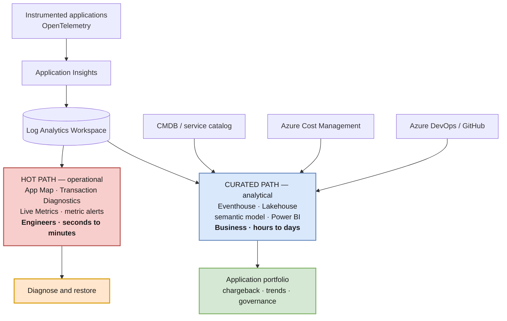
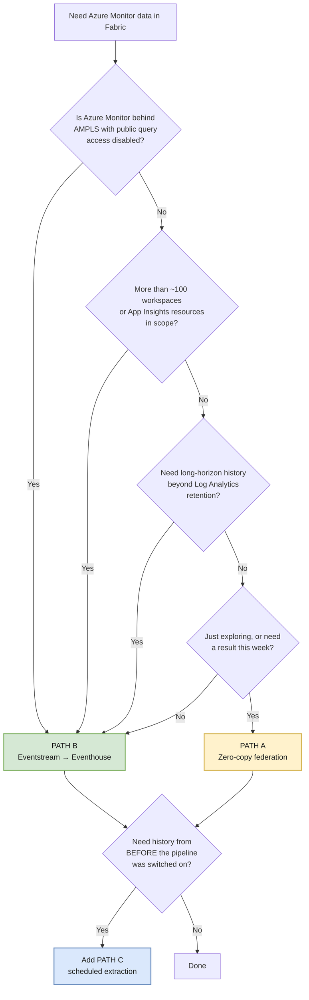
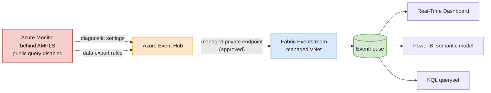

# 10 — Microsoft Fabric Integration

> **Verdict: yes — at the portfolio and analytics layer only.** Fabric earns its place *above* Log Analytics, never *instead of* it. This document draws that line, presents three integration paths with a selection rule, and is equally explicit about where Fabric must not go.

---

## The core idea: a two-speed architecture

The architecture in docs 01–09 has exactly one speed — the operational one. It is excellent at answering *"why is checkout slow right now?"* and structurally incapable of answering *"what does our application portfolio cost, who owns it, and is it getting better?"*



| | Hot path | Curated path |
|---|---|---|
| **Store** | Application Insights + Log Analytics | Fabric Eventhouse / Lakehouse |
| **Audience** | Engineers, SRE, on-call | Business owners, finance, compliance, leadership |
| **Latency tolerance** | Seconds to minutes | Hours to days |
| **Question answered** | "What is broken and why?" | "What do we run, what does it cost, is it improving?" |
| **Access model** | Azure RBAC | Semantic model permissions |
| **Optimized for** | Diagnosis | Reporting and blending |

**The rule that keeps this honest: the curated path never becomes the diagnostic path.** If an engineer opens Fabric during an incident, the architecture has failed.

---

## The three gaps Fabric genuinely closes

### Gap 1 — The RBAC ceiling *(the strongest argument)*

Doc 06 states it plainly: *"Workbooks respect the viewer's RBAC — a user sees only the resources they can read."*

That is exactly right for engineers and **fatal for the portfolio audience**. A CFO, a business owner, or a compliance officer is not going to be granted Monitoring Reader across the estate — and shouldn't be. So the portfolio hub, as designed in doc 06, is structurally unavailable to the very people who most want a portfolio view.

Microsoft's Log Analytics/Power BI guidance names this use case explicitly: *"Sharing insights with stakeholders who don't have access to Log Analytics."*

A Power BI semantic model carries **its own permission model**, decoupled from Azure RBAC. Row-level security can still scope a business owner to their own domain. This is the difference between a portfolio leadership can open and one they cannot.

> This is the gap that most justifies Fabric here. Everything else is optimization; this is a capability the Workbook cannot provide at all.

### Gap 2 — The blending ceiling

Log Analytics joins telemetry to telemetry. It cannot join telemetry to the systems that make a portfolio meaningful:

| Source | What it unlocks |
|---|---|
| **CMDB / service catalog** (doc 05) | Authoritative ownership, criticality, lifecycle stage, documentation links |
| **Azure Cost Management** | True cost per application — infrastructure *and* telemetry — for chargeback |
| **Azure DevOps / GitHub** | Deployment frequency, lead time, change failure rate — DORA metrics correlated to reliability |

Doc 06 merges catalog data into a Workbook by hand, one grid at a time. Fabric does this natively and durably, and it is the natural home for the application portfolio originally asked for.

The highest-value question this unlocks is one no single Azure service can answer today: **"Which applications are expensive, unreliable, and business-critical at the same time?"** That requires cost + telemetry + catalog in one model.

### Gap 3 — The 100-resource query ceiling

Doc 06 documents the hard limit: **100 workspaces or classic Application Insights resources in a single query.** The consolidation discipline in doc 02 keeps a healthy estate far below it.

But a large, federated, or acquisition-heavy estate can exceed it — and when it does, the portfolio hub does not degrade, it fails.

Critically: **zero-copy federation does not escape this limit** (see Path A below). Only ingesting into Eventhouse does, because at that point the data is local.

---

## Three integration paths



### Path A — Zero-copy federation

Query Azure Monitor from Fabric without moving any data.

**Fabric Real-Time Dashboards support Azure Monitor natively as a data source — both Application Insights and Log Analytics.** Connect via `Add data source` → `Azure Monitor`, supplying subscription, resource group, and resource name, or a full connection URI.

Underneath, this is the Kusto cross-service query proxy, also usable directly from a KQL queryset:

```kusto
// A single Application Insights resource
cluster('https://adx.monitor.azure.com/subscriptions/<sub-id>/resourcegroups/<rg>/providers/microsoft.insights/components/<ai-name>')
  .database('<ai-name>').AppRequests
| where TimeGenerated > ago(1h)
| summarize Requests = count(), P95 = percentile(DurationMs, 95) by AppRoleName
```

```kusto
// Subscription-scoped: ALL workspaces and App Insights resources in one cluster
cluster('https://adx.monitor.azure.com/subscriptions/<sub-id>')
  .database('<workspace-name>').AppDependencies
| where TimeGenerated > ago(1h) and Success == false
| summarize Failures = count() by Target, DependencyType
```

| ✅ Strengths | ❌ Limits |
|---|---|
| No data movement, no duplication, no export cost | **Blocked by Private Link and IP restrictions** |
| Stand up in minutes | **Still bound by the 100-resource limit** |
| Always current — queries live data | Cross-tenant needs Lighthouse or `TrustedExternalTenant` |
| Full existing history available immediately | Retrieval only — only `.show functions` supported |
| Ideal for exploration and proving value | Repeated refreshes re-query Log Analytics each time |

**Use it for:** proving the concept, early dashboards, and estates with a public query endpoint and a modest resource count.

### Path B — Eventstream → Eventhouse *(recommended durable foundation)*

Stream telemetry into Fabric, then serve everything from Fabric-native storage.



**Why this sidesteps Private Link entirely:** Azure Monitor *pushes* to Event Hub. Eventstream *pulls* from Event Hub over an approved managed private endpoint. The `adx.monitor.azure.com` proxy is never in the path, so its Private Link limitation is irrelevant. Once data lands in Eventhouse, every downstream consumer is Fabric-native — no federation, no proxy, no resource ceiling.

Verified specifics:

| Item | Detail |
|---|---|
| Eventstream managed private endpoints | **Generally available.** (The platform overview page still labels the Eventstream link "Preview" — that link text is stale; the Eventstream page itself documents a GA release with expanded regions and production support) |
| Capacity requirement | **Plan for F64 or larger.** The two Microsoft pages disagree: the Eventstream prerequisites say *"Fabric trial and all Fabric F SKU capacities,"* while the managed-private-endpoint overview says *"capacities with 64 or more capacity units, including Trial, F64, and larger."* The overview is the authoritative page for the platform feature and is the more restrictive of the two — **design against F64+** and treat any smaller SKU as something to prove in your own tenant before committing |
| **Workload prerequisite** | Managed private endpoints require **Fabric Data Engineering (Spark) workload support in both the tenant home region and the capacity region.** If Data Engineering isn't available in a region, private endpoint creation there is **blocked** — even though this pattern never runs a Spark job. Check this before assuming Path B is viable in your region |
| Supported private endpoint targets | **Azure Event Hubs and Azure IoT Hub only** — exactly what this pattern requires |
| Regional availability | GA regions include East US, East US 2, Central US, North Central US, West US, West US 2, Canada Central, Brazil South, North/West Europe, France Central, Germany West Central, Sweden Central, UK South, UAE North, South Africa North, Australia East, Australia Southeast, Central India, Japan East, Korea Central, Southeast Asia. Confirm the current list for your capacity region |
| Known limitation | Data Preview may not render for non-public sources. Cosmetic — data still flows |
| Setup | Workspace settings → Network security → Create, with the Event Hub namespace resource ID and the `Azure Event Hub` sub-resource. Approve the request in the Azure portal under Networking → Private endpoint connections. When adding the source, **uncheck "Test connection"** if the hub isn't publicly reachable, and enter the consumer group manually |

> **Honest caveat on the Event Hub.** The Azure Monitor → Event Hub leg requires "allow trusted Microsoft services to bypass this firewall." Log Analytics data export explicitly *cannot* reach an Event Hub with virtual networks enabled otherwise. So the hub is reachable **privately from Fabric** while accepting **trusted-service writes from Azure Monitor**. That is a standard, supported topology — but it is not "the Event Hub is fully private," and you should not represent it that way in a security review.

**Choosing the feed:**

| Data | Preferred feed | Why |
|---|---|---|
| Azure resource logs (App Service, SQL, gateways) | **Diagnostic settings → Event Hub directly** | Documented as **lower latency** than exporting from the workspace, and it avoids the data-export meter entirely |
| App Insights / workspace tables (`AppRequests`, `AppDependencies`, …) | **Log Analytics data export rules → Event Hub** | These only exist after workspace ingestion |

### Path C — Scheduled extraction

A Spark notebook or query-API job (Data Factory, Functions, Logic Apps) writing to a Lakehouse.

**This is the only path that can move historical data.** Data export is strictly forward-only, so if the portfolio needs trends predating the pipeline, Path C backfills them once. It is also the private-estate option for tables you don't want streaming, since Fabric managed private endpoints support **Azure Monitor Private Link Scopes** directly for Data Engineering workloads.

Keep extractions **aggregated in KQL before they leave Azure Monitor** — the query API enforces size limits and returns partial results silently if exceeded.

### Path comparison

| | A — Zero-copy | B — Eventstream | C — Extraction |
|---|---|---|---|
| AMPLS estate | ❌ Blocked | ✅ Unaffected | ✅ Works (managed PE to AMPLS) |
| 100-resource limit | ❌ Applies | ✅ Escaped | ✅ Escaped |
| Historical data | ✅ All of it | ❌ Forward-only | ✅ Backfills |
| Latency | ✅ Live | ✅ Near-real-time | ❌ Batch |
| Duplication cost | ✅ None | ❌ Export meter + storage | ❌ Storage |
| Long retention cost | ❌ Log Analytics rates | ✅ Cheap | ✅ Cheap |
| Blending with CMDB/cost | ⚠️ Awkward | ✅ Native | ✅ Native |
| Setup effort | ✅ Minutes | ⚠️ Real pipeline | ⚠️ Real pipeline |

**Recommended combination:** Path A to prove value quickly where a public endpoint exists, **Path B as the durable foundation**, Path C once for backfill if trends matter.

---

## Constraints to design around

| Constraint | Consequence |
|---|---|
| Cross-service queries are subject to the **same cross-resource query limits** | Path A does not escape the 100-resource ceiling |
| **Cross-service query doesn't support Private Link or IP restrictions** | Path A only. Paths B and C are unaffected |
| Cross-service query is **retrieval only**; only `.show functions` supported | You cannot manage Azure Monitor from Fabric |
| Cross-tenant queries unsupported directly | Lighthouse or `TrustedExternalTenant` |
| Data export: **max 10 rules per workspace** | Choose tables deliberately |
| Data export: **Analytics and Basic plans only — Auxiliary unsupported** | The cheap-tier data you'd most want to offload is exactly what you cannot export this way |
| Data export: **destination must be in the workspace region** | Interacts with the consolidation decision in [02](./02-resource-topology.md) |
| Data export **can't reach an Event Hub with virtual networks enabled** | Requires the trusted-services bypass |
| Data export bills on **uncompressed JSON**, larger than the reported table size | Property names repeat per record; metadata overhead is significant for small records. Docs recommend **measuring a representative export** rather than estimating |
| Data export retries for **12 hours**, may duplicate a fraction of records, then discards | Design the Eventhouse for idempotency; don't assume exactly-once |
| Data export sends **no historical data** | Path C exists for this reason |
| Power BI export subject to **Query API limits**; partial results if exceeded | Aggregate in KQL first; never export raw |

---

## Where Fabric must not go

This section matters as much as the value case, because it is where these programs fail.

| Anti-pattern | Why it fails |
|---|---|
| **Replacing Application Insights for diagnostics** | Application Map, Transaction Diagnostics, Live Metrics, and Smart Detection are portal experiences bound to App Insights data. Copying telemetry to Fabric does not recreate any of them — it produces a table of spans and a lost afternoon |
| **Routing operational alerting through Fabric** | Metric alerts are lower-latency and metrics are never sampled ([03](./03-telemetry-flow.md)). Fabric adds latency to the one path that must not have it |
| **Sending engineers to Fabric during an incident** | If the incident workflow starts in Fabric, the two-speed model has collapsed |
| **Dual-ingesting everything "so it's all in one place"** | You pay Log Analytics ingestion, the export meter on inflated JSON, *and* Fabric capacity — for a copy that is worse at diagnosis than the original |
| **Letting the semantic model become a second source of truth for health** | Operational status comes from Azure Monitor; Fabric reports on it. Two conflicting availability numbers destroy trust in both |
| **Streaming raw verbose traces into Eventhouse** | Apply the same sampling and filtering discipline as the hot path. Fabric is not a reason to stop filtering |
| **Building the semantic model before the taxonomy** | Same failure as doc 08's ordering rule — the model joins on `business.domain`, `service.name`, and workload ID. Without [05](./05-domain-model.md), it joins on nothing |

---

## What Fabric adds vs. what stays custom

| Capability | Fabric provides | You still build |
|---|---|---|
| Streaming ingestion | Eventstream, connectors, managed private endpoints | Which tables, which filters, which sampling |
| Analytical store | Eventhouse, Lakehouse, OneLake, retention policies | Table design, update policies, aggregation cadence |
| Query engine | KQL, cross-database queries | The portfolio query library |
| Reporting surface | Power BI, Real-Time Dashboards | **The semantic model, its measures, and RLS** |
| Access model | Semantic model permissions, row-level security | The role-to-domain mapping |
| Blending | Dataflows, pipelines, notebooks | Catalog / cost / DevOps connectors and reconciliation |
| Alerting | Activator | Business-condition definitions — **not** operational alerts |

**The semantic model is the custom deliverable.** A shared, governed definition of availability, SLO attainment, cost per application, and portfolio health that Power BI, Excel, and Copilot all read consistently. That definition is organizational judgment; Fabric only hosts it.

---

## Adoption phases

Slots into the roadmap in [08](./08-implementation-roadmap.md) after Phase 3 — **never before**, because the semantic model joins on taxonomy that must already be stable.

| Phase | Scope | Exit criteria |
|---|---|---|
| **F0 — Prove** | Path A. One Real-Time Dashboard against App Insights + Log Analytics. No data movement, no commitment | A stakeholder confirms the view answers a question the Workbook couldn't |
| **F1 — Semantic model** | Power BI model over Path A or a small Path B feed. Add the catalog from [05](./05-domain-model.md). Row-level security by domain | A business owner opens the portfolio **without any Azure RBAC** and sees only their domain |
| **F2 — Durable pipeline** | Path B in full. Diagnostic settings and data export → Event Hub → Eventstream → Eventhouse. Managed private endpoint if AMPLS applies | Telemetry lands reliably; ingestion volume and cost measured against a representative sample, not an estimate |
| **F3 — Blend** | Join Azure Cost Management, CMDB, and Azure DevOps. Cost-per-application and DORA metrics | The "expensive, unreliable, and business-critical" question is answerable in one view |
| **F4 — Govern** | Long-horizon retention in Eventhouse/OneLake, retention tuning in Log Analytics, quarterly review | Log Analytics retention is reduced where Fabric now holds the history — the cost case closes |

> **The cost case only closes at F4.** Until you actually reduce Log Analytics retention because Fabric holds the long tail, you are paying for both. Plan F4 deliberately rather than treating it as cleanup.

---

## Do not adopt this if…

- Fabric capacity does not already exist and would be bought solely for this. A Workbook plus the [05](./05-domain-model.md) catalog covers most of the need at zero marginal cost.
- **You need Path B but your capacity is below F64, or your capacity region lacks Fabric Data Engineering support.** Managed private endpoints are gated on both. Without them, a Private-Link-isolated estate has no streaming path — Path C becomes the only option, and it is materially more work for less value.
- The taxonomy in [05](./05-domain-model.md) is not yet stable — you will model on sand.
- Every portfolio consumer can reasonably hold Azure RBAC. Gap 1 is the strongest argument, and without it the case weakens considerably.
- There is no appetite to maintain a semantic model. An unowned model decays faster than an unowned dashboard, and is trusted longer while wrong.

---

**Back:** [09 — Verification Log](./09-verification-log.md) · [06 — Application Portfolio](./06-application-portfolio.md) · [README](./README.md)
