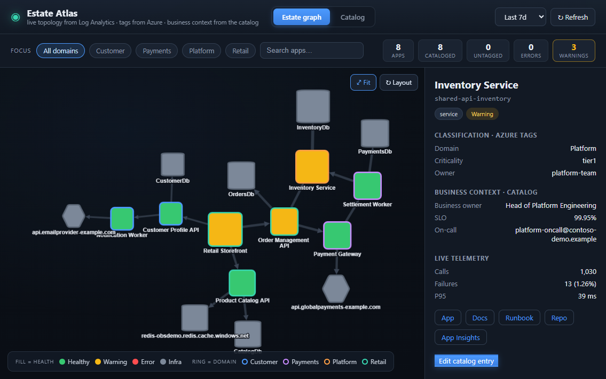
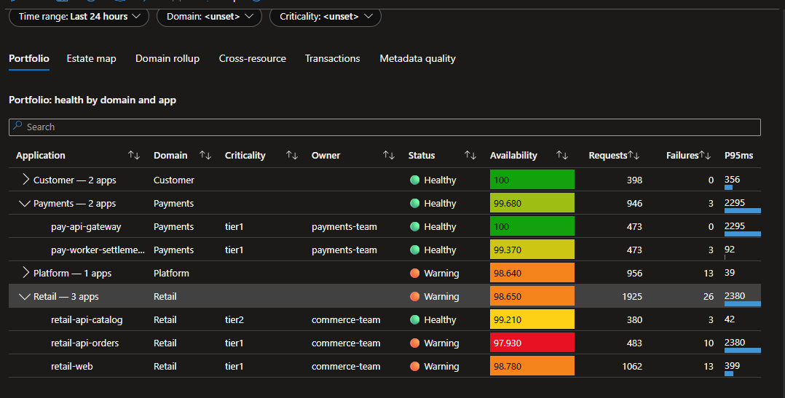
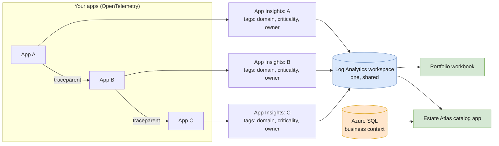

# Application Insights: cross-app tracing and an app catalog

A deployable starter that shows two things:

1. **Stitching.** Separate apps (A → B → C), each with its own Application Insights resource, produce *one* end-to-end transaction: requests, HTTP calls, database and queue calls, exceptions, and logs. W3C trace context ties the spans together, and one shared Log Analytics workspace puts them all in reach of a single query.
2. **The app catalog.** *Estate Atlas*, a small web app, draws the observed dependency graph from that telemetry, classifies every app from its Azure tags, and holds business context: what an app is for, its business owner, SLO, runbook, and on-call.

A portfolio workbook shows the same estate inside the Azure portal. A telemetry simulator supplies data for eight demo apps without deploying real workload services. The catalog platform itself uses real Azure resources.

## What you'll see



*The Azure-hosted catalog, with one app selected. Classification comes from tags; business context comes from SQL; traffic and health come from telemetry.*



*The portfolio workbook groups the same observed apps by domain. These are captures of a deployed demo, not mockups; counts and health depend on the selected time range. See the [guided tour](demo/README.md#guided-tour) for the transaction view.*

## How it fits together



There is no central list of apps. An app joins the estate when its Application Insights resource is linked to the shared workspace and tagged with `domain`, `criticality`, and `owner`. Every telemetry row records the resource that received it, so the workbook and the catalog app read those tags at query time.

## What's configuration and what's code

| What | Where it lives | Who changes it |
|---|---|---|
| Resource group and region | `RG` and `LOCATION` environment variables (defaults in [`lib/common.sh`](lib/common.sh)) | You, once |
| An app's classification | `domain`, `criticality`, and `owner` tags on its Application Insights resource | The app team, with [`add-app.sh`](add-app.sh) or their own infrastructure as code |
| An app's identity in telemetry | `OTEL_SERVICE_NAME` and `APPLICATIONINSIGHTS_CONNECTION_STRING` in the app | The app team |
| Business context | The catalog app's UI or API | The app owner |
| Tag names, queries, workbook, catalog schema, SKUs | This repo | Rarely |
| The demo apps, their tags, catalog seed, flows, and incidents | [`demo/`](demo/README.md) | Optional sample data. Use `DEMO=false` for a platform-only deployment |

## Quick start

You need:

- An Azure subscription and permission to deploy resources and grant the catalog app's role. For an existing resource group, use **Owner**, or **Contributor** plus **Role Based Access Control Administrator**, at that scope. Creating a new group also requires resource-group creation permission at subscription scope; otherwise, have an administrator create the dedicated group first.
- Bash: Linux, macOS, WSL, Git Bash, or Azure Cloud Shell. The commands below are Bash, not native PowerShell.
- [Azure CLI](https://learn.microsoft.com/cli/azure/install-azure-cli) with a current Bicep (`az bicep upgrade`).
- curl.
- [.NET 10 SDK](https://dotnet.microsoft.com/download) to run the simulator.
- Node.js 24 and npm, to build the catalog app and the workbook. The minimum patch version is in the catalog app's [`package.json`](standalone-catalog-graph/package.json), and npm enforces it.

> [!WARNING]
> **The catalog UI and API are anonymous by default.** Anyone who can reach the URL can read the exposed telemetry and business context and edit the catalog. Use synthetic data for this demo. Add [App Service authentication](https://learn.microsoft.com/azure/app-service/overview-authentication-authorization) or appropriate network access controls before using real data.

Start in Bash:

```bash
git clone https://github.com/howardginsburg/Azure-AppInsights-and-AppCatalog-Demo.git
cd Azure-AppInsights-and-AppCatalog-Demo

az login
az account set --subscription "<subscription-name-or-id>"

# Choose a dedicated group. Keep these exports for all later commands.
export RG="my-observability-dev"
export LOCATION="centralus"
az account show --query '{subscription:name, id:id}' --output table

./deploy.sh
```

The deployment registers the demo apps and writes their simulator settings. Before generating failures, review the [simulator alert warning](demo/README.md#run-it). Then, still at the repository root:

```bash
(cd demo/simulator && dotnet run -c Release -- --backfill-hours 24)
```

The parentheses keep your shell at the repository root. Open the workbook and catalog links printed by the deployment. Allow for ingestion and component discovery, check [what success looks like](demo/README.md#check-it-worked), then follow the [guided tour](demo/README.md#guided-tour).

| Setting | Purpose |
|---|---|
| `RG`, `LOCATION` | Target group and region; defaults are defined in [`lib/common.sh`](lib/common.sh) |
| `APP_LOCATION`, `SQL_LOCATION` | Optional regional overrides when capacity differs; otherwise resources use `LOCATION` |
| `DEMO` | Includes the demo unless set to `false` |

Use the same subscription and exported `RG` for deployment, adding apps, and cleanup. In a new terminal, set them again before running any scripts.

For a clean platform without sample registrations or catalog entries:

```bash
DEMO=false ./deploy.sh
```

This skips demo setup; it does not delete demo resources, catalog rows, or telemetry from an earlier deployment. Keep the demo files in the checkout. Re-running the deployment converges the infrastructure, redeploys the app, and, when included, imports only demo catalog entries that do not already exist.

Deploy separate resource groups and platform instances for development and production. Each has its own workspace, workbook, and catalog; this starter does not provide a combined-environment view. See [environment boundaries](docs/01-topology.md#one-environment-per-deployment).

## Add your own app

From the repository root, with the same exported `RG`:

```bash
./add-app.sh orders-api --domain Sales --criticality tier1 --owner sales-team
```

This creates a tagged Application Insights resource linked to the shared workspace and prints the two settings the app needs:

```text
OTEL_SERVICE_NAME=orders-api
APPLICATIONINSIGHTS_CONNECTION_STRING=InstrumentationKey=...
```

Set them in the application's runtime environment, add the [Microsoft OpenTelemetry Distro](https://learn.microsoft.com/azure/azure-monitor/app/opentelemetry-enable), and initialize it:

```csharp
using Microsoft.OpenTelemetry;

var builder = WebApplication.CreateBuilder(args);
builder.UseMicrosoftOpenTelemetry(options => options.Exporters = ExportTarget.AzureMonitor);
```

Instrumented HTTP calls propagate trace context. Queue behavior depends on the SDK and consumer; see [End-to-end correlation](docs/02-end-to-end-correlation.md). Registration alone appears in **Metadata quality**. Once request or processing telemetry arrives within the selected time range, the app appears in the graph. Select it and choose **Add to catalog** to record optional business context.

Using your own infrastructure as code? Copy [`infra/modules/app.bicep`](infra/modules/app.bicep). It's the whole registration contract: a workspace-based Application Insights resource with three tags.

## What gets deployed

| Resource | Purpose |
|---|---|
| Log Analytics workspace | Every app's telemetry. 30-day retention and a 1 GB daily cap |
| Workbook *Application Portfolio* | Health by domain, estate map, transactions, metadata quality |
| App Service plan (B1, Linux) and web app | The catalog app, with a system-assigned managed identity |
| Azure SQL server and Basic database | Catalog business context. Microsoft Entra authentication only, public access disabled |
| Virtual network, private endpoint, private DNS zone, network security groups | Private path from the web app to SQL |
| Role assignment | Log Analytics Reader on the resource group, for queries and reading tags |
| Application Insights resources | One per app: 8 for the demo, plus any you add |

The catalog backend uses managed identity to query Log Analytics, read resource tags, and access SQL; it needs no SQL password or storage account. Telemetry producers use Application Insights connection strings containing an instrumentation key, which identifies the destination resource, not a SQL credential. This starter does not configure Microsoft Entra-authenticated telemetry ingestion. Browser access is separate from backend identity and remains anonymous until you protect it.

## Cost and clean-up

Azure Monitor bills on ingestion, and the demo's event volume is small. The catalog's App Service plan, SQL database, and private endpoint incur ongoing charges even when the simulator is stopped. The workspace daily ingestion cap is not an overall spending limit or a guarantee against overshoot; review [Azure Monitor daily caps](https://learn.microsoft.com/azure/azure-monitor/logs/daily-cap).

From the repository root, confirm the subscription and the same exported `RG`, then:

```bash
./teardown.sh
```

The script asks you to type the group name, **force-deletes the group's Log Analytics workspaces and their data**, and requests deletion of the entire resource group in the background. That includes apps added later and any unrelated resources placed there. It also removes the local simulator environment file. Do not use a shared group for this starter. To remove just one sample registration, follow [tour stop 9](demo/README.md#9-register-an-app-yourself).

## Scope and publishing

This is a deployable learning starter, not a production service catalog or a comprehensive instrumentation tutorial. The snippets focus on .NET; other languages can use the same resource/tag and trace-context contract. Multi-workspace aggregation, combined environments, SLO enforcement, and production authentication/authorization are not implemented here.

For questions or reproducible problems, use this repository's [GitHub issues](https://github.com/howardginsburg/Azure-AppInsights-and-AppCatalog-Demo/issues). Include the command, symptom, and sanitized logs; never include connection strings, tokens, or real customer telemetry.

Before publishing a fork:

- Include new files and obsolete-file deletions together, including the screenshots. Do not publish local environment files or build outputs.
- Preserve executable permissions on the scripts: `git add --chmod=+x deploy.sh add-app.sh teardown.sh demo/setup.sh lib/common.sh`.
- Review the quick start from a clean checkout and confirm the doc links, target subscription/group, runtime requirements, and teardown warning.
- Capture only synthetic data in screenshots, excluding account details and credentials. Screenshots are examples, not a source of configuration or expected exact counts.

## Repository layout

```text
deploy.sh, add-app.sh, teardown.sh   Deploy the platform, register an app, delete everything
lib/common.sh                        Settings and helpers shared by the scripts
infra/main.bicep                     Workspace, workbook, catalog app, SQL, network, role
infra/modules/app.bicep              One app: a tagged Application Insights resource
workbook/                            Workbook generator, its map query, and the generated JSON
standalone-catalog-graph/            Estate Atlas, the catalog app (React, Express, Azure SQL)
demo/                                Demo apps, catalog seed, and the telemetry simulator
docs/                                The three guides below
```

## Learn more

| Guide | Covers |
|---|---|
| [Topology](docs/01-topology.md) | One Application Insights resource per app, one shared workspace, and when to split |
| [End-to-end correlation](docs/02-end-to-end-correlation.md) | How A → B → C stitch, with C# snippets and the KQL to read a trace back |
| [Catalog and workbook](docs/03-catalog-and-workbook.md) | Tags, the workbook's tabs, the catalog app, and their limits |
| [Demo guide](demo/README.md) | Running the simulator and a guided tour |
| [Catalog app](standalone-catalog-graph/README.md) | Architecture, API, and local development |

## License

[MIT](LICENSE)
