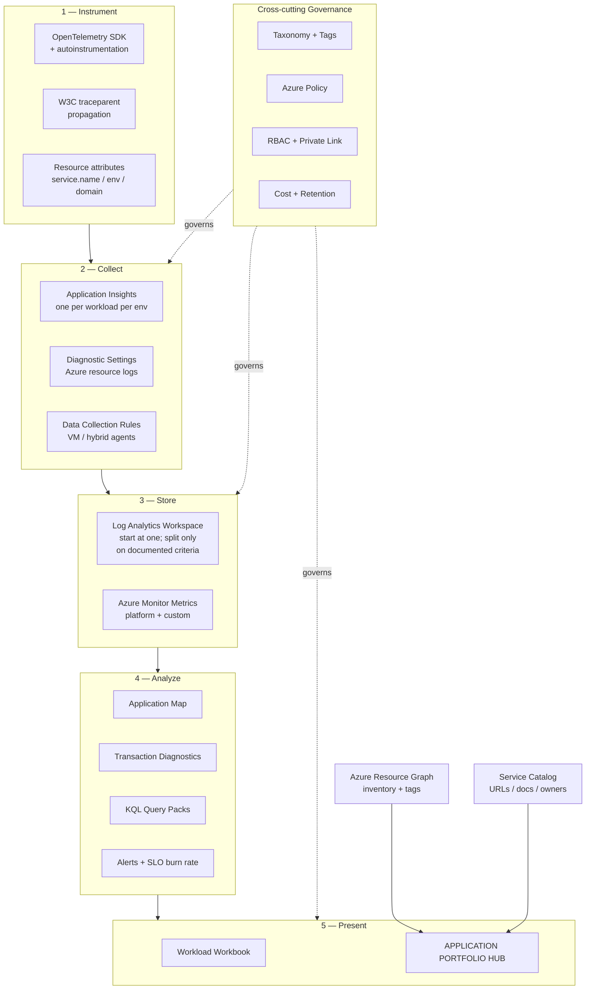

# Application Observability Architecture

A design-thinking reference architecture for maximizing the value of **Azure Application Insights** and **Azure Monitor Logs (Log Analytics)** across a multi-domain application estate — ending in a unified **Application Portfolio** view.

> **Status:** Design artifact. Technology-neutral. No assumptions about a specific codebase or existing Azure estate.

---

## The four questions this architecture answers

| Question | Answer | Detail |
|---|---|---|
| Multiple App Insights based on business domains? | **No — split by _workload_ per _environment_.** Domain is a *label*, not a resource boundary. | [02 — Resource Topology](./02-resource-topology.md) |
| Multiple Log Analytics, or a single shared one? | **Start from one, for the whole estate.** Microsoft's own guidance: *"your design should use the fewest number of workspaces to meet your requirements."* Split only against documented criteria — and note that a different Azure region is **not** one of them absent a residency need. | [02 — Resource Topology](./02-resource-topology.md) |
| How do I get end-to-end flows including database calls? | **OpenTelemetry + W3C trace context**, uniform `service.name`, sanitized DB dependency spans. | [03 — Telemetry Flow](./03-telemetry-flow.md) |
| Does Microsoft Fabric add value here? | **Yes — at the portfolio/analytics layer only.** It removes the Azure-RBAC ceiling for business audiences and enables blending with CMDB, cost, and DevOps data. It is an anti-pattern for diagnosis or alerting. | [10 — Fabric Integration](./10-fabric-integration.md) |

---

## Document map

| # | Document | What it covers |
|---|---|---|
| 01 | [Architecture Principles](./01-architecture-principles.md) | The 12 non-negotiable design principles and the tradeoffs behind them |
| 02 | [Resource Topology](./02-resource-topology.md) | App Insights and Log Analytics boundaries, decision trees, sizing |
| 03 | [Telemetry Flow](./03-telemetry-flow.md) | End-to-end distributed trace flows, correlation, database dependencies |
| 04 | [C# Instrumentation Guide](./04-csharp-instrumentation.md) | **Working C# code** — wiring end-to-end tracing across apps, APIs, databases, and queues |
| 05 | [Domain Model & Taxonomy](./05-domain-model.md) | Business domains, workloads, components, the metadata contract |
| 06 | [Application Portfolio](./06-application-portfolio.md) | The portfolio hub: inventory + health + links to apps, docs, runbooks |
| 07 | [Service Responsibilities](./07-service-responsibilities.md) | **What Azure gives you vs. what you must custom build** |
| 08 | [Implementation Roadmap](./08-implementation-roadmap.md) | Phased delivery plan, pilot criteria, maturity model |
| 09 | [Verification Log](./09-verification-log.md) | **Every claim checked against Microsoft docs** — corrections made and confidence levels |
| 10 | [Fabric Integration](./10-fabric-integration.md) | **Does Microsoft Fabric add value?** The two-speed architecture, three integration paths, constraints, and anti-patterns |

### Beyond the design docs

| Artifact | What it is |
|---|---|
| [`demo/`](./demo/README.md) | **A deployable, working demo of this architecture.** One resource group, 8 Application Insights resources, 1 Log Analytics workspace, and a synthetic telemetry simulator that produces real Application Maps, real end-to-end transactions including database calls, and a real portfolio Workbook — with no application services deployed. Includes a guided 10-stop tour. Costs approximately nothing and tears down with one command. |
| [`demo/simulator/ARCHITECTURE.md`](./demo/simulator/ARCHITECTURE.md) | **How the telemetry simulator works.** The build-then-emit trace model, one OTel pipeline per simulated service, how spans and logs are back-dated for a 24-hour backfill, the OpenTelemetry-attribute-to-Application-Insights-column mapping (verified against the live workspace), and how incidents are injected. |
| `deck/` | Customer-facing PowerPoint deck (`Application-Observability-Architecture.pptx`), generated from `build-deck.cjs`. **Not tracked in this repository** — it is a large binary with its own review cycle, and is kept alongside the working copy. Edit the generator script and re-run it rather than editing the `.pptx` by hand. |

---

## The big picture

---

## Architecture in one paragraph

Instrument every service with **OpenTelemetry** so a single request carries one `operation_Id` from browser to gateway to service to database to background worker. Land that telemetry in **one Application Insights resource per workload per environment** — small enough to keep Application Map readable, large enough that a whole user journey stays in one place. Point many Application Insights resources at **as few Log Analytics workspaces as your requirements allow — starting from one**, splitting only against documented criteria such as Entra tenant, data residency, legal-entity ownership, split billing, same-table retention, access control, or deliberate resilience. Above that, build one **Application Portfolio workbook** that joins **Azure Resource Graph** inventory with live telemetry, resource health, and a **curated service catalog** supplying the things Azure does not know: app URLs, internal documentation, runbooks, repositories, and business owners.

---

## What is Azure-native vs. custom build (summary)

| | Azure gives you | You must build |
|---|---|---|
| **Instrumentation** | OTel distros, autoinstrumentation, auto DB dependency capture | Trace propagation for custom protocols, redaction rules, business event schema |
| **Storage** | App Insights, Log Analytics, table plans, retention | Workspace topology decisions, table plan policy |
| **Analysis** | App Map, Transaction Diagnostics, Failures/Performance blades | KQL query pack, SLO definitions, burn-rate alert logic |
| **Presentation** | Workbooks engine, Resource Graph, link actions, merge control; Fabric/Power BI for non-RBAC audiences | **The portfolio workbook itself**, catalog sync, metadata quality reporting, **the semantic model and its measures** |
| **Governance** | Azure Policy, RBAC, Private Link, DCRs | Taxonomy, tag standard, onboarding scorecard, chargeback reporting |

Full breakdown: [07 — Service Responsibilities](./07-service-responsibilities.md) · Working code: [04 — C# Instrumentation Guide](./04-csharp-instrumentation.md)

---

## Primary Microsoft references

- [Architecture best practices for Application Insights](https://learn.microsoft.com/azure/well-architected/service-guides/application-insights)
- [Best practices for Azure Monitor Logs](https://learn.microsoft.com/azure/azure-monitor/best-practices-logs)
- [Create and configure workspace-based Application Insights resources](https://learn.microsoft.com/azure/azure-monitor/app/create-workspace-resource)
- [Dependency tracking in Application Insights](https://learn.microsoft.com/azure/azure-monitor/app/dependencies)
- [Azure Workbooks data sources](https://learn.microsoft.com/azure/azure-monitor/visualize/workbooks-data-sources)
- [Azure Workbooks link actions](https://learn.microsoft.com/azure/azure-monitor/visualize/workbooks-link-actions)
- [Query across multiple workspaces and apps](https://learn.microsoft.com/azure/azure-monitor/logs/cross-workspace-query)
