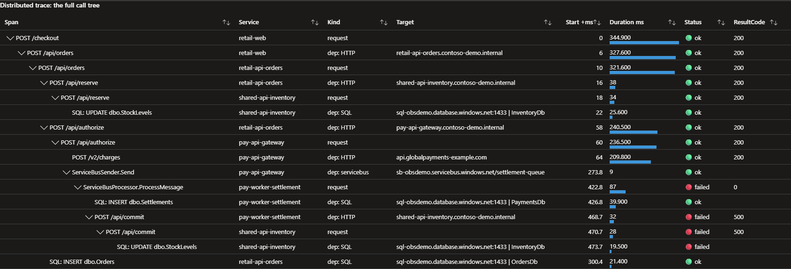
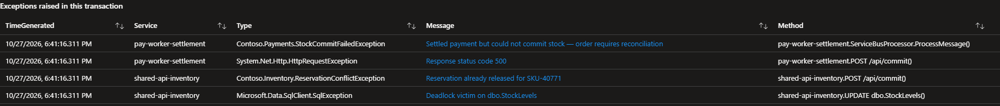

# Demo: eight simulated apps on a real Azure platform

The demo brings the starter to life without running a single real service. Eight apps are registered, each with its own tagged Application Insights resource. One console process, the simulator, emits the telemetry those apps would produce: correlated traces, database and queue calls, logs, exceptions, and three injected incidents.

| | |
|---|---|
| **Workloads** | Eight simulated app identities; no real workload services, databases, or queues |
| **Telemetry volume** | A default backfill produces roughly 12,000 spans; the exact count depends on the run |
| **Platform cost** | The catalog's App Service, SQL database, and private endpoint are real, billable resources. See [cost and clean-up](../README.md#cost-and-clean-up) |
| **Clean up** | `./teardown.sh` from the repository root |

The OpenTelemetry SDK, Azure Monitor exporter, ingestion pipeline, and visualization are real. The workload events, timings, errors, and propagation are authored in one process. This demonstrates how correctly shaped telemetry is assembled; it does not test real HTTP, database, or broker integrations.

| File | What it is |
|---|---|
| [`apps.bicep`](apps.bicep) | The eight apps and their `domain`, `criticality`, and `owner` tags |
| [`catalog-seed.json`](catalog-seed.json) | Their business context, loaded into the catalog |
| [`setup.sh`](setup.sh) | Registers the apps, writes `demo/.env`, loads the catalog. `deploy.sh` runs it |
| [`simulator/`](simulator/) | The .NET telemetry generator. See [how it works](simulator/ARCHITECTURE.md) |

## Run it

Use Bash at the repository root after the [quick-start setup](../README.md#quick-start), including the selected subscription and exported `RG` and `LOCATION`:

```bash
./deploy.sh
```

This deploys the platform, then runs `demo/setup.sh`. That registers the eight apps, writes their connection strings to `demo/.env` (gitignored), and loads `catalog-seed.json` into the catalog.

The generated environment file belongs to the most recent demo setup in this checkout. Changing `RG` in a shell does not change those connection strings. Before switching environments, run setup for the intended group or use a separate checkout.

> [!WARNING]
> The simulator intentionally emits failures. Azure can create [Failure Anomalies](https://learn.microsoft.com/azure/azure-monitor/alerts/proactive-failure-diagnostics) rules and attach a subscription's existing Smart Detection action group. Review or disable the demo resources' rules before sending synthetic failures in a shared subscription; default notifications can reach Monitoring Reader and Monitoring Contributor role members.

Generate 24 hours of history:

```bash
(cd demo/simulator && dotnet run -c Release -- --backfill-hours 24)
```

The subshell leaves you at the repository root. Allow for ingestion after the simulator exits; Application Map also needs time to discover components. The simulator prints the generated counts, not a guarantee that every row has already become queryable.

Application Insights ingestion rejects telemetry older than 48 hours, so the simulator refuses more than 47.

To send current-time telemetry without another historical backfill, use live mode in a second Bash terminal at the repository root:

```bash
(cd demo/simulator && dotnet run -c Release -- --backfill-hours 0 --live)
```

Live-mode telemetry is retained normally. Stop with Ctrl+C. This is different from the **Live Metrics** collector; see [stop 10](#10-watch-it-live).

### Check it worked

In **Logs** on the workspace that `deploy.sh` created, run:

```kusto
union AppRequests, AppDependencies, AppTraces, AppExceptions
| where TimeGenerated > ago(26h)
| summarize Rows = count(), Apps = dcount(AppRoleName) by Type
```

You should see all four tables. `AppRequests` and `AppDependencies` cover all eight apps; fewer apps appear in `AppTraces` and `AppExceptions` because not every app logs warnings or throws.

In the deployed catalog, verify that the graph has the expected service nodes, tags, catalog entries, and no data-source warning banner. `GET /api/health` proves the process is responding and reports settings presence; it does not test access to SQL, Resource Graph, or telemetry. Check the graph and `GET /api/catalog` as well. Use the URL printed by deployment.

| Symptom | Check before changing anything | Possible next step |
|---|---|---|
| No rows | Simulator exit/errors and its `config:` path; destination workspace; query time range; ingestion delay and workspace cap | Correct the target or settings, allow for ingestion, then retry the query. A full redeploy is not the first diagnostic step |
| Fewer than eight apps | Missing-connection-string errors and whether all eight settings came from the intended demo deployment | From the root with the correct exported `RG`, re-run `./demo/setup.sh`, then the simulator |
| Application Map is sparse | Whether the request/dependency rows are queryable and the range includes them | Allow component discovery, refresh, or widen the range |
| Everything is Healthy | Selected incident window, request failure rate, and P95 separately | Follow [stop 1](#1-find-the-incidents); latency alone does not change a failure-rate label |
| Apps are untagged | Actual Azure tags, workbook viewer access, catalog managed-identity access, and any query errors | Follow [tag-reading limits and permissions](../docs/03-catalog-and-workbook.md#how-the-workbook-reads-tags) |
| Catalog warning or failed catalog reads | SQL settings, private network/DNS reachability, and SQL authorization | Check the deployed app's logs. A laptop without private access can still develop the graph, as described in [local development](../standalone-catalog-graph/README.md#local-development) |

## Simulator options

| Option | Default | Effect |
|---|---|---|
| `--backfill-hours N` | `24` | Hours of history ending now. Maximum 47. `0` skips the backfill |
| `--traces-per-hour N` | `60` | Backfill density |
| `--live` | off | Keep sending in real time after the backfill, until Ctrl+C |
| `--live-minutes N` | unlimited | Stop live mode after N minutes. Implies `--live` |
| `--live-rate N` | `60` | Live traces per minute. Implies `--live` |
| `--seed N` | `1337` | Random seed, for repeatable runs |
| `--dry-run` | off | Build every trace and print the summary without sending anything |

Unknown options are rejected rather than ignored. Incident windows are relative to the backfill run's reference time. A window shorter than 4.5 hours misses the historical incidents; one between 4.5 and 6 hours overlaps part of the inventory incident. Live mode chooses degraded scenarios independently, so its observed failure rate varies.

## The demo flows

| Flow | Share | Path |
|---|---|---|
| **checkout** | 45% | `retail-web` → `retail-api-orders`; orders calls inventory and payments. Payments calls an external processor and publishes to Service Bus; settlement processes the message and calls inventory again. SQL calls are leaves on the issuing apps |
| **browse-catalog** | 35% | `retail-web` → `retail-api-catalog`; the catalog API makes separate Redis and SQL calls |
| **update-profile** | 20% | `retail-web` → `cust-api-profile`; profile calls Cosmos DB and publishes to Service Bus. `cust-worker-notify` processes the message and calls an external email API |

`shared-api-inventory` is the one to watch. Retail calls it during checkout, and Payments calls it again after settlement, so when it fails, two domains feel it.

## Guided tour

Keep the backfill's run time in mind when choosing ranges: the injected windows age as time passes. Stops 1–6 explain cross-app traces and logs, stops 7–8 connect those observations to the workbook and catalog, and stops 9–10 cover registration and ongoing traffic.

### 1. Find the incidents

Everything interesting happens inside three injected incidents. Find them first:

```kusto
AppRequests
| where TimeGenerated > ago(26h)
| summarize Requests = count(), Failures = countif(Success == false), P95 = round(percentile(DurationMs, 95), 0)
    by bin(TimeGenerated, 1h), AppRoleName
| where Failures > 0 or P95 > 1500
| order by TimeGenerated asc
```

| Incident | Relative to the backfill run | Signature |
|---|---|---|
| Catalog SQL timeouts | 17 to 18 hours ago | `retail-api-catalog` failing, P95 climbing |
| Payment latency | 10 to 12 hours ago | `pay-api-gateway` P95 of 2 to 3 seconds, with **no** failures |
| Inventory failures | 4.5 to 6 hours ago | `shared-api-inventory` failing, in two domains |

The payment incident has no failures at all. An app can be up by every availability measure and still ruin the customer's experience.

### 2. One map, eight resources

Open the `appi-retail-web` resource, then **Application Map**. It draws apps you didn't open, because every one of them is in the same transactions. Databases and queues are nodes too, and two external APIs appear with no server side: that's exactly where instrumentation stops.

Set the time range to the inventory incident. Look for failures on `shared-api-inventory` and calls from both Retail and Payments; portal coloring depends on the chosen range and view.

### 3. One transaction, five resources

From the map, select `shared-api-inventory`, then **Investigate failures**, and choose a failed **`POST /api/commit`** operation. Alternatively, select a failed **`pay-worker-settlement`** processing request in the workbook's **Transactions** tab. These failures happen after the reservation succeeds, so their transaction includes the web app, orders, inventory, payments, and the settlement worker.

A failed **`POST /api/reserve`** is a different, shorter outcome: checkout stops before payment and settlement. That is expected, not missing telemetry.

Each span exists once, in the resource of the app that produced it. `POST /api/reserve` appears as both the caller's dependency and the callee's request: two spans for the two ends of one call, not duplicate ingestion. [End-to-end correlation](../docs/02-end-to-end-correlation.md#5-read-a-transaction-back) has the query that lists every row with its resource.



*This checkout succeeds at the web tier before a later settlement failure. Horizontal and vertical scrolling captures preserve every column and all sixteen spans, including timings, failures, and result codes. Column widths were expanded locally for readability; the saved workbook and telemetry were not changed.*

[Open the full-size transaction image](../docs/images/azure-workbook-transactions.png).



*The same transaction connects the settlement error to the failed inventory commit and SQL deadlock details.* [Open the full-size exception image](../docs/images/azure-workbook-transaction-exceptions.png).

### 4. From failure to root cause

Set the range to the catalog SQL incident. In `appi-retail-api-catalog`, open **Failures**, then **Dependencies**. The failing SQL calls carry result code `-2`, SQL Server's timeout. Deadlocks in the inventory incident carry `1205`. The exception on the request and the failing statement under it are in the same transaction.

### 5. Latency without failure

Set the range to the payment incident. In `appi-pay-api-gateway`, open **Performance**. `POST /api/authorize` sits at 2 to 3 seconds, and almost all of it is the external `POST /v2/charges` call. You can see that you're slow and where, but the fix is somebody else's. The slowness also propagates upstream, so three apps look guilty and only one is.

### 6. Logs in the transaction

```kusto
AppTraces
| where TimeGenerated > ago(26h) and SeverityLevel >= 2
| project TimeGenerated, AppRoleName, SeverityLevel, Message, OperationId
| order by TimeGenerated desc
| take 50
```

Every log line carries its transaction's `OperationId`. In the inventory incident, `shared-api-inventory` logs a deadlock and `retail-api-orders` logs that it's abandoning the checkout: different apps, different resources, one story. `pay-worker-settlement` logs *"Stock commit failed ... after settlement"*, a failure that happens after the customer already got a success response.

### 7. The portfolio workbook

Open the **Workbook** link from `deploy.sh`, or **Monitor** > **Workbooks** > **Application Portfolio**.

- **Portfolio** starts as one row per domain. Expand a domain to see its apps, each with **Open in catalog** and **App Insights** links.
- **Estate map** draws every app and backing service. Select **Payments** in the Domain filter: the map keeps Payments in color and everything one hop away, including the Retail caller of inventory, in gray.
- **Transactions** lists every failed request. Select a Payments failure, and the call tree still resolves all the way back to `retail-web`.
- **Metadata quality** compares registrations with telemetry. Everything is green until you do stop 9.

The domains and owners on every tab come from the deployed resources' Azure tags, initially set by [`apps.bicep`](apps.bicep). Nothing about the demo apps is defined in the workbook.

### 8. The catalog app

Open the **Catalog app** link. The graph is the same estate, drawn from the same topology query.

- **Overview** starts with domain/owner summaries, sortable apps and attention findings. Compare settlement's observed request-success percentage with its target; this comparison is separate from failure-rate health.
- Open **Graph**: domains start collapsed. Expand Platform, then select `shared-api-inventory`. Its card includes the description, owners, target, on-call, observation timestamps, previous-period latency, and operational links.
- Choose **Upstream consumers** to highlight potential exposure across domains. Select a connection to inspect calls, failures, duration, protocol, and whether the relationship is matched or inferred.
- Choose **Applications** for the full estate, or **Resources** to distinguish telemetry destinations from hosting. The eight simulated apps have no real workload hosts and say so.
- Select settlement and open a failed transaction example. The overlay and timeline retain all observed spans, including successful checkout and the later failed commit; exceptions and warning/error logs retain their span context.
- Choose **Edit catalog entry**, change the request-success target, and save. The app reloads the same authoritative catalog value; the workbook never stored it.
- From the workbook's Portfolio tab, choose **Open in catalog** on any app. It opens the catalog with that app selected.

The target measures observed request/processing success in the selected window, not uptime or an error budget. Saving it does not change the separate failure-rate health colors or configure an alert. The default backfill has no preceding seven-day baseline, so a seven-day comparison correctly shows Insufficient history.

### 9. Register an app yourself

From the repository root, using the same subscription and exported `RG` as the platform:

```bash
./add-app.sh demo-billing-api --domain Finance --criticality tier2 --owner finance-team
```

After Resource Graph reflects the registration, refresh **Metadata quality** to find `appi-demo-billing-api` with no telemetry, and **Finance** in the Domain filter. Point an instrumented real app at the printed settings and send requests or processing spans to join the graph. To remove just this registration:

```bash
az resource delete -g "$RG" -n appi-demo-billing-api \
  --resource-type Microsoft.Insights/components
```

This does not erase retained telemetry or remove a catalog entry you added. Remove that entry in the catalog UI, and check for a separately retained Failure Anomalies rule for the removed resource.

### 10. Watch it live

Run live mode as described above, then choose a recent range in Application Map or the workbook. In the catalog, select **Last 1h** and choose **Refresh** after ingestion. Newly emitted requests, failures, and logs become visible without another historical backfill.

**Live mode is not Live Metrics.** This simulator configures trace and log exporters only; it does not configure the separate Application Insights Live Metrics collector. A real app with supported distro instrumentation can use that feature. The workbook and catalog remain log-query views, with ingestion delay and explicit refresh rather than instant streaming.

## Gotchas

| Gotcha | Why it matters |
|---|---|
| The exporter samples by default: rate-limited at five traces per second | A fast backfill would lose most of its traces. The simulator sets `TracesPerSecond = null` and an always-on sampler, in that order |
| Exporter 1.9 and later save telemetry still queued at shutdown and upload it on a later run | The simulator turns that off so a single run delivers everything |
| Ingestion rejects telemetry older than 48 hours | The backfill stops at 47 |
| Pre-aggregated metrics accept only about 20 minutes of back-dating | Backfilled dashboards must query log tables. Every tile in the workbook does |
| Disposing `ILoggerFactory` is the only way to flush logs | Do it only at shutdown, or logging silently stops |
| A root request's `ParentId` is its `OperationId`, not empty | Tree views must treat it as top-level |
| `_ItemId` and `_ResourceId` don't appear in `getschema` | Both can still be selected and joined |
| Azure can create Failure Anomalies rules for Application Insights resources | Review notifications before emitting synthetic failures; see the [warning before running the simulator](#run-it) |

## Clean up

From the repository root, after confirming the subscription and the same exported `RG`:

```bash
./teardown.sh
```

This removes the **whole platform group**, not just the demo, and force-deletes its workspace data. Review the [cleanup boundary](../README.md#cost-and-clean-up) first.
