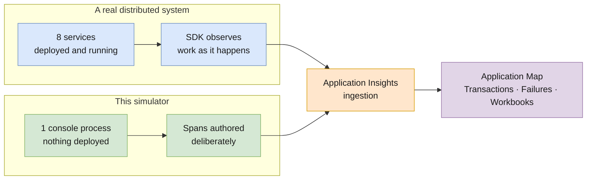
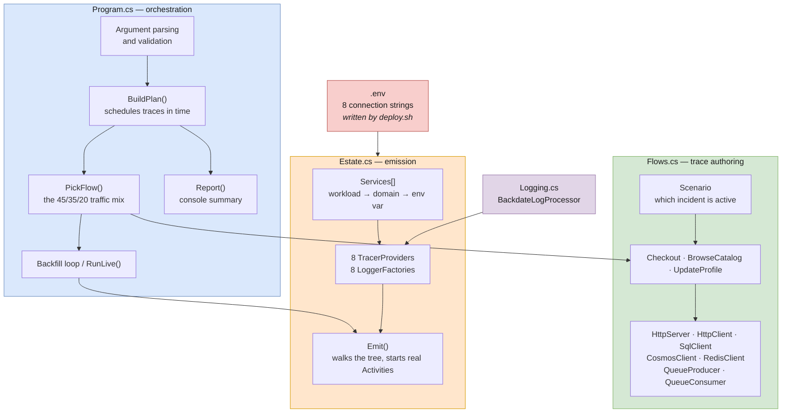
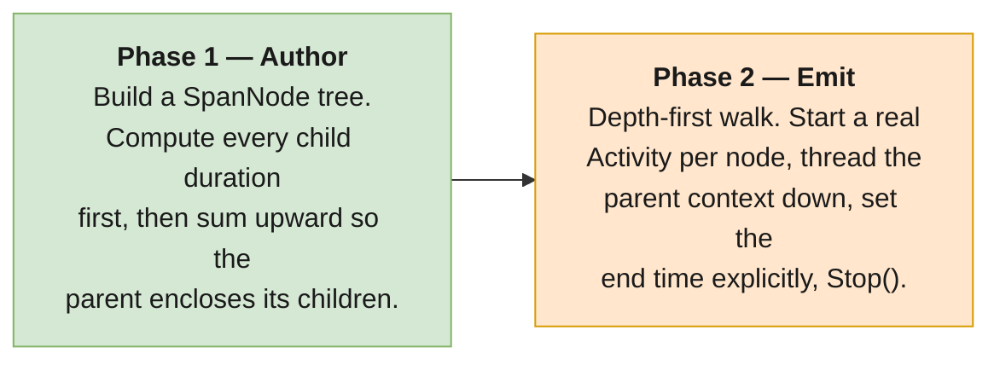
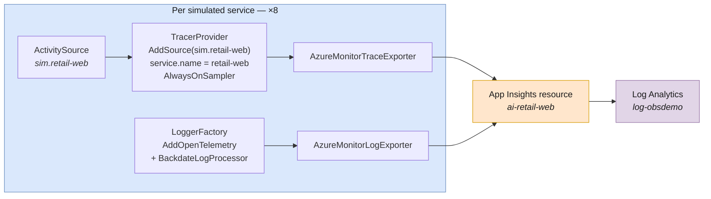
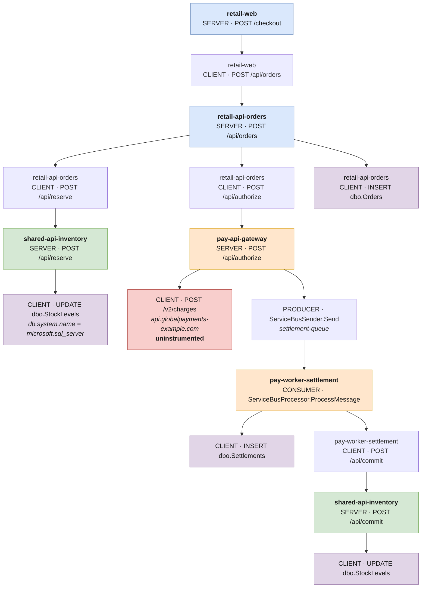
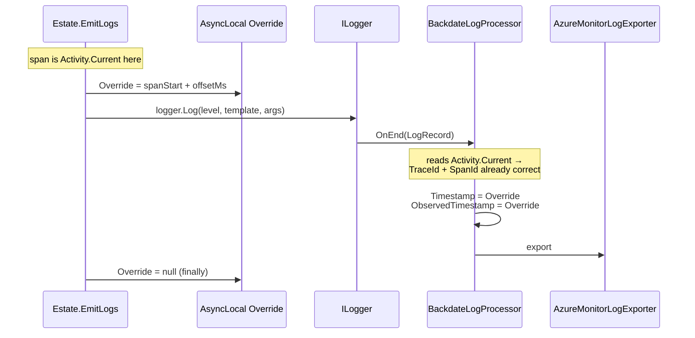
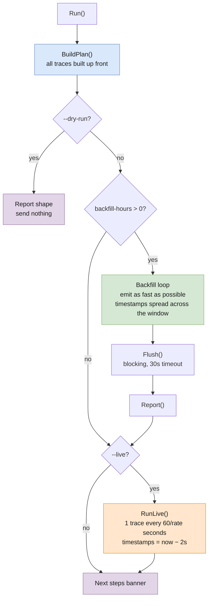
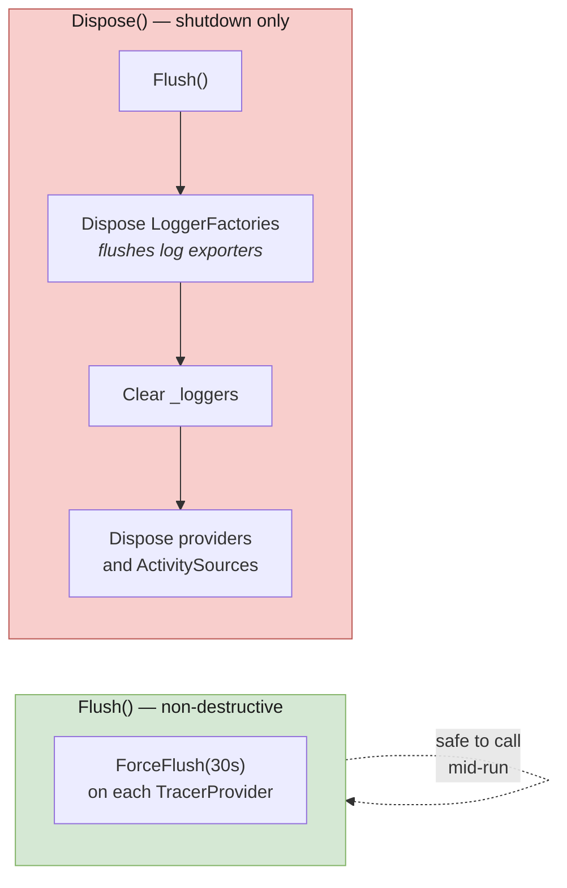

# Simulator Architecture

How the synthetic telemetry generator is built, and how a span travels from a C# object
to a row in a Log Analytics table.

> **This is not an instrumentation reference.** The simulator does the opposite of what a real
> application does: a real app is instrumented *incidentally* while doing work, whereas this
> program does no work and emits telemetry *deliberately*. For how to instrument a real service,
> see [`04-csharp-instrumentation.md`](../../04-csharp-instrumentation.md). For how to *run* the
> demo, see [`demo/README.md`](../README.md).

**Contents**

| Section | What it covers |
|---|---|
| [1. The central bet](#1-the-central-bet) | Why synthetic telemetry is indistinguishable from real telemetry |
| [2. Component map](#2-component-map) | The four source files and what each owns |
| [3. Build first, emit second](#3-build-first-emit-second) | The single most important design decision |
| [4. End-to-end data flow](#4-end-to-end-data-flow) | Config → plan → tree → SDK → ingestion → tables |
| [5. Pipeline isolation](#5-pipeline-isolation-one-provider-per-service) | Why there are eight of everything |
| [6. Anatomy of a trace](#6-anatomy-of-a-trace-checkout) | The checkout span tree |
| [7. Back-dating](#7-back-dating-the-hard-part) | Two different mechanisms, and why |
| [8. Attribute mapping](#8-attribute-mapping-otel--application-insights) | OTel attributes → App Insights columns |
| [9. Scenario injection](#9-scenario-injection) | How incidents are placed in time |
| [10. Backfill vs live mode](#10-backfill-vs-live-mode) | Two loops, one traffic mix |
| [11. Lifecycle and flushing](#11-lifecycle-and-flushing) | Flush vs Dispose, and the bug that taught us |
| [12. Constraints](#12-constraints-that-shape-the-design) | The limits the design is built around |
| [13. Extending it](#13-extending-it) | Adding a service, flow, or incident |

---

## 1. The central bet

Application Map, transaction diagnostics, the failure blade and the performance blade are all
**derived from telemetry**. They read `cloud_RoleName`, `operation_Id`, parent/child span
relationships and dependency attributes. None of them inspects Azure Resource Manager to ask
whether a service actually exists.

So the bet is:

> If the telemetry is correctly shaped and correctly correlated, Azure cannot tell the
> difference between a synthetic estate and a real one.

That bet is what makes the demo nearly free. There is no App Service, no AKS, no SQL Database,
no Service Bus namespace — only eight metadata-only Application Insights resources, one Log
Analytics workspace, and this console app.



The one thing the simulator cannot fake is anything Azure derives from the *resource* rather
than from telemetry — Live Metrics needs a live process (which is why `--live` exists), and
Profiler and Snapshot Debugger need a real runtime. Everything else behaves identically.

---

## 2. Component map

Four files, each with one job.



| File | Owns | Deliberately does **not** own |
|---|---|---|
| `Program.cs` | CLI, scheduling traces across the window, traffic mix, the two run loops, console reporting | Anything about span shape or OTel wiring |
| `Flows.cs` | What a trace *looks like* — services, timings, attributes, failures. All semantic-convention decisions live here | Anything about how spans are sent |
| `Estate.cs` | The service roster and one isolated OTel pipeline per service; walking a tree into real `Activity` objects | Anything about what a trace means |
| `Logging.cs` | Back-dating log records on their way out | Everything else |

The seam between `Flows.cs` and `Estate.cs` is the important one: **flows produce a plain data
tree with no OpenTelemetry types in it beyond `ActivityKind`.** You can unit-test, print or
reshape a trace without an exporter, a connection string, or a network call. `--dry-run` exists
precisely because of this split.

---

## 3. Build first, emit second

A real application's spans are produced by *executing* — a span starts when work starts and ends
when work ends, so a parent naturally outlives its children. A generator has no work to execute,
so it has to arrange that relationship by hand.

The simulator therefore separates **authoring** from **emission**:



You can see the upward summing in `Flows.Checkout`: leaf durations are computed first, then

```
settleDur  = settleSqlDur + commitSvcDur + jitter
payDur     = payExtDur + payProdDur + jitter
ordersDur  = invSvcDur + payDur + orderSqlDur + jitter
webDur     = ordersDur + jitter
```

If this were done top-down, a child would routinely end after its parent and the Gantt view in
transaction diagnostics would render nonsense.

`SpanNode` is a deliberately dumb container — service, name, kind, start, end, attributes,
failure state, children, logs. Its fluent helpers (`Add`, `Tag`, `Log`) return the right node so
a whole trace reads as nested structure rather than a pile of local variables.

---

## 4. End-to-end data flow

A single trace, from configuration to a queryable row:

```mermaid
flowchart TD
    A["<b>deploy.sh</b><br/>creates 8 App Insights resources<br/>writes .env"]
    B["<b>LoadEnv()</b><br/>reads .env; real env vars win"]
    C["<b>BuildPlan()</b><br/>hours × tracesPerHour, jittered,<br/>with a day/night traffic shape"]
    D["<b>Scenario.At()</b><br/>is this timestamp inside<br/>an incident window?"]
    E["<b>PickFlow()</b><br/>45% checkout<br/>35% browse-catalog<br/>20% update-profile"]
    F["<b>Flows.*</b><br/>returns a SpanNode tree with<br/>OTel semantic attributes"]
    G["<b>Estate.Emit()</b><br/>depth-first; ActivitySource.StartActivity<br/>with explicit startTime + parent context"]
    H["<b>OpenTelemetry SDK</b><br/>AlwaysOnSampler<br/>BatchActivityExportProcessor"]
    I["<b>AzureMonitorTraceExporter</b><br/>maps spans to the AI wire format"]
    J["<b>Ingestion endpoint</b><br/>per-resource connection string"]
    K["<b>Log Analytics workspace</b><br/>AppRequests · AppDependencies<br/>AppExceptions · AppTraces"]
    L["<b>Portal experiences</b><br/>App Map · Transactions · Failures<br/>Performance · Workbooks"]

    A --> B --> C --> D --> E --> F --> G --> H --> I --> J --> K --> L

    style A fill:#f8cecc,stroke:#b85450,color:#1a1a1a
    style C fill:#dae8fc,stroke:#6c8ebf,color:#1a1a1a
    style D fill:#dae8fc,stroke:#6c8ebf,color:#1a1a1a
    style E fill:#dae8fc,stroke:#6c8ebf,color:#1a1a1a
    style F fill:#d5e8d4,stroke:#82b366,color:#1a1a1a
    style G fill:#ffe6cc,stroke:#d79b00,color:#1a1a1a
    style H fill:#ffe6cc,stroke:#d79b00,color:#1a1a1a
    style I fill:#ffe6cc,stroke:#d79b00,color:#1a1a1a
    style K fill:#e1d5e7,stroke:#9673a6,color:#1a1a1a
    style L fill:#e1d5e7,stroke:#9673a6,color:#1a1a1a
```



**Where the correlation actually happens.** `Emit` is recursive, and the only state it threads
down is `ActivityContext`:

```csharp
var activity = source.StartActivity(node.Name, node.Kind, parentContext, tags, ...);
var childContext = activity.Context;
foreach (var child in node.Children)
    count += EmitNode(child, childContext);
```

Because the child's `ActivitySource` belongs to a *different* service with a *different*
exporter and a *different* connection string, this one line is what produces a trace that spans
eight Application Insights resources. The `traceId` is inherited; the `parentSpanId` points at a
span that was written to a different resource entirely. Transaction diagnostics reassembles it
at query time.

---

## 5. Pipeline isolation: one provider per service

Each simulated workload gets its own `ActivitySource`, its own `TracerProvider`, its own
`ILoggerFactory`, and its own connection string. Nothing is shared.



Two things make this work, and both are easy to get wrong:

**`service.name` becomes `cloud_RoleName`.** Set via `ResourceBuilder.AddService(serviceName:)`.
Without it, every node collapses into one and Application Map does not function. It is the single
most important field the simulator produces.

**`AddSource` scopes each provider to exactly one source.** If a provider subscribed to all
sources, every service's spans would be exported to every resource — eight copies of everything,
with the wrong role names. The `sim.` prefix on source names keeps them from colliding with any
real instrumentation running in the same process.

### The sampling trap

```csharp
.AddAzureMonitorTraceExporter(o =>
{
    o.ConnectionString = cs;
    o.TracesPerSecond  = null;   // exporter 1.8.x defaults to rate-limited sampling at 5/sec
    o.SamplingRatio    = 1.0f;
})
.SetSampler(new AlwaysOnSampler())   // AFTER the exporter, so this is the one that survives
```

`AddAzureMonitorTraceExporter` **installs its own sampler** and defaults to rate-limited sampling
at five traces per second. A backfill emits thousands of traces as fast as the loop runs, so
leaving the defaults in place silently discards most of the telemetry — the run reports success
and the portal shows a fraction of it. Both the exporter options *and* the explicit
`SetSampler` call after it are required; order matters.

---

## 6. Anatomy of a trace: checkout

The flagship flow. One trace, three business domains, two databases, a queue hop, and an
uninstrumented third party.



Four things are modelled on purpose:

**Client/server pairs.** Every cross-service hop is *two* spans — a `Client` span owned by the
caller and a `Server` span owned by the callee. That is what real HTTP instrumentation produces,
and it is what lets Application Map show a directed edge with latency measured from both sides.

**Database calls are leaves.** A SQL span hangs off the service that issued it. The database is
never an intermediate hop, because a database does not call anything back. (An earlier draft of
the customer deck got this wrong and had to be corrected.)

**The third party has no server side.** `api.globalpayments-example.com` gets a `Client` span and
nothing else. It renders on the map as an observed node with no server telemetry — showing
exactly where your instrumentation ends. That is a teaching point, not an omission.

**The shared service is called from two domains.** `shared-api-inventory` is hit once by
`retail-api-orders` (reserve) and again by `pay-worker-settlement` (commit). When it degrades,
the blast radius appears in Retail *and* Payments simultaneously — which is the entire argument
for treating domain as a tag rather than a resource boundary.

Note that the commit-side failure is drawn **independently** of the reserve-side failure: a flaky
service fails per call, not per trace. And it lands *after* the customer already received their
`200`, which is precisely why async worker failures are so easy to miss.

---

## 7. Back-dating: the hard part

Backfilling 24 hours of history means every span and every log line must carry a timestamp in the
past. Traces and logs need completely different mechanisms.

### Traces — explicit start and end

```csharp
source.StartActivity(name, kind, parentContext, tags, links: null,
                     startTime: new DateTimeOffset(node.StartUtc, TimeSpan.Zero));
// ... children emitted here ...
activity.SetEndTime(node.EndUtc);
activity.Stop();
```

`StartActivity` accepts an explicit `startTime`. The end is subtler: **`Stop()` only computes a
duration from the wall clock when `Duration` is still zero.** Calling `SetEndTime` first means
`Stop()` leaves it alone. Reverse the order and every span gets a real-time duration of
approximately zero.

### Logs — a processor, because the API is internal

The OpenTelemetry SDK stamps `LogRecord.Timestamp` at emit time. The Logs Bridge API
(`LoggerProvider.GetLogger` / `Logger.Emit`), which *would* let a caller supply its own
timestamp, is still `internal` in the stable package. A `BaseProcessor<LogRecord>` is therefore
the only way to back-date a log record through public, stable API — and `LogRecord.Timestamp` is
publicly settable precisely so that processors can enrich records like this.



Two details worth noting:

- The override is an `AsyncLocal<DateTime?>` set immediately before the log call and cleared in a
  `finally`. It is a scoped hand-off to the processor, not ambient state.
- **Trace correlation needs no help at all.** The OpenTelemetry `ILogger` provider reads
  `Activity.Current`, and `EmitLogs` runs while the synthetic span is current — so `TraceId` and
  `SpanId` are already right. This is what makes Stop 5 of the guided tour work: click a trace,
  see its log lines.

---

## 8. Attribute mapping: OTel → Application Insights

`Flows.cs` follows **current stable OpenTelemetry semantic conventions**, and span names follow
what today's Azure and OTel .NET instrumentation libraries actually emit. The goal is that the
resulting rows are indistinguishable from a real .NET app built with current SDKs.

| Span shape | Key attributes | Lands in | `DependencyType` |
|---|---|---|---|
| `Server` HTTP | `http.request.method`, `url.path`, `http.route`, `http.response.status_code` | `AppRequests` | — |
| `Consumer` queue | `messaging.system`, `messaging.operation.type = process` | `AppRequests` | — |
| `Client` HTTP | `http.request.method`, `url.full`, `server.address` | `AppDependencies` | `HTTP` |
| SQL | `db.system.name = microsoft.sql_server`, `db.namespace`, `db.query.text`, `db.operation.name`, `db.collection.name` | `AppDependencies` | `SQL` |
| Redis | `db.system.name = redis` | `AppDependencies` | `redis` |
| Cosmos DB | `db.system.name = cosmosdb`, `az.namespace = Microsoft.DocumentDB` | `AppDependencies` | `cosmosdb` |
| `Producer` queue | `messaging.system = servicebus`, `az.namespace = Microsoft.ServiceBus`, `messaging.destination.name` | `AppDependencies` | `servicebus` |
| Exception event | `exception.type`, `exception.message`, `exception.stacktrace` | `AppExceptions` | — |
| `ILogger` call | template + args, `TraceId`/`SpanId` from `Activity.Current` | `AppTraces` | — |
| `service.name` | resource attribute | every table | `AppRoleName` |

> **Span kind decides the table, not the protocol.** `ActivityKind.Server` and
> `ActivityKind.Consumer` both become `AppRequests`; `Client` and `Producer` both become
> `AppDependencies`. This is why the queue hop works: `pay-api-gateway` records a *dependency* on
> `settlement-queue`, and `pay-worker-settlement` records a *request* named
> `ServiceBusProcessor.ProcessMessage` — the same shape a real consumer produces.

The values above are not inferred from documentation — they were read back out of the demo
workspace with `AppDependencies | summarize by DependencyType, Target`. Note that `redis` and
`servicebus` arrive **lowercase**, exactly as the attribute was written, because the exporter
passes systems it does not specially recognise through verbatim.

Four modelling decisions deserve their own note.

**SQL text is captured and sanitized.** `OpenTelemetry.Instrumentation.SqlClient` 1.12.0-beta.3+
removed `SetDbStatementForText`, so `db.query.text` is now *always* captured — a modern app does
populate `Data` for SQL dependencies. Since 1.11.0-beta.1 the captured text is also sanitized,
with literal values replaced by `?`. The simulator's statements are valid and parameterized, so
the demo *models* the redaction rule from [`03-telemetry-flow.md`](../../03-telemetry-flow.md)
rather than violating it.

**Cosmos DB deliberately diverges from the spec.** The current OTel registry value is
`azure.cosmosdb`, but the Cosmos .NET SDK has not adopted it, and the exporter passes unknown db
systems through verbatim. Emitting the spec value would produce a `DependencyType` that appears
in no real production app's data today. Since this simulator exists to mirror what a real
deployment produces, it follows the SDK and emits `cosmosdb`. This is the only intentional
divergence in *attribute values*, and it is commented as such in `Flows.cs`.

**Service Bus span names follow the SDK, not the convention.** `Azure.Messaging.ServiceBus` names
its spans after the client operation (`ServiceBusSender.Send`), not the generic
`{destination} {operation}` pattern. The exporter copies `DisplayName` verbatim into
`AppDependencies.Name` for messaging spans, so this is exactly the string a real app shows.

**Queue correlation is modelled as parent-child.** This is a divergence in *behaviour* rather
than in attribute values, and it is the one place where the simulator shows you the destination
rather than the default. The real `Azure.Messaging.ServiceBus` SDK uses span **links** and starts
a new trace on the consumer side, so producer and consumer land in two separate traces. The
simulator instead nests the consumer under the producer, which is the outcome you get after
following the manual context-propagation guidance in
[`04-csharp-instrumentation.md`](../../04-csharp-instrumentation.md) — and it is what makes a
single `operation_Id` span the whole checkout, worker included.

> **A note on `AppDependencies.Name`.** Azure Monitor's OTel exporter prepends `SQL: ` to the name
> when it classifies a dependency as `DependencyType` `SQL`. A span named `INSERT dbo.Orders`
> becomes `SQL: INSERT dbo.Orders` in the table. This is current exporter behaviour, not a legacy
> SDK artifact — expect it when writing KQL against these rows.

---

## 9. Scenario injection

A perfectly healthy estate is a dull demo: the map never goes red and the Failures blade stays
empty. `Scenario` is a three-flag record that flows down into every builder in `Flows.cs`.

During backfill, incidents are **fixed windows relative to now**, so the guided tour can tell you
exactly where to click:

```
            24h ago                                                  now
            |________________________________________________________|
Retail      ..............###.........................................
Payments    .............................#####........................
Platform    ............................................###...........
            |             |              |              |            |
            24h           18h            12h            6h         now
```

| Scenario | Window | Realised effect | What it teaches |
|---|---|---|---|
| `InventoryFailing` | 6h → 4.5h ago | 25% of reserve calls *and* 25% of commit calls fail, independently | Blast radius of a shared service across two domains |
| `PaymentSlow` | 12h → 10h ago | External processor call stretches from ~180 ms to ~2400 ms | Latency without failure; the performance blade |
| `CatalogSqlTimeouts` | 18h → 17h ago | 30% of catalog SQL calls time out at ~1800 ms | Drilling from a failed request to the exact statement |

`Scenario.At(now, point)` is a pure function of the timestamp, so the same window produces the
same incidents on every run. `--seed` (default `1337`) makes the *within*-window coin flips
reproducible too.

In live mode there are no fixed windows — roughly 25% of traces are drawn into a randomly chosen
degraded scenario. Because the failure is then drawn *again* inside the flow, the realised failure
rate is lower than 25%: about 6–8%, which matches the backfill.

Traffic is also shaped so the charts do not look synthetic: `BuildPlan` drops ~45% of traces
outside a 09:00–21:00 busy window, producing a visible day/night curve.

---

## 10. Backfill vs live mode

Two loops, one shared traffic mix. `PickFlow` is called by both, which is what keeps them from
drifting apart.



| | Backfill | Live |
|---|---|---|
| Timestamps | Spread across the requested window | `UtcNow − 2s`, so the span has "finished" when sent |
| Rate | As fast as the loop runs | `--live-rate` traces per **minute** (default 60) |
| Incidents | Fixed windows via `Scenario.At` | ~25% of traces, randomly chosen |
| Flush | Blocking `Flush()` at the end | None in the loop — batch processors export every 5s |
| Ends | When the plan is exhausted | `--live-minutes`, or `Ctrl+C` |
| Console | Progress bar + summary tables | One line per trace, totals every 25 |

Live mode deliberately does **not** call `ForceFlush` periodically. A blocking flush across eight
providers stalls the loop for seconds at a time, which shows up as visible gaps in the emitted
timestamps. The batch processors already export on their own 5-second cadence.

The two-second lookback in live mode matters: emitting a span stamped exactly `UtcNow` means it
is sent at the same instant it supposedly ended, which occasionally produces spans that appear to
end fractionally in the future.

---

## 11. Lifecycle and flushing

`Flush()` and `Dispose()` are **not** the same operation, and conflating them broke live mode
once already.



There is no `ForceFlush` on `ILoggerFactory`, so the only way to flush the log exporters is to
dispose the factories. That is fine at shutdown and catastrophic mid-run: disposing them clears
`_loggers`, and every subsequent `EmitLogs` call silently finds no logger and drops the line. The
symptom was traces continuing to appear in live mode while `AppTraces` went permanently empty.

Hence the split — `Flush()` touches only the tracer providers and is safe to call between the
backfill and live mode; factory disposal happens exactly once, in `Dispose()`.

---

## 12. Constraints that shape the design

| Constraint | Consequence in the code |
|---|---|
| Ingestion rejects records much older than ~48 hours | `MaxBackfillHours = 47`; `--backfill-hours` above it throws rather than silently emitting telemetry that will be discarded |
| Pre-aggregated metrics do not usefully backfill | The simulator emits **no** metrics. Every workbook tile queries log tables (`AppRequests`, `AppDependencies`) instead |
| Exporter defaults to rate-limited sampling at 5 traces/sec | `TracesPerSecond = null`, `SamplingRatio = 1.0f`, and `SetSampler(AlwaysOnSampler)` *after* the exporter |
| `Stop()` overwrites duration only when it is zero | `SetEndTime` must be called before `Stop()` |
| Logs Bridge API is `internal` in the stable package | Back-dating requires `BackdateLogProcessor` rather than a timestamp argument |
| Application Map needs `cloud_RoleName` | `service.name` set per provider via `ResourceBuilder.AddService` |
| Cross-resource queries cap at 100 resources | Eight is comfortable; the README explains why the number matters |
| Cross-component map uses progressive discovery | First load takes a few minutes; the guided tour narrates this rather than treating it as a bug |

The simulator also **fails loudly** in two places where silence would waste an afternoon:
unknown `--` flags are rejected rather than ignored (an ignored `--hours 1` looks like it worked
but quietly runs the 24-hour default), and a `null` return from `StartActivity` throws instead of
producing a trace with holes in it.

---

## 13. Extending it

**Add a service.** Append to `Estate.Services`, add the matching `APPINSIGHTS_*` resource in
`deploy.sh`, and reference the new workload name from a flow. The provider, logger and exporter
are all constructed from the roster automatically.

**Add a flow.** Write a `public static SpanNode` builder in `Flows.cs` using the existing span
helpers, then add it to the `PickFlow` switch with a probability. Backfill and live mode both
pick it up, because they share that one method.

**Add an incident.** Add a flag to the `Scenario` record, a window to `Scenario.At`, a branch in
whichever flow it affects, and an entry to the live-mode random selector in `RunLive`. Also add it
to the incident table in `PrintBanner` so the console keeps telling the truth — the banner only
advertises incidents that actually fall inside the requested window.

**Change a dependency type.** Add a helper alongside `SqlClient` / `CosmosClient` / `RedisClient`.
Check the exporter's known-systems set first: recognised values get a friendly `DependencyType`,
and unknown ones pass through verbatim.

Always verify with `--dry-run` before sending. It builds the full plan and prints traces by flow,
spans by service, spans by domain, and backing-service call counts — without touching the network.

---

## See also

| Document | What it covers |
|---|---|
| [`demo/README.md`](../README.md) | Running the demo, the guided tour, teardown |
| [`04-csharp-instrumentation.md`](../../04-csharp-instrumentation.md) | How to instrument a **real** service |
| [`03-telemetry-flow.md`](../../03-telemetry-flow.md) | Correlation, redaction, and the telemetry contract |
| [`02-resource-topology.md`](../../02-resource-topology.md) | Why one resource per workload and one workspace |
| [`05-domain-model.md`](../../05-domain-model.md) | The taxonomy the resource tags implement |
