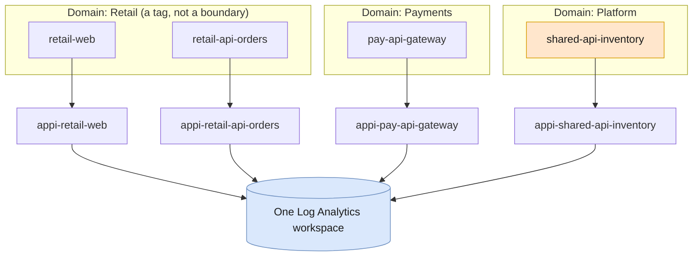

# Topology: one resource per app, one shared workspace

This starter makes two decisions that everything else depends on:

1. **One Application Insights resource per app per environment.** Each team owns its resource, its alerts, and its sampling.
2. **One Log Analytics workspace per environment.** All apps in that environment point at the same workspace, so one query sees their telemetry. Development and production use separate platform deployments.

Business domain, criticality, and owner are **tags** on each Application Insights resource, not resource boundaries.

`shared-api-inventory` is called from both Retail and Payments. A shared workspace makes that cross-domain impact visible without cross-workspace queries. Separate workspaces would not destroy trace correlation, but would require broader queries and permissions to assemble the same view.

## Why one resource per app

Application Insights is where an app team works: Application Map, Failures, Performance, Live Metrics, alerts. Separate resources keep that per-team:

- Each team can manage resource access, alert rules, and sampling. The deployed workspace ingestion cap is shared, not a separate allowance per app.
- Resource-scoped experiences, including Live Metrics when supported by the app's instrumentation, are easier to interpret.
- Each environment gets its own app resources **and** its own platform view, as described below.

Correlation doesn't depend on sharing a resource. The operation ID comes from the W3C trace ID, so a transaction that crosses five resources is still one transaction. See [End-to-end correlation](02-end-to-end-correlation.md).

**Share** a resource when components are deployed together, owned by one team, need the same access control and alerts, and you're happy to tell them apart by role name. A handful of microservices on one release train is a good example.

## One environment per deployment

Use separate dedicated resource groups for development, test, and production. Run the platform deployment for each; every deployment creates a separate workspace, workbook, and catalog. App teams register against the appropriate environment's workspace.

The graph and catalog identify an app by its effective `AppRoleName`, not by a `(name, environment)` pair. Separate Application Insights resources alone do not prevent same-named apps from being grouped in a workspace-wide query. A deployment-environment attribute is useful telemetry context, but it is not an environment filter in this starter.

Keep effective role names unique within each environment. With no `service.namespace`, that is `OTEL_SERVICE_NAME`; with a namespace it is `<namespace>.<name>`. Use that full value as the catalog's `workload` key. Renaming it creates a different observed app and requires the catalog entry to be updated deliberately.

Combined-environment and multi-workspace catalog views are outside this starter's scope. Tags classify apps; they do not enforce access control.

## Why one workspace

> *"Your design should always start with a single workspace to reduce the complexity of managing multiple workspaces and in querying data from them."*
> [Design a Log Analytics workspace architecture](https://learn.microsoft.com/azure/azure-monitor/logs/workspace-design)

With every app in one workspace:

- `AppRequests`, `AppDependencies`, `AppTraces`, and `AppExceptions` already contain every app. No `workspace()` or `app()` unions, and no limit of 100 resources per cross-resource query.
- The workbook and the catalog app each need one workspace to query.
- One trace is one `where OperationId == ...`, however many resources it touched.

Each telemetry row carries the hidden column `_ResourceId`, the Application Insights resource that received it. That's how the workbook and the catalog app find each row's tags.

### When to add a workspace

Within one environment, a different Azure region on its own isn't a reason to split. Additional workspaces may be needed when one of these is true:

| Criterion | Example |
|---|---|
| Data residency or sovereignty | EU data must stay in an EU workspace |
| Separate Microsoft Entra tenants | A subsidiary in its own tenant |
| A security boundary that resource-context or table-level access control can't express | A regulated workload whose logs only its auditors may read |
| Different retention for the same table | Seven-year retention for one app's requests |
| Hard billing separation that tags and usage queries can't provide | A chargeback contract that requires a separate bill |

If you do split an environment, propagated context still provides correlation, but queries must union workspaces. The supplied workbook and catalog app query one workspace each; they do not automatically discover or aggregate the others.

## Naming and tags in this starter

| Thing | Convention |
|---|---|
| Application Insights resource | `appi-<app>`, where `<app>` is the registration name passed to the app module |
| Required tags | `domain`, `criticality`, `owner` |
| Criticality values | `tier1`, `tier2`, `tier3`. The workbook's domain rollup counts `tier1` apps |

[`infra/modules/app.bicep`](../infra/modules/app.bicep) encodes all three. Consider an [Azure Policy](https://learn.microsoft.com/azure/governance/policy/tutorials/govern-tags) that requires the tags, so untagged apps can't appear in the first place.

## Learn more

- [How many Application Insights resources should I deploy?](https://learn.microsoft.com/azure/azure-monitor/app/create-workspace-resource#how-many-application-insights-resources-should-i-deploy)
- [Architecture best practices for Application Insights](https://learn.microsoft.com/azure/well-architected/service-guides/application-insights)
- [Design a Log Analytics workspace architecture](https://learn.microsoft.com/azure/azure-monitor/logs/workspace-design)
- [Query across workspaces and resources](https://learn.microsoft.com/azure/azure-monitor/logs/cross-workspace-query)
