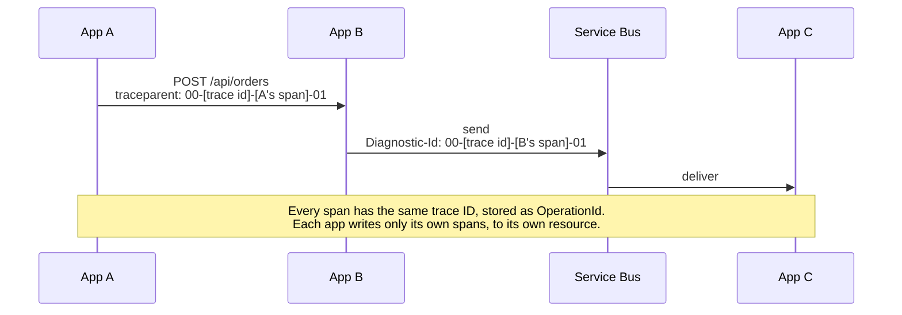

# End-to-end correlation: how A → B → C stitch

A complete checkout touches five apps in the demo, and each app writes to its **own** Application Insights resource. Propagated W3C context creates the trace relationship; the shared workspace makes it easy to query. These are separate responsibilities:

1. **W3C trace context on every hop.** Each outgoing call carries a `traceparent` header (or message property) holding the trace ID and the caller's span ID.
2. **A distinct effective service name per app.** `OTEL_SERVICE_NAME`, optionally combined with `service.namespace`, becomes `AppRoleName`, which identifies the app in the graph and catalog.
3. **One shared workspace per environment.** Every resource in that environment writes to the same workspace, so the transaction is a single `where OperationId == ...`. Workspace co-location does not create correlation by itself.

This conceptual A → B → C example shows a consumer deliberately continuing its producer's trace; it is not the complete demo checkout route:



Nothing is copied between resources. Each span exists once, in the resource of the app that produced it, and the transaction is assembled at query time.

Queue SDKs can instead link a new processing trace to the producer. That is valid correlation, but does not put both sides under one `OperationId`. The simulator deliberately models the parent-child case; see [queue propagation](#3-queues-carry-the-context-in-the-message).

## What lands where

| OpenTelemetry | Application Insights column |
|---|---|
| Trace ID | `OperationId` |
| Span ID | `Id` |
| Parent span ID | `ParentId`. For a root request this equals `OperationId` |
| `service.name` | `AppRoleName`. With `service.namespace` set, it becomes `<namespace>.<name>` |
| The resource that received the row | `_ResourceId` (hidden: selectable, but not listed by `getschema`) |
| Span kind `Server` or `Consumer` | A row in `AppRequests` |
| Span kind `Client` or `Producer` | A row in `AppDependencies` |
| Exception event on a span | A row in `AppExceptions` |
| `ILogger` record inside a span | A row in `AppTraces`, with that span's `OperationId` and `ParentId` |

**Span kind decides the table, not the protocol.** A Service Bus send is a `Producer` dependency, and receiving it is a `Consumer` request. That's why a queue hop looks like any other call on the map.

How common attributes map to `DependencyType`, as read back from the demo workspace:

| Span | Key attributes | `DependencyType` |
|---|---|---|
| HTTP client | `http.request.method`, `url.full`, `server.address` | `HTTP` |
| SQL | `db.system.name = microsoft.sql_server`, `db.namespace`, `db.query.text` | `SQL`, and the exporter prefixes `Name` with `SQL: ` |
| Redis | `db.system.name = redis` | `redis` |
| Cosmos DB | `db.system.name = cosmosdb`, `az.namespace = Microsoft.DocumentDB` | `cosmosdb` |
| Service Bus send | `messaging.system = servicebus`, `az.namespace = Microsoft.ServiceBus` | `servicebus` |

Values the exporter doesn't recognize pass through verbatim, which is why `redis` and `servicebus` arrive in lowercase.

## 1. Bootstrap every app

Install the [Microsoft OpenTelemetry Distro](https://learn.microsoft.com/azure/azure-monitor/app/opentelemetry-enable):

```bash
dotnet add package Microsoft.OpenTelemetry
```

```csharp
using Microsoft.OpenTelemetry;

var builder = WebApplication.CreateBuilder(args);
builder.UseMicrosoftOpenTelemetry(options => options.Exporters = ExportTarget.AzureMonitor);

var app = builder.Build();
app.Run();
```

In the Bash shell that launches your app, export the settings so the child process inherits them. Replace the connection string with the full value printed by the registration script:

```bash
export OTEL_SERVICE_NAME="orders-api"
export APPLICATIONINSIGHTS_CONNECTION_STRING="<full connection string from add-app.sh>"
export OTEL_RESOURCE_ATTRIBUTES="deployment.environment.name=dev"  # optional
```

For a hosted app, set these in its hosting configuration instead of a terminal. The distro collects supported ASP.NET Core requests, `HttpClient` calls, SqlClient, Azure SDK calls, and `ILogger` output. Keep the effective service name stable and unique within the workspace; see [environment and identity boundaries](01-topology.md#one-environment-per-deployment).

## 2. HTTP calls: nothing to do

`HttpClient` creates a client span and adds `traceparent` to every outgoing request, and ASP.NET Core continues the trace on the receiving side. That's the A → B hop.

Two ways it breaks:

- **Hand-rolled correlation IDs.** A custom `X-Correlation-Id` header is invisible to Application Insights. Keep it if you need it, but alongside `traceparent`, never instead of it.
- **Proxies that drop headers.** API gateways, ingress controllers, and reverse proxies must forward `traceparent` and `tracestate` unchanged.

## 3. Queues: carry the context in the message

Azure Service Bus carries W3C context in each message's `Diagnostic-Id` property, and the SDK instruments messages processed through `ServiceBusProcessor.ProcessMessageAsync`. Depending on the receive path, processing can be linked to the send rather than continuing its trace. A different consumer `OperationId` is not, on its own, evidence that context was lost.

For a custom receive loop that must continue one transaction, start the processing span with the producer's context as its parent. This sample expects a valid `Diagnostic-Id`. Register its source with the tracer provider as indicated; do not blindly add a second processing span on top of an already instrumented SDK processor:

```csharp
using System.Diagnostics;
using Azure.Messaging.ServiceBus;

public sealed class OrderProcessor
{
    // Register this source with the SDK:
    // builder.Services.ConfigureOpenTelemetryTracerProvider(t => t.AddSource("Contoso.Orders"));
    private static readonly ActivitySource Source = new("Contoso.Orders");

    public async Task ProcessAsync(ServiceBusReceivedMessage message, CancellationToken ct)
    {
        if (!message.ApplicationProperties.TryGetValue("Diagnostic-Id", out var traceparent) ||
            !ActivityContext.TryParse(traceparent as string, null, isRemote: true, out var parent))
            throw new InvalidOperationException("Missing or invalid message trace context.");

        // The producer's context as parent keeps this work in the same transaction.
        using var activity = Source.StartActivity("orders process", ActivityKind.Consumer, parent);
        activity?.SetTag("messaging.system", "servicebus");
        activity?.SetTag("messaging.destination.name", "orders");

        await HandleAsync(message, ct);
    }

    private static Task HandleAsync(ServiceBusReceivedMessage message, CancellationToken ct) => Task.CompletedTask;
}
```

The simulator models this parent-child outcome, so its settlement worker appears inside the checkout transaction. It does not send real Service Bus messages or prove that a customer's broker and consumer are configured this way.

## 4. Logs: use ILogger

Log through `ILogger` inside the request or processing span. The distro stamps each record with the current span, so it lands in `AppTraces` with the transaction's `OperationId` and the span's `ParentId`:

```csharp
logger.LogError(ex, "Stock commit failed for order {OrderId}", orderId);
```

`Console.WriteLine` and logging frameworks that bypass `ILogger` lose that correlation. Control volume with log levels in configuration rather than by sampling logs after the fact.

## 5. Read a transaction back

Every row from every app, for one operation, in time order:

```kusto
let op = "<operation id>";
union AppRequests, AppDependencies, AppTraces, AppExceptions
| where TimeGenerated > ago(1d) and OperationId == op
| project TimeGenerated, Table = Type, AppRoleName, Name, Target, Message, OuterMessage,
          DurationMs, Success, Id, ParentId, Resource = tostring(split(_ResourceId, "/")[-1])
| order by TimeGenerated asc
```

`Resource` shows that each row came from a different Application Insights resource. `Id` and `ParentId` rebuild the call tree; the workbook's **Transactions** tab draws it.

Find hops that didn't propagate context: requests whose parent span never arrived.

```kusto
let window = 1d;
AppRequests
| where TimeGenerated > ago(window)
| where isnotempty(ParentId) and ParentId != OperationId
| join kind=leftanti (AppDependencies | where TimeGenerated > ago(window) | project ParentId = Id) on ParentId
| summarize Orphaned = count() by AppRoleName
```

A few orphans at the edges of the time window are normal. Sustained counts warrant checking propagation, sampling differences, callers outside the workspace, and linked queue traces. This is a diagnostic hint, not proof of a propagation failure.

Don't count calls by unioning requests and dependencies: one HTTP call appears twice, as the caller's dependency and the callee's request. The duration difference can include network and queuing overhead; it is not a precise network-latency measurement.

## Sampling: keep transactions whole

The distro defaults to rate-limited sampling at five traces per second. Its Application Insights sampler is designed to keep traces complete, so leave it in place in every app. To sample by percentage instead, set the same rate in every app that shares transactions:

```bash
export OTEL_TRACES_SAMPLER="microsoft.fixed_percentage"
export OTEL_TRACES_SAMPLER_ARG="0.25"
```

The .NET distro also drops logs that belong to unsampled traces, so logs follow their transactions.

## Learn more

- [Enable OpenTelemetry in Application Insights](https://learn.microsoft.com/azure/azure-monitor/app/opentelemetry-enable)
- [Configure OpenTelemetry: cloud role name, sampling, connection strings](https://learn.microsoft.com/azure/azure-monitor/app/opentelemetry-configuration)
- [Sampling with OpenTelemetry](https://learn.microsoft.com/azure/azure-monitor/app/opentelemetry-sampling)
- [Distributed tracing through Service Bus](https://learn.microsoft.com/azure/service-bus-messaging/service-bus-end-to-end-tracing)
- [.NET distributed tracing concepts](https://learn.microsoft.com/dotnet/core/diagnostics/distributed-tracing-concepts)
