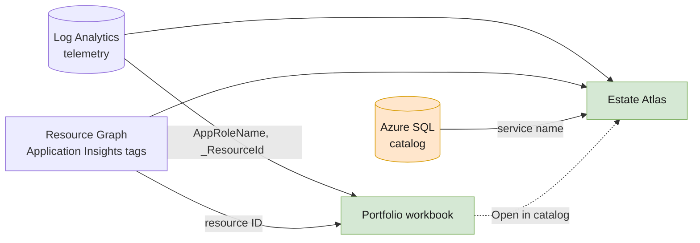

# Catalog and workbook

The portfolio workbook and the Estate Atlas catalog app show the same estate, assembled at query time. Each fact lives in exactly one source.

| Source | Holds | Key | Read by |
|---|---|---|---|
| Telemetry, in Log Analytics | Requests, dependencies, logs, exceptions, and the health derived from them | `AppRoleName` (the app's service name) and `_ResourceId` | Both |
| Azure tags, through Azure Resource Graph | `domain`, `criticality`, `owner` | The Application Insights resource ID | Both |
| The catalog, in Azure SQL | Display name, description, business owner, request-success target, on-call, app, docs, runbook, and repo links | The service name | The catalog app. The workbook links to it |



Health is never stored. Classification is never copied into the catalog, and business context is never copied into tags. A change in one place shows up everywhere on the next query.

## Register an app

An app is registered when its Application Insights resource is linked to the shared workspace and carries the three tags. [`add-app.sh`](../add-app.sh) deploys [`infra/modules/app.bicep`](../infra/modules/app.bicep) to do exactly that:

```bash
./add-app.sh orders-api --domain Sales --criticality tier1 --owner sales-team
```

Teams with their own infrastructure as code can copy the module. Several service names can report to one resource, such as an API and its worker: each appears separately, and both inherit the resource's tags.

These are different states, not one registration action:

| State | Where to look |
|---|---|
| Resource registered, no telemetry yet | Workbook **Metadata quality**, including the selected time range |
| Requests or processing spans received | Estate graph, using the effective service name and the tags of the receiving resource |
| Business context added | Catalog UI/API; the entry is joined onto the observed graph app |

A catalog entry does not create telemetry. The catalog's Overview and application graph retain catalog-only apps as **Not observed**, rather than silently dropping them or marking them Healthy. Separate environments use [separate platform views](01-topology.md#one-environment-per-deployment).

## The workbook

*Application Portfolio* is deployed by [`infra/main.bicep`](../infra/main.bicep) from [`workbook/workbook.json`](../workbook/workbook.json). Domain and Criticality filters apply to every tab except Metadata quality.

| Tab | Shows |
|---|---|
| **Portfolio** | A tree with one row per domain, rolled up, expanding into its apps: availability, requests, failures, P95, owner, and links to the app's catalog entry and its Application Insights resource |
| **Estate map** | The dependency graph of every app and backing service, a detail grid for the selected node, and a honeycomb of health by domain |
| **Domain rollup** | Health per domain, including how many `tier1` apps each has |
| **Cross-resource** | Every dependency of every app, from one query with no `workspace()` joins |
| **Transactions** | Every failed request. Select one to rebuild its whole call tree across apps, with the exceptions raised along the way |
| **Metadata quality** | Registered resources that are missing tags or that sent no telemetry in the time range |

An app is **Healthy** below 1% failed requests, **Warning** from 1%, and **Error** from 5%, over the selected time range. These workbook/graph labels remain separate from the catalog's request-success target comparison. An app can be marked Healthy while missing that target or having unacceptable latency. Neither calculation configures an alert.


*Actual deployed workbook with synthetic telemetry. Domain rows expand into apps, and each app links to its catalog entry and Application Insights resource.*

On the estate map, a filter picks a *focus* rather than removing nodes. Selecting Payments keeps the Payments apps in color and everything one hop away in gray. A plain filter would delete the Retail caller of a shared service, and the map would quietly lose the cross-domain fan-in that matters most.

### How the workbook reads tags

Each query looks up the tags of the resource that received each row, through [Azure Resource Graph from Log Analytics](https://learn.microsoft.com/azure/azure-monitor/logs/azure-monitor-data-explorer-proxy):

```kusto
let appTags = toscalar(
    arg("").Resources
    | where type =~ "microsoft.insights/components"
    | where tolower(tostring(properties.WorkspaceResourceId)) == tolower("<workspace resource ID>")
    | summarize make_bag(bag_pack(tolower(id), tags)));
AppRequests
| summarize Requests = count(), P95 = percentile(DurationMs, 95), Resource = take_any(tolower(_ResourceId)) by AppRoleName
| extend Domain = tostring(appTags[Resource].domain)
```

A plain `join` against `arg("")` fails when the same query uses `percentile()`, so the tags are collected into one lookup bag first. Limits to know:

- `arg()` in Log Analytics is in preview.
- Only the first 1,000 Resource Graph rows are returned: here, 1,000 Application Insights resources linked to the workspace.
- It runs as the person viewing the workbook. Viewers see tags only for resources they can read; the rest show as `untagged`.
- Resource Graph failures can produce partial results or a query error. Inspect the workbook's query details; do not assume that `untagged` means the Azure tags are absent.

### Change the workbook

The workbook is generated. Edit [`workbook/build-workbook.mjs`](../workbook/build-workbook.mjs), then redeploy:

```bash
node workbook/build-workbook.mjs   # deploy.sh runs this too
./deploy.sh
```

The estate map's topology query is [`standalone-catalog-graph/server/estate.kql`](../standalone-catalog-graph/server/estate.kql), shared with the catalog app. The workbook adds tags, hover text, and focus filtering in [`workbook/estate-map-overlay.kql`](../workbook/estate-map-overlay.kql). The generator fails if the JSON grows past what Bicep's `loadTextContent()` accepts.

## The catalog app

Estate Atlas runs on App Service with a system-assigned managed identity. That identity reads the workspace and the tags, and is the Microsoft Entra admin of the catalog database.

Those permissions simplify this starter, including schema creation; they are not a production least-privilege design. Browser access is independent of the backend identity.

- **Overview.** Domain/owner rollups, a sortable application/attention table, observation times, and registration/catalog coverage. Counts distinguish resources from apps. Missing data and unavailable data sources are not reported as healthy zeroes.
- **Domain map.** The Graph view starts with collapsed business domains. Expand a domain to reveal its apps without losing cross-domain connections, or choose **Applications** for the full estate. The graph and workbook read the same topology.
- **Impact and connections.** Select an app for direct callers/dependencies and cycle-safe upstream/downstream exposure. Select a line for typed call/failure/P95/protocol evidence. Reachability is potential exposure, not proven customer impact; hosting and monitoring relationships are excluded from call traversal.
- **Actual transaction overlay.** Select a failed/slow request example to highlight its observed path and open a span timeline with offsets, durations, failures, result codes, exceptions, and warning/error logs. Repeated calls and asynchronous work remain individual spans. Portfolio filters do not hide the chosen transaction's context.
- **Resources.** Solid lines are calls, dashed lines are telemetry destinations, and dotted lines are reported hosts. `_ResourceId` identifies the receiving Application Insights resource, not compute. Hosting is read from resource-detector metadata such as `cloud.resource_id` and enriched only by exact, readable Resource Graph identity. The simulated apps explicitly have no hosting metadata; the catalog's own infrastructure is not assigned to them.
- **Catalog.** Add, edit, and delete business context. Domain, criticality, and owner show read-only, from tags.
- **Deep links.** `https://<catalog>/?workload=<service name>` selects that app. The workbook's **Open in catalog** links use it.

If the tags or the catalog can't be read, the graph still renders and a banner explains what's missing.

The catalog page loads on open, when its time range changes, or when you choose **Refresh**; it is not a continuously streaming dashboard. It starts with seven days. The window end is fixed for the response and for its transaction queries. Query completion and last telemetry event are displayed separately: recently querying an old backfill does not make it live data.

The existing catalog percentage now has one explicit meaning: **successful observed requests/processing operations divided by operations with known outcomes in the selected range**. It is not uptime, a customer-journey success rate, or a rolling error budget. The API still calls this field `slo` for compatibility; no second target is stored. Blank targets are Not configured, invalid values are flagged, and no known outcomes means Not observed. Existing non-demo entries should be reviewed before adopting this definition.

Latency compares P95 with the immediately preceding equal-length period. Missing baseline means Insufficient history; zero baseline has no relative percentage change. Counts use `ItemCount` estimates where available, while sample counts remain visible. Group P95 is computed from underlying samples, never averaged from app percentiles. When filters narrow a group beyond the available grouped query, P95 is explicitly omitted. Comparisons are descriptive, not automated regression verdicts; sparse traffic and operation mix matter. Thirty-day retention does not provide a complete preceding baseline for a thirty-day selection.


*The selected app's card separates Azure classification, SQL business context, and observed telemetry.*

Resource metadata names vary by exporter version (`_OTELRESOURCE_` and the observed `_APPRESOURCEPREVIEW_` shape). The implementation preserves app/instance/component identity and metadata timestamps; absent, malformed, or unreadable host identities remain explicit. The first documented detector reference is [.NET on App Service](https://learn.microsoft.com/azure/azure-monitor/app/opentelemetry-collect-detect#resource-detectors). No real hosted-workload smoke test is implied by the unhosted simulator. For a manually configured detector fallback, derive resource attributes from platform/deployment identity, not a second catalog inventory.

The full API and local development setup are in the [catalog app README](../standalone-catalog-graph/README.md). To load many entries at once, post an array to the import endpoint. Existing entries are never overwritten:

```bash
curl --fail-with-body -X POST "$CATALOG_URL/api/catalog/import" -H 'Content-Type: application/json' \
  --data-binary @demo/catalog-seed.json
```

Run that command from the repository root after setting `CATALOG_URL` to the URL printed by deployment. It changes catalog data; it is not a health check.

> [!WARNING]
> The UI and API are anonymous. Anyone who can reach the URL can read the data exposed by the app and change the catalog. Turn on [App Service authentication](https://learn.microsoft.com/azure/app-service/overview-authentication-authorization) or suitable network controls before storing real data. Link validation permits only `http://` and `https://` prefixes; that is a URL-scheme restriction, not a general security guarantee.

## Apps in other resource groups

The deployment grants the catalog app's identity **Log Analytics Reader** on the platform's resource group. That covers the workspace and the tags of apps registered there. An app in another group can appear once its request telemetry reaches the shared workspace. It shows as **untagged** until the identity can read that resource. Grant **Reader** where those apps live:

```bash
export RG="<the same platform resource group used for deployment>"
export WEB_APP="<catalog web app name from the deployment>"
principal=$(az webapp identity show -g "$RG" -n "$WEB_APP" --query principalId -o tsv | tr -d '\r')
az role assignment create --assignee-object-id "$principal" --assignee-principal-type ServicePrincipal \
  --role Reader --scope "/subscriptions/<subscription id>/resourceGroups/<their resource group>"
```

People viewing the workbook need the same read access, because the workbook queries Resource Graph as them.

## Learn more

- [Query Azure Resource Graph from Log Analytics](https://learn.microsoft.com/azure/azure-monitor/logs/azure-monitor-data-explorer-proxy)
- [Azure Workbooks](https://learn.microsoft.com/azure/azure-monitor/visualize/workbooks-overview)
- [Azure Resource Graph](https://learn.microsoft.com/azure/governance/resource-graph/overview)
- [App Service authentication and authorization](https://learn.microsoft.com/azure/app-service/overview-authentication-authorization)
